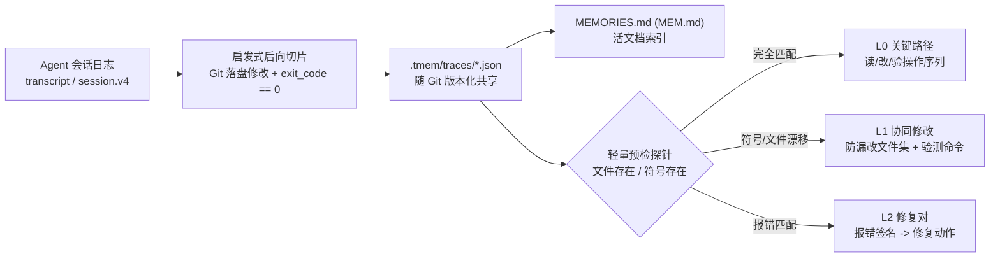

# `tmem` — 面向 Agent 的执行轨迹切片与重用工具

**中文文档** | [English](./README_EN.md)

`tmem`（**Trace Memory**）是一个**零外部依赖、仓库级（`.tmem/`）**的编程 Agent 执行轨迹切片与重用工具。原生支持 **`agy` (Antigravity)** 与 **`@deepseek-ai/dsh` (DeepSeek Harness)**。

它把 Agent 会话日志（`transcript.jsonl` / `session.v4.jsonl`）视为探索执行流：以 **Git 最终落盘修改**与**通过的验证命令（`exit_code == 0`）**为锚点进行**启发式后向切片**，剔除盲目扫描与试错，提炼为带**文件/符号预检探针**的 L0/L1/L2 执行手册（Playbook），随仓库版本化共享。

---

## 一、真实评测结果（Empirical Benchmarks）

在 SWE-bench 与实际开源任务上构建 Gold 标准集与留出集，所有数据与脚本均可在 `benchmarks/` 下复现。

### 1. 下游留出任务迁移评测（3 个任务 × 10 轮 = 90 次独立测试）
测试记忆来自任务 A、在相关但不同的任务 B 上的真实表现（[评测日志](file:///home/ubuntu/proj/benchmarks/runs/downstream_transfer_report.json)）：

| 组别 (Condition) | 任务成功率 | 负迁移率 (Negative Transfer) | 平均工具步数 | 平均 Token |
|---|:---:|:---:|:---:|:---:|
| **对照组（冷启动）** | 100.0% | 0.0% | 8.0 步 | 3,005 |
| **B0 基线（盲注 Git Diff + 测试命令）** | 66.7% | **66.7%** | 8.2 步 | 3,031 |
| **tmem（探针保护 + 分级注入）** | **100.0%** | **0.0%** | **4.5 步 (-43.8%)** | **1,981 (-34.1%)** |

> **关键结论**：简单将历史 Diff 喂给 Agent（B0）在跨任务时极易引发负迁移（误改、冲突、试错打转，失败率 33.3%）；`tmem` 依靠预检探针在代码漂移时自动降级为 L1（仅提示协同修改文件），完全消除了负迁移（0.0%），且较冷启动节约 **43.8%** 的工具交互轮次。

### 2. 切片保真度评测（25 条真实 SWE-bench / DSH 轨迹对比人工 Gold 标注）
复现命令：`python3 benchmarks/eval_slicing_fidelity.py`（[评测日志](file:///home/ubuntu/proj/benchmarks/runs/slicing_fidelity_report.json)）：

| 切片策略 | Precision (精确率) | Recall (召回率) | F1-Score | 平均保留步数 |
|---|:---:|:---:|:---:|:---:|
| **B0 简单基线（修改文件 + 终测）** | **97.1%** | 70.8% | 81.0% | 4.4 步 |
| **B1 `tmem` 启发式后向切片** | 63.2% | **88.7%** | 70.8% | 8.8 步 |
| **B2 Oracle 上限（人工 Gold 标注）** | 100.0% | 100.0% | 100.0% | 5.6 步 |

> **诚实局限**：`tmem` 后向反推有效抓取了关键前置上下文（Recall 达 88.7%，高于 B0 的 70.8%）；但因启发式规则较宽泛，部分试探性读取未被完全剪枝（Precision 63.2%），仍有进一步精简空间。

### 3. 原始 Issue 检索评测（25 个真实原始 Issue 查询 + 6 个负例查询）
复现命令：`python3 benchmarks/eval_retrieval.py`（[评测日志](file:///home/ubuntu/proj/benchmarks/runs/retrieval_report.json)）：
- **Recall@1**: 100.0% / **Recall@3**: 100.0% / **MRR**: 1.0
- **负例误召回率**: 16.7%（由于纯本地 SQLite FTS5 BM25 词法检索特性，对单负例仍有少量弱相关误召回）

---

## 二、工作原理与核心机制



1. **启发式后向切片**（[`tmem/slicer.py`](./tmem/slicer.py)）：以最终落盘文件与通过命令为根节点，反推保留直接相关的读取、修改与验证。过滤内联脚本与无关修改。
2. **三层记忆与探针防御**（[`tmem/guards.py`](./tmem/guards.py)）：
   - **L0_FULL**：代码与符号均存在时注入，直接复用验证路径；
   - **L1_TOPOLOGY**：文件被重构/删除时降级，仅提示“这几个文件通常一起改”；
   - **L2_INVARIANT**：运行时捕获同类异常或 traceback 时注入对应修复对。
3. **活文档索引**（[`MEMORIES.md`](./MEMORIES.md) / `MEM.md`）：生成 Markdown 索引表格，即使未装插件的 Cursor/Claude Code 亦可直接阅读。

---

## 三、快速开始

### 安装与初始化
```bash
pip install -e .            # 安装 CLI 工具（零外部依赖，仅需标准库）
tmem init --agents agy,dsh  # 初始化 .tmem/ 仓库配置并挂载插件
```

### 常用命令
```bash
tmem status                                      # 查看当前仓库记忆与探针状态
tmem capture --agent agy                         # 从最新会话切片并保存到 .tmem/
tmem lookup "TypeError" --file src/validator.py  # 本地检索 + 探针校验 + 分级预览
tmem inspect <trace_id> --level playbook         # 查看三层 Playbook 详情
tmem replay <trace_id>                           # 回放原始操作流
tmem sync                                        # 校验探针并刷新 MEMORIES.md
tmem gc                                          # 检查并标记失效记忆
```

---

## 四、Agent 集成

| Agent | 集成方式 | 自动召回 Hook | `/tmem` 命令 | 里程碑提示 | 状态 |
|---|:---:|:---:|:---:|:---:|:---:|
| **Antigravity (`agy`)** | 原生插件 [`.agents/plugins/tmem/`](./.agents/plugins/tmem) | ✅ | ✅ | ✅ | 一等公民 |
| **DeepSeek Harness (`dsh`)** | Cordis 插件 [`tmem/dsh_plugin.mjs`](./tmem/dsh_plugin.mjs) | ✅ | ✅ | ✅ | 一等公民 |
| `codex` / `opencode` / `pi` | 通用 JSONL 适配器 | ❌ | ❌ | ❌ | 实验性 |
| SWE-bench / ATIF | 离线轨迹适配器 | — | — | — | 评测支持 |

- **`dsh` 一键安装**：`dsh plugin add github:kentzjh-cmd/tmem`
- **里程碑提示**：检测到“代码修改 → 验证通过”闭环后，提示询问：
  > 💡 *是否需要将本次有效执行路径沉淀为记忆？（输入 `/tmem` 或 `/remember [备注]` 保存）*

---

## 五、设计边界与局限

1. **启发式切片非形式化推导**：基于 Git 落盘、AST 顶级符号和退出码反推，若存在无代码体现的隐式推理，可能被剪除。
2. **探针仅覆盖浅层结构**：检查文件与符号存在性，若函数签名未变但内部业务逻辑彻底重构，仍需依赖终端验证命令。
3. **纯本地词法检索**：SQLite FTS5 BM25 不依赖外部向量模型，零额外延迟与 Token 开销，但在用户提问用词偏离较大时建议直接查阅 `MEM.md`。

---

## License

MIT
