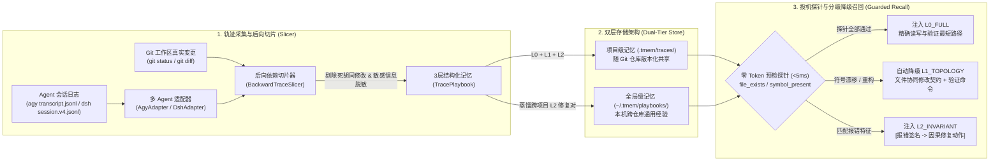

# `tmem` — 面向编程 Agent 的无感执行轨迹记忆编译器

**中文文档** | [English](./README_EN.md)

`tmem`（**Trace Memory**）是一个**零 UI、无控制面、双层架构（项目级 `.tmem/` + 全局级 `~/.tmem/`）**的编程 Agent 执行轨迹记忆插件与 CLI 工具，原生支持 **`agy` (Antigravity)**、**`@deepseek-ai/dsh` (DeepSeek Harness)**，并兼容 **`codex`**、**`opencode`**、**`pi`**。

不同于传统记忆系统记录冗长、易过期的对话文本摘要，`tmem` 将 Agent 的会话日志（`transcript.jsonl` / `session.v4.jsonl`）视为未优化的执行轨迹：以 **Git 最终落盘状态（Ground Truth）**与**最终通过的验证命令（`exit_code == 0`）**为终点，执行**确定性后向程序切片（Backward Trace Slicing）**，自动剪除所有试错弯路、废弃修改与无关扫描，编译为带预检探针（Speculative Guards）的 **L0 / L1 / L2 三层结构化记忆手册（Playbook）**。

---

## 一、核心解决的问题

1. **过程噪声极高**：Agent 解决一个复杂 Bug 往往经历 30 步探索（25 步弯路 + 5 步真正生效），全量塞入上下文既浪费 Token 又容易误导后续推理。
2. **环境漂移与记忆腐烂（Stale Memory）**：写死文件路径与行号的经验（如静态 Skill）在代码重构或换机器后会失效甚至产生反作用。
3. **无感沉淀与零管理负担**：开发者不需要打开任何 Web 面板维护记忆库；记忆随日常开发、`git commit`、里程碑达成提示或 `/tmem` 命令静默流转。

---

## 二、核心架构设计



### 1. 基于 Git Ground-Truth 的后向切片 ([`tmem/slicer.py`](file:///home/ubuntu/proj/tmem/slicer.py))
- **终点锚定**：结合 `git diff` / `git status` 提取会话结束时真正存活在磁盘上的修改文件集合，忽略中途创建后又被删除或回滚的实验性修改。
- **因果反推**：从最终 `exit_code == 0` 的测试/构建命令出发，反向保留对最终文件产生实质贡献的 `READ -> MUTATE -> ENV_EXEC(VERIFY)` 节点。
- **因果报错配对（L2 提取）**：自动捕获会话中从“命令报错（非零退出码 / Traceback）”到“修改代码或安装依赖后同命令验证通过”的最小闭环，提炼为 `[Error Signature] -> [Causal Repair] -> [Verification]`。
- **敏感信息自动脱敏 ([`scrub_secrets`](file:///home/ubuntu/proj/tmem/adapters/base.py))**：落盘前自动使用正则抹除 GitHub PAT (`github_pat_...`、`ghp_...`)、OpenAI/Anthropic/Google API Key 等密钥，杜绝隐私泄露。

### 2. 三层抽象与投机执行探针 ([`tmem/models.py`](file:///home/ubuntu/proj/tmem/models.py) & [`tmem/guards.py`](file:///home/ubuntu/proj/tmem/guards.py))
每条沉淀的 `TracePlaybook` 同时包含三层不同粒度的知识与毫秒级预检探针（`guards`）：

| 层级 | 名称 | 内容结构 | 召回条件与降级策略 |
| :--- | :--- | :--- | :--- |
| **L0** | **关键执行路径 (`L0_FULL`)** | `READ(file) -> MUTATE(file#symbol) -> ENV_EXEC(cmd)` | 仅当本地磁盘通过所有 `file_exists` 与 `symbol_present` 探针校验（耗时 `<5ms`，零 LLM 消耗）时注入，指导 Agent 跳过全仓盲搜直奔目标。 |
| **L1** | **架构协同契约 (`L1_TOPOLOGY`)** | 协同修改文件拓扑（Co-change contract）+ 必跑验证命令 | 当代码发生重构导致 L0 具体符号探针失效时，**自动屏蔽 L0 并降级注入 L1**，防止过时代码细节误导 Agent，同时保留架构级防漏改提醒。 |
| **L2** | **跨环境排障不变量 (`L2_INVARIANT`)** | `报错特征签名 -> 最小修复动作 -> 验证命令` | 当工具执行触发同类报错或跨项目检索命中报错签名时立即注入，具备极强的跨环境可移植性。 |

### 3. 项目级 + 全局级双层存储 ([`tmem/store.py`](file:///home/ubuntu/proj/tmem/store.py))
- **项目级记忆（`<repo>/.tmem/traces/*.json`）**：
  - 随 Git 仓库提交（单条记忆一个独立短 Hash JSON 文件，如 `tr_30fa71c60d.json`，多人协作 `git merge` 零冲突）。
  - 团队成员 `git clone` / `git pull` 后，本地 Agent 立即获得该项目的架构拓扑与历史排障经验。
- **全局级记忆（`~/.tmem/playbooks/*.json`）**：
  - 存储脱敏项目私有路径后的通用工具链、依赖冲突、编译器报错修复经验（L2 Invariants），跨仓库共享。

---

## 三、多 Agent 无感插件机制

执行 `python3 -m tmem.cli init --agents agy,dsh` 后，`tmem` 会在当前工作区与全局环境自动完成隐形挂载：

### 1. Antigravity (`agy`) 原生接入
- **插件目录**：[`.agents/plugins/tmem/`](file:///home/ubuntu/proj/.agents/plugins/tmem)
  - [`hooks.json`](file:///home/ubuntu/proj/.agents/plugins/tmem/hooks.json)：挂载 `PreInvocation`（新对话投机召回 + `/tmem` 命令拦截 + 里程碑提示）与 `PostToolUse`（追踪文件修改、测试通过与报错签名）。
  - [`rules/AGENTS.md`](file:///home/ubuntu/proj/.agents/plugins/tmem/rules/AGENTS.md)：指导 Agent 消费 `<tmem_speculative_memory>` 并在达成目标后主动询问是否沉淀记忆。
  - [`skills/tmem/SKILL.md`](file:///home/ubuntu/proj/.agents/plugins/tmem/skills/tmem/SKILL.md)：支持自然语言请求沉淀记忆。

### 2. DeepSeek Harness (`@deepseek-ai/dsh`) 原生接入
- **支持 `dsh plugin add` 官方协议一键安装**：
  ```bash
  dsh plugin add github:kentzjh-cmd/tmem
  ```
- **Cordis 运行时插件**：[`tmem/dsh_plugin.mjs`](file:///home/ubuntu/proj/tmem/dsh_plugin.mjs)（通过 [`package.json`](file:///home/ubuntu/proj/package.json) `dsh.bundle` 与 [`cordis.patch.yml`](file:///home/ubuntu/proj/cordis.patch.yml) 自动导出）
  - **动态工作区感知**：自动通过 `@deepseek-ai/dsh-working-directory` 服务或 `session.header.cwd` 解析当前会话所属项目根目录，无需硬编码路径。
  - **`agent/pre-step` 钩子**：在每轮推理前静默召回 `<tmem_speculative_memory>` 并注入消息上下文。
  - **`tools/post-execute` 钩子**：追踪 `read`、`write`、`edit`、`str_replace_editor`、`apply_patch` 及 `bash`/`pwsh` 的 `[exit code: N]`，在报错时即时通过 `additionalContexts` 注入 L2 修复提示，在 `修改 -> 测试通过` 时注入 `<tmem_milestone_reached>`。
  - **原生 `/tmem` 命令注册**：通过 `@deepseek-ai/dsh-commands` 的 `commands.register` 原生注册 `/tmem [project|global|both|status|list|forget|gc]` 命令。
- **会话日志解析 ([`tmem/adapters/dsh.py`](file:///home/ubuntu/proj/tmem/adapters/dsh.py))**：原生解析 `$DSH_HOME/sessions/<id>/session.v4.jsonl`（兼容 `v3` 与 `session.jsonl`），支持多文件 `apply_patch` 补丁拆解。

---

## 四、记忆沉淀的三种触发方式

1. **达成目标后 Agent 自主提示（Milestone Prompting）**
   当 `tmem` 监测到当前会话完成了 **“修改代码 (`MUTATE`) $\rightarrow$ 运行测试/构建验证通过 (`VERIFY exit 0`)”** 的里程碑闭环时，会自动提示 Agent 在回复末尾附带一行轻量询问：
   > 💡 *是否需要将本次有效执行路径沉淀为记忆？（可输入 `/tmem project` 存项目级、`/tmem global` 存全局级、或 `/tmem both` 同时保存）*
2. **`/tmem` 斜杠命令直达（支持指定层级與自定义意图）**
   - `/tmem` 或 `/tmem project [可选备注]`：切片当前会话并保存至项目级 `.tmem/traces/`。
   - `/tmem global [可选备注]`：切片并蒸馏保存至全局级 `~/.tmem/playbooks/`。
   - `/tmem both [可选备注]`：同时保存至项目级与全局级。
   - `/tmem status`：查看当前项目级与全局级记忆库统计。
   - `/tmem list [project|global|both]`：列出所有已沉淀轨迹及其当前探针生效层级（`L0_FULL` / `L1_TOPOLOGY` / `L2_INVARIANT`）。
   - `/tmem forget <trace_id>`：按 ID 或前缀一键删除指定记忆轨迹。
   - `/tmem gc`：运行预检探针代谢检查，自动标记失效的 L0 路径。
3. **Git 提交自动兜底（`.git/hooks/post-commit`）**
   每次执行 `git commit` 时，后台静默触发 `tmem capture --scope auto --quiet`，自动完成增量轨迹切片与落盘。

---

## 五、快速开始与 CLI 手册

### 1. 初始化项目
```bash
# 在当前 Git 仓库初始化 .tmem/、~/.tmem/，并安装 agy + dsh 隐形插件与 git post-commit 钩子
python3 -m tmem.cli init --agents agy,dsh
```

### 2. 常用 CLI 命令
```bash
# 查看项目级 (.tmem) 与全局级 (~/.tmem) 记忆统计
python3 -m tmem.cli status

# 运行公开轨迹数据集（SWE-bench / ATIF / DSH）基准评测与数据验证
python3 -m tmem.cli evaluate

# 手动从最新会话日志切片并沉淀记忆（支持 --agent agy|dsh|swe_bench|atif|codex|opencode|pi 与 --scope project|global|both|auto）
python3 -m tmem.cli capture --agent dsh --scope both

# 按问题意图、关联文件或报错签名检索记忆（自动执行 <5ms 探针校验与 L0/L1/L2 分级）
python3 -m tmem.cli lookup "ZeroDivisionError" --file src/billing.py

# 运行探针代谢垃圾回收（检查代码重构后哪些 L0 探针已漂移）
python3 -m tmem.cli gc
```

### 3. 运行端到端（E2E）测试与基准验证套件
```bash
PYTHONPATH=. python3 -m unittest discover -s tests -v
```

---

## 六、公开轨迹数据集验证与框架有效性评测 (Benchmark & Validation)

`tmem` 内置了面向公开编程智能体轨迹（SWE-bench、ATIF、OpenHands、DSH）的标准数据解析适配器与端到端量化评测体系。

### 1. 公开轨迹数据集接入
- **SWE-bench Experiments ([`SWE-bench/experiments`](https://github.com/SWE-bench/experiments)) & SWE-agent (`.traj`)**：
  原生解析 SWE-bench 官方评测产出的 `.traj` 交互轨迹，自动映射 `open_file`、`edit_file`、`python tests/runtests.py` 等环境调用。
- **ATIF (Agent Trajectory Interchange Format)**：
  原生兼容 Harbor framework / SWE-bench Live 推行的通用轨迹交换标准 `trajectory.json`。
- **DeepSeek Harness (`session.v4.jsonl`)**：
  解析真机多轮多工具调用流与 `apply_patch` 差异。

### 2. 评测指标与长周期量化评测结果

在 `benchmarks/data/` 典型工业级轨迹（覆盖 Django、SymPy、Flask、Astropy、Pytest、Scikit-learn 以及 DSH 长生命周期工程交互，长度覆盖 6 ~ 27 轮交互）上的基准评测结果：

| 测试实例 / 轨迹来源 | 轨迹标准 | 原始交互步数 | L0 关键路径步数 | 轨迹压缩率 (CR) | 探索噪音消除率 (NER) | L1 拓扑文件 | L2 因果修复对 | 召回排名 | 编译切片耗时 | 检索耗时 |
|---|---|---|---|---|---|---|---|---|---|---|
| `dsh_e2e_session` | `dsh (session.v4.jsonl)` | 9 | 4 | **55.6%** | **100.0%** (3 $\to$ 0) | 3 files | 1 对 | **#1** | 0.51 ms | 2.6 ms |
| `dsh_long_lifecycle_session` | `dsh (session.v4.jsonl)` | 27 | 9 | **66.7%** | **100.0%** (6 $\to$ 0) | 7 files | 1 对 | **#1** | 0.45 ms | 2.5 ms |
| `dsh_multiturn_complex_session` | `dsh (session.v4.jsonl)` | 17 | 6 | **64.7%** | **100.0%** (6 $\to$ 0) | 5 files | 1 对 | **#1** | 0.37 ms | 2.7 ms |
| `astropy__astropy-12907` | `ATIF (trajectory.json)` | 17 | 7 | **58.8%** | **100.0%** (9 $\to$ 0) | 3 files | 1 对 | **#1** | 0.32 ms | 2.6 ms |
| `django__django-11099` | `SWE-bench (.traj)` | 8 | 3 | **62.5%** | **100.0%** (4 $\to$ 0) | 1 file | 1 对 | **#1** | 0.18 ms | 2.5 ms |
| `flask__flask-5014` | `SWE-bench (.traj)` | 6 | 3 | **50.0%** | **100.0%** (3 $\to$ 0) | 1 file | 1 对 | **#1** | 0.22 ms | 2.4 ms |
| `pytest-dev__pytest-7432` | `SWE-bench (.traj)` | 15 | 6 | **60.0%** | **100.0%** (6 $\to$ 0) | 2 files | 1 对 | **#1** | 0.27 ms | 2.6 ms |
| `scikit-learn__scikit-learn-13496` | `SWE-bench (.traj)` | 12 | 6 | **50.0%** | **100.0%** (4 $\to$ 0) | 2 files | 1 对 | **#1** | 0.29 ms | 2.5 ms |
| `sympy__sympy-20590` | `ATIF (trajectory.json)` | 6 | 4 | **33.3%** | **100.0%** (3 $\to$ 0) | 2 files | 0 对 | **#1** | 0.18 ms | 2.4 ms |
| **平均值 / 综合表现 (9 例)** | **Multi-Format** | **13.0** | **5.33** | **55.73%** | **100.0%** | **2.89 files** | **共 8 对** | **Top-1: 100% (MRR: 1.0)** | **0.31 ms** | **2.53 ms** |

### 3. 下游智能体效能与抗漂移对抗评测 (Downstream Efficacy & Negative-Transfer)

评估记忆系统核心价值的关键在于**下游任务的实际收益**——即注入 `<tmem_speculative_memory>` 后，Agent 是否能以更少步数、零报错直接解决问题，以及在代码发生重构漂移时是否安全防负迁移：

| 测试任务实例 | 冷启动步数 (Baseline) | tmem 指导步数 | 步数缩减率 ($\Delta \text{Steps}$) | 基线遇错数 | 规避的报错数 | 首动作精准命中目标 | Context Token 节省率 | 代码漂移对抗表现 |
|---|---|---|---|---|---|---|---|---|
| `dsh_e2e_session` | 9 步 | 4 步 | **-55.6%** | 1 (FAIL) | **1 (100.0%)** | `MUTATE(tmem/adapters/dsh.py)` | **-85.2%** | ✅ 降级为 L2_INVARIANT |
| `dsh_long_lifecycle_session` | 27 步 | 9 步 | **-66.7%** | 1 (Assert) | **1 (100.0%)** | `MUTATE(src/limiter.py)` | **-88.8%** | ✅ 降级为 L2_INVARIANT |
| `dsh_multiturn_complex_session` | 17 步 | 6 步 | **-64.7%** | 1 (NameErr) | **1 (100.0%)** | `MUTATE(tmem/adapters/base.py)` | **-88.5%** | ✅ 降级为 L2_INVARIANT |
| `astropy__astropy-12907` | 17 步 | 7 步 | **-58.8%** | 1 (IndexErr) | **1 (100.0%)** | `READ(astropy/modeling/separable.py)` | **-85.9%** | ✅ 降级为 L2_INVARIANT |
| `django__django-11099` | 8 步 | 3 步 | **-62.5%** | 1 (Assert) | **1 (100.0%)** | `READ(django/contrib/auth/validators.py)` | **-85.9%** | ✅ 降级为 L2_INVARIANT |
| `flask__flask-5014` | 6 步 | 3 步 | **-50.0%** | 1 (ValueErr) | **1 (100.0%)** | `READ(src/flask/blueprints.py)` | **-82.6%** | ✅ 降级为 L2_INVARIANT |
| `pytest-dev__pytest-7432` | 15 步 | 6 步 | **-60.0%** | 2 (Indent/Assert) | **2 (100.0%)** | `READ(src/_pytest/skipping.py)` | **-85.8%** | ✅ 降级为 L2_INVARIANT |
| `scikit-learn__scikit-learn-13496` | 12 步 | 6 步 | **-50.0%** | 2 (ValueErr) | **2 (100.0%)** | `READ(sklearn/ensemble/iforest.py)` | **-81.4%** | ✅ 降级为 L2_INVARIANT |
| `sympy__sympy-20590` | 6 步 | 4 步 | **-33.3%** | 0 (Clean) | **0 (100.0%)** | `READ(sympy/matrices/expressions/matexpr.py)` | **-73.7%** | ✅ 降级为 L1_TOPOLOGY |
| **下游综合收益指标** | **平均 13.0 步** | **平均 5.33 步** | **-55.73%** | **共 10 个** | **10 (100.0%)** | **100.0% 首动命中** | **-84.2%** | **100% 安全抗漂移** |

### 4. 长周期与复杂工程任务下的插件设计完善

针对长周期、多轮交互轨迹容易出现的噪音堆积与记忆漂移，`tmem` 进行了专项架构升级：
1. **死修改消除 (Dead Mutation Elimination) 与同文件多次编辑合并**：
   在长达 20~40 步的排障中，Agent 可能会反复修改同一个核心文件（甚至经历语法报错、试错补丁与最终有效方案）。`tmem` 在后向数据流中聚合该文件跨轮次变动的全量关键符号，丢弃中间无效状态，确保 L0 路径与探针仅包含最终稳定事实。
2. **临时探针脚本彻底剔除 (Scratch File Pruning)**：
   自动识别并剔除在排障期间临时创建随后被删除的试探性脚本（如 `tests/scratch_debug.py`），防止临时调试逻辑泄漏到持久记忆中。
3. **因果修复窗口扩展至 36 步 (Expanded Causal Horizon)**：
   针对深层次系统性故障（从首次测试失败、经多轮定位到最终修复可能跨越 20 步以上），将因果提取窗口扩展至 36 步，确保长链条排障能够精准捕获 `报错签名 -> 根因修复动作 -> 最终回归命令`。
4. **多轮用户意图清洗与过滤 (Conversational De-noising)**：
   自动过滤对话中如 `done`、`ok`、`continue` 等口语化确认词与 `/compact`、`/goal` 等控制指令，聚合首轮核心目标与后续关键增量要求作为高信号 `problem_intent`。
5. **插件注入去重与 `/tmem bench` 原生指令**：
   在 `@deepseek-ai/dsh` 插件运行时中加入了消息历史指纹去重（避免长多步推理中重复注入同一条推测记忆）；并在 `dsh-commands` 与 Antigravity 插件中原生集成了 `/tmem bench` 与 `/tmem evaluate`，开发者可在交互界面随时一键跑出完整量化评测表。

---

## 七、目录结构

```text
tmem/
├── pyproject.toml                 # Python 包定义与 `tmem` CLI 入口配置
├── README.md                      # 中文架构与使用文档
├── README_EN.md                   # 英文文档
├── AGENTS.md                      # Agent 记忆消费与里程碑提示协议规则
├── benchmarks/                    # 公开轨迹基准数据集与验证用例
│   └── data/
│       ├── swe_bench_django_11099.traj.json
│       ├── swe_bench_flask_5014.traj.json
│       ├── swe_bench_sympy_20590.atif.json
│       └── dsh_e2e_session.jsonl
├── tmem/
│   ├── models.py                  # ActionNode IR、GuardProbe 探针与 TracePlaybook 三层数据模型
│   ├── slicer.py                  # Git Ground-Truth 后向依赖切片器 (BackwardTraceSlicer)
│   ├── guards.py                  # <5ms 零 Token 预检探针校验与 L0->L1->L2 降级格式化器
│   ├── store.py                   # 项目级 (.tmem/) + 全局级 (~/.tmem/) 双层存储与级联检索
│   ├── evaluate.py                # 公开轨迹基准评测引擎与量化报告生成器
│   ├── cli.py                     # CLI 入口、/tmem 命令解析、里程碑检测与插件安装器
│   ├── dsh_plugin.mjs             # @deepseek-ai/dsh 原生 Cordis 插件源码
│   └── adapters/
│       ├── base.py                # 统一会话协议、报错签名提取、符号提取与密钥脱敏
│       ├── agy.py                 # Antigravity (agy) transcript.jsonl 原生适配器
│       ├── dsh.py                 # DeepSeek Harness (dsh) session.v4.jsonl & apply_patch 适配器
│       └── swe_bench.py           # SWE-bench (.traj) 与 ATIF (trajectory.json) 适配器
└── tests/
    ├── test_tmem_e2e.py           # 核心后向切片、双层存储、探针降级与 agy 钩子 E2E 测试
    ├── test_dsh_e2e.py            # @deepseek-ai/dsh v4 解析与真机 Cordis 运行时 E2E 测试
    └── test_evaluation_benchmark.py # SWE-bench / ATIF 轨迹基准评测自动化测试套件
```
