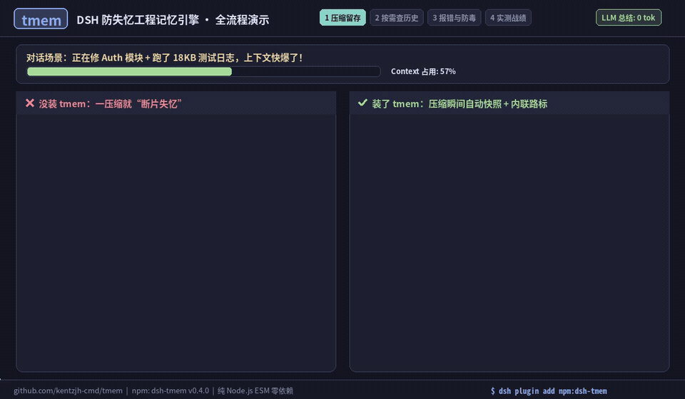
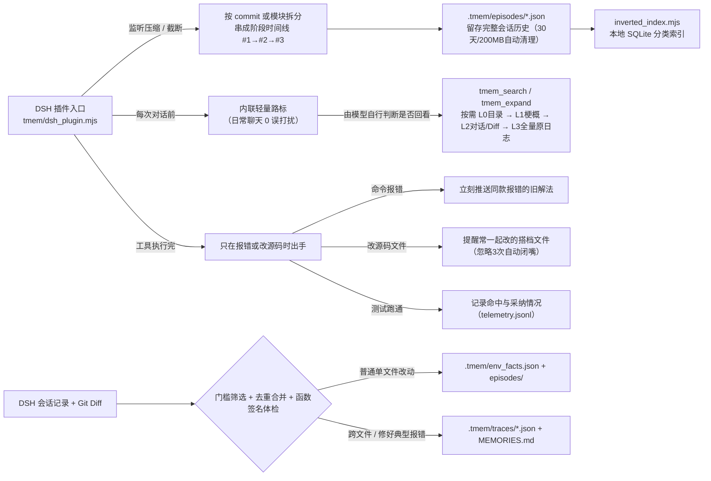

# `tmem` — 给 DeepSeek Harness (`dsh`) 用的“防失忆”记忆插件

**中文文档** | [English](./README_EN.md)

<p align="center">
  
</p>

`tmem`（npm 包名 [`dsh-tmem`](https://www.npmjs.com/package/dsh-tmem)）是一个专门配合 `@deepseek-ai/dsh` (DeepSeek Harness) 使用的本地代码记忆插件，纯 Node.js 实现、零外部依赖，所有记录都存在当前仓库的 `.tmem/` 目录里。

用一句话说清它干嘛的：**对话长了要压缩（compact），或者长报错日志被截断时，`tmem` 顺手把现场完整存下来；它在当前对话里内联留一张极短的历史路标，由模型自己判断要不要、以及要找回多少之前的完整会话历史——平时几乎不占 Token，真要回看某几行改动、被截断日志甚至整段历史对话时，模型自己按目录翻出来看就行，不用重新读整个项目。**

---

## 一、为什么做 `tmem`？（先说痛点，再说做法）

用 Coding Agent 连续写代码、修 Bug 久了，经常会碰到 4 件很烦的事：

1. **压缩一下就“断片”**：对话一长触发 `compact`，或者跑测试打出几万字日志被截断后，前面定好的方案、改过哪几行代码、中间报过什么关键错误经常一起被折叠抹掉。模型只好重新满仓库找文件、重新踩一遍刚才踩过的坑。
2. **靠大模型写总结既费钱又容易写歪**：很多记忆插件喜欢在后台让 LLM 把历史对话总结成几段话。这不仅每轮都要烧 Token，而且总结多次以后，最关键的函数名、文件路径、报错行号全没了，变成一句“好像改好了某个校验逻辑”，真用的时候根本靠不住。
3. **不加区分地往上下文塞记忆，反而越帮越忙**：如果用户每发一句话，插件都拿去“模糊搜一圈历史记录”塞进 Prompt，平时问个简单问题也会被一堆不相干的历史干扰。
4. **代码重构了，旧记忆还在瞎指挥**：前两天某个函数改了参数、或者文件删掉了，如果旧记忆里还写着原来的调用方法并继续塞给模型，等于在故意误导模型写错代码。

针对这 4 个问题，`tmem` 的做法很直接，总结起来就 4 条：

### 1. 不请大模型写总结，直接从真实操作里“挑干货”
> 写代码留下的 `读文件 → 改代码 → 报错 → 修好 → 测试通过`，本身就是最准确的记录，没必要再让模型花钱“复述一遍”。

`tmem` 不会在后台偷偷调 LLM 总结记忆，而是像视频剪辑一样，顺着 **“最后改了哪些文件 + 哪次测试跑通了”** 倒推回去：
- 没用上的闲逛读文件、改错又撤回的操作、后来被 `git checkout` / `rm` 清掉的临时文件、以及最后一次测试通过后又瞎改但没验证的代码，统统剪掉；
- 只留下真正让任务跑通的关键步骤，**0 总结 Token 成本**，而且保留下来的文件路径、符号名和报错原话 100% 是当时真实发生过的。

### 2. 把“对话压缩”和“记记忆”合在一起，并内联保留会话历史时间线
> 压缩（Compact）负责给当前对话瘦身，`tmem` 负责在瘦身那一刻把完整现场存进时间胶囊，并在对话里内联留一张轻量化路标。

- **盯着压缩时刻自动存档 + 时间线串联**：`tmem` 监听 DSH 自己的压缩事件（`compaction/summary`、`compaction/end`、`compaction/prune`）。只要对话触发压缩，或者上万字的命令输出被截断，它就顺手把这一整段经历打包存进 `.tmem/episodes/`；如果一段对话中途提交过 commit，或者顺带干了好几件互不相干的活，它还会自动拆成多个子片段，并把多次压缩串联成一条前后衔接的时间线（`prev_episode_id` + `phase_index`：`#1 -> #2 -> #3`）。
- **保留内联目录，交由模型判断是否找回全量历史**：压缩后，`tmem` 会直接在当前对话的 `<compact-checkpoint>` 旁边**内联**放一张极短的索引路标（`<tmem_compacted_index>`），提示每一段历史存了什么、时间线怎么接。如果单靠原生压缩摘要就够干活，模型可以完全不触发召回（零多余消耗）；一旦模型自己判断“摘要信息太粗了，需要回看当时某轮对话细节、甚至顺着时间线把整段完整会话历史全量找回来”，它就可以自主调用工具按需拉取——**要不要找回、找回几段还是全量找回，完全交给模型按当下任务判断**。
- **日常备份和精品经验分开存**：
  - **`.tmem/episodes/`（会话历史全量备份区，不提交 Git）**：不管任务大小，每次压缩或手动执行 `/tmem` 都会存一份完整的过程记录（含每轮对话、决定、Diff 以及被截断的长日志原文），保证有需要时能无损找回全部会话历史。默认保留 30 天、上限 200MB，满了自动清最旧的。
  - **`.tmem/traces/` + `MEMORIES.md`（团队共享经验库，可提交 Git）**：只有真正跨文件修改成功、或者修好了某个典型报错的高价值记录，才会提炼成复用手册，方便以后开新会话或者队友直接复用。

### 3. 像翻书目录一样“按需翻页”，从摘要一路翻到全量历史
> 与其塞给模型一大篇模糊总结，不如建个本地索引，需要看哪段再翻哪段——甚至直接调出某轮或整条时间线的完整原文。

`tmem` 用 Node.js 自带的 SQLite 建了一张本地搜索索引，把提问需求、报错信息、技术决策、函数/类名、文件路径、命令行、代码 Diff、长日志分开记录权重，然后分 4 层给模型按需翻阅：
- **L0（内联目录纸条 / 快速定位）**：压缩后直接内联在上下文里的极简路标，或由模型调用 `tmem_search` 秒定位到对应的历史片段坐标；
- **L1（阶段梗概）**：调用 `tmem_expand(level="slice")`，查看这段当时想干嘛、做过哪些关键决定、一共几轮对话（Turn 目录）、改了哪几个文件、修过什么错；
- **L2（逐轮对话 / 具体改动）**：调用 `tmem_expand(level="turn" | "diff")`，把某几轮或整段压缩周期的对话内容、行动和精确代码补丁找回来；
- **L3（全量原始现场）**：调用 `tmem_expand(level="raw", query=...)`，把被截断的几万字命令输出或未裁剪的原始工具执行历史原封不动取出来；配合 `prev_episode_id` 链表，模型可以顺着把多轮压缩前的完整历史逐段拼回。

### 4. 平时闭嘴不乱插话，报错才提醒，代码变了自动失效
> 宁可不提醒，也不乱猜瞎提醒；每条旧经验塞进去之前，先花几毫秒体检一遍。

- **平时保持安静，只在关键节点出声**：在 `agent/pre-step`（模型思考前），普通聊天语句 **0 误插嘴**；只有新对话第一轮告诉你“这个项目通常用什么命令跑测试”、刚压缩完给你内联一份“历史目录路标”、或者你明确提到了某个文件名/报错类型时才会主动带出相关记忆。在 `tools/post-execute`（工具执行完）阶段，只有真报错了才立刻弹出“以前这样修好过”，或者改完某个源码文件时提示“通常还要一起改另一个搭档文件”（而且如果你连续 3 次忽略这个搭档提醒，它后面就识趣闭嘴）。
- **代码改了会自动降级，不误导模型**：每次准备注入一条历史经验前，`tmem` 会用不到 5ms 的时间在本地查一遍文件还在不在、函数还在不在、参数列表变没变（`signature_match`）。一旦发现你已经重构了函数签名，旧的“直接照着改代码”就会被自动降级，只保留思路和踩坑原因，不把过时代码路数塞给模型。

---

## 二、整体是怎么运转的？



1. **压缩即存档、内联路标 + 模型自主翻查历史**（[`tmem/episodes.mjs`](./tmem/episodes.mjs)、[`tmem/inverted_index.mjs`](./tmem/inverted_index.mjs)、[`tmem/dsh_tools.mjs`](./tmem/dsh_tools.mjs)）：
   接管 DSH 的 `session/event`，兼容 CLI / Headless / Web 等不同运行方式；压缩后仅内联放一张极小的路标 + 阶段时间线（`prev_episode_id`），并给模型注册 `tmem_search` 和 `tmem_expand` 工具，由模型自主判断要不要只看梗概、还是顺着时间线全量找回历史对话与长日志。
2. **极轻的钩子挂载，不拖慢每一步推理**（[`tmem/dsh_plugin.mjs`](./tmem/dsh_plugin.mjs)、[`tmem/hooks/dsh.mjs`](./tmem/hooks/dsh.mjs)）：
   纯 Node.js ESM 进程内直接调用，不用每次起子进程；普通的 `read`/`grep`/`glob` 操作直接跳过，只在报错、改代码、跑测试和压缩时干活，并把提示到底帮没帮上忙记录在 `.tmem/telemetry.jsonl`。
3. **精剪过程、AST 函数签名检查与自动清理**（[`tmem/slicer.mjs`](./tmem/slicer.mjs)、[`tmem/guards.mjs`](./tmem/guards.mjs)、[`tmem/store.mjs`](./tmem/store.mjs)）：
   [`tmem/ast_parser.mjs`](./tmem/ast_parser.mjs) 支持对 Python / JS / TS / Go / Rust 等语言提取函数名与参数签名指纹，发现代码大改过就自动降级或用 `tmem gc --prune` 清理过期条目。

---

## 三、快速上手

> 运行要求：**Node.js >= 22.5.0**（使用内置 `node:sqlite`，免安装 Python，零第三方 npm 依赖；旧版 Python 代码归档在 `python` 分支）。

### 安装与初始化
```bash
npm install -g dsh-tmem                       # 全局安装 CLI（或 git clone 后 npm link）
tmem init                                     # 在当前项目初始化 .tmem/、安装 DSH 插件与 git hook
dsh plugin add npm:dsh-tmem                   # 或直接用 dsh 安装（也可 github:kentzjh-cmd/tmem）
npm test                                      # 跑完整单元测试（50/50）
npm run verify:benchmarks                     # 跑所有评测基准和文档数字同步检查
```

### 平时常用的命令
```bash
tmem status                                      # 看看存了多少剧本、多少压缩切片和命中率
tmem telemetry                                   # 看报错提醒帮修好了几次、搭档文件提醒采纳了多少
tmem capture --agent dsh                         # 手动把当前进度存进 episodes/ 并提炼高价值经验
tmem search "jwt_guard.ts leewaySec"             # 像搜代码一样搜历史对话和报错（支持 --files / --symbols / --errors）
tmem episodes --session <id>                     # 列出某次会话经历过的压缩片段和时间线
tmem expand <episode_id> --level slice           # 一层层往里翻：index (L0) -> slice (L1) -> turn / diff (L2) -> raw (L3)
tmem lookup "TypeError" --file src/validator.py  # 查某类报错有没有现成解法（会先过一遍签名体检）
tmem inspect <trace_id> --level playbook         # 查看某条团队经验剧本的详细内容
tmem sync                                        # 检查所有经验是否还有效，并刷新 MEMORIES.md
tmem gc --prune                                  # 清理已经失效的旧剧本和超期/超容量的 episode 缓存
```

在 DSH 对话里面，模型自己会判断是否调用 **`tmem_search`** 和 **`tmem_expand`**（支持从 `slice` 一路查到 `turn` / `raw` 全量历史）；你也可以随时输入斜杠命令 **`/tmem [status|search|episodes|expand|list|inspect|replay|diff|sync|gc|forget|telemetry|evaluate]`** 手动查看或存档。

---

## 四、实测效果（所有测试都能本地复现）

`benchmarks/` 目录下放了所有评测脚本和真实数据集（通过 `node scripts/verify_benchmarks.mjs` 自动复跑校验）：

### 1. 压缩 / 截断以后，还能不能把丢掉的细节找回来？（`eval_compact_recall.mjs`）
复现：`node benchmarks/eval_compact_recall.mjs`（[评测脚本](./benchmarks/eval_compact_recall.mjs)）：

专门测了 4 类最容易“压缩完就忘”的场景（早期定好的架构约束、18KB 超长测试日志正中间的报错根因、同一次对话顺手做了几件不同事的拆分、精确 Diff 恢复与旧函数重构防误导）：
- **关键细节找回率**：只用原生压缩摘要 + 截断基线 **0.0%**（`0/4`）→ 加上 `tmem` 后 **100.0%**（`4/4`）
- **省了多少上下文 Token**：平时只放 L0 目录纸条省了 **91.6%**（`7,157 tok` → `603 tok`）；就算加上按需展开 L1/L2 查清楚细节，整体依然省了 **87.0%**（`933 tok`）
- **翻找耗时**：搜一次索引 **~6 ms**，展开一层细节 **< 10 ms**

### 2. DSH 实战里能不能少走弯路、平时会不会乱插嘴？
复现：`node benchmarks/eval_dsh_e2e.mjs`（[评测脚本](./benchmarks/eval_dsh_e2e.mjs)）：
- **做完同一件事少走多少步**：**37.5%**（8 步试错基线 → 5 步完成）
- **提醒有没有真帮上忙**：L2 报错修复转绿率 **100%**（`1/1`），L1 共变提醒采纳率 **100%**（`1/1`）
- **泛自然语言负例误注入率**：**0.0%**（10 句跟代码/报错无关的日常提问全保持安静，绝不乱插嘴）
- **插件自己占多少时间**：跑 21 次高频钩子（6 轮 `agent/pre-step` + 15 次只读 `tools/post-execute`）一共只花了 **~5 ms**

### 3. “剪废话”剪得准不准？（50 条真实轨迹 + 盲测打分）
复现：`node benchmarks/eval_slicing_fidelity.mjs --gold-path benchmarks/gold/gold_annotations_50.json` 与 `node benchmarks/eval_llm_judge.mjs`（[50 轨迹盲测报告](./benchmarks/runs/llm_judge_50_report.json) / [Gold-50 标注集](./benchmarks/gold/gold_annotations_50.json)）：

在 **50 条真实开源修复轨迹**（25 条 SWE-bench/DSH + 25 条从 `sailplane/swe-agent-trajs` 挑出的已解决轨迹）上，让 5 位独立 LLM 评委盲测打分（打乱顺序不知道哪份是 `tmem` 剪的）：

| 截取方式 | Precision (剪完留下的有多准) | Recall (真正有用的留住多少) | F1-Score | 平均保留步数 | 盲测综合分 (1–5) |
|---|:---:|:---:|:---:|:---:|:---:|
| **B0 土办法（只看最后改了哪几个文件 + 终测）** | 81.1% | 66.5% | 71.4% | 4.7 步 | 3.20 |
| **B1 `tmem` 倒推裁剪** | **93.8%** | **95.0%** | **93.6%** | 5.1 步 | **4.80**（一对一 PK 胜率 **49:1 / 98.0%**） |
| **B2 人工参考上限（Gold-50）** | 98.0% | 98.0% | 98.0% | 5.0 步 | — |

> **也说一下不足**：极少数案例（例如 `sympy__sympy-22005`）里，模型最后一次跑通测试后又顺手改了测试文件却没再跑验证，离线且没有 Git 状态时默认策略会把那次修改留着（`v0.4.0` 已在 Episode / Slicer Phase 2 里加了 `pruneTrailingUnverified` 开关专门裁掉这种尾巴）；另外在原始 25 条标注集（`benchmarks/gold/gold_annotations.json`，复现：`node benchmarks/eval_slicing_fidelity.mjs --gold-path benchmarks/gold/gold_annotations.json`）基准评测中，B1 Precision 亦已从 63.2% 提升至 92.3%（F1 81.8% > B0 81.0%）。

### 4. 存了 50 条剧本之后，检索还准不准、会不会变慢？
复现：`node benchmarks/eval_plugin_scale.mjs`（[规模报告](./benchmarks/runs/plugin_scale_50_report.json)）与 `node benchmarks/eval_retrieval.mjs`（[检索日志](./benchmarks/runs/retrieval_report.json)）：
- **50 条轨迹全量压缩入库**：50 条编译为 **49** 条 Playbook（空改动的 `pytest-dev__pytest-7168` 自动跳过），原始 **898 步 → L0 157 步**（步数精简 **82.5%**，字符体积压缩 **94.8%**），每条压缩都是毫秒级完成。
- **插件钩子压力测试**：49 条库规模下 `pre_step` 负例误注入 **0.0%**（`0/10`）、显式锚点召回 **100.0%**（`48/48`）；`post_tool_use` L2 同源报错拦截与验证转绿率 **100.0%**（`7/7`）。
- **拿原始报错 / 需求直接搜**：24 条含原始需求文本的样本在 `eval_retrieval.mjs` 取得 **Recall@1 = 100.0% / Recall@3 = 100.0% / MRR = 1.0**，加上词边界与覆盖率过滤后，负例误召回率降至 0.0%**（49 条全库压力下 FTS5 负例误召回 **10.0%**，但会被 `pre_step` 入口门控直接挡掉变成 **0.0%**）。

### 5. 跨格式轨迹压缩与运行时开销评测（9 条真实轨迹）
复现：`node tmem/cli.mjs evaluate`：
- **L0 步骤精简率**：**56.5%**（106 步 → 43 步，5,406 → 1,480 字符，~1,348 tok → ~367 tok）
- **高熵 L2 因果修复对**：**8 组**（确认过改完确实让原本报错的命令跑通了）
- **单条平均耗时**：**0.88 ms**（不连网、不调模型）

---

## 五、坦白说：它目前做不到什么

1. **只管 DeepSeek Harness (`dsh`)**：为了做深做透，运行时钩子和压缩监听只针对 `@deepseek-ai/dsh` 打磨（`swe_bench` 适配器只是为了跑上面的开源评测）。
2. **靠代码结构和报错规则推理，不做全仓库编译器分析**：主要结合 Git 改动、轻量多语言结构化解析（[`tmem/ast_parser.mjs`](./tmem/ast_parser.mjs)）和命令退出码做判断，不会去构建跨文件完整调用图。
3. **能查出函数参数改了，但管不到“参数没变但逻辑全变”**：`signature_match` 能拦住改名、增删参数导致的老剧本误导；如果函数名字参数一模一样、里面业务完全重写了，还是要靠最后跑一次测试来兜底。

---

## License

MIT
