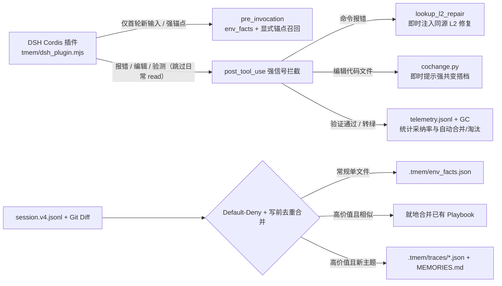

# `tmem` — 面向 DeepSeek Harness (`dsh`) 的仓库级确定性工程记忆引擎

**中文文档** | [English](./README_EN.md)

`tmem`（**Trace Memory**）是一个**零外部依赖、聚焦 `@deepseek-ai/dsh` (DeepSeek Harness)、仓库级（`.tmem/`）**的确定性工程记忆与**历史会话零 Token 摘要引擎**。

它对 DSH 历史执行轨迹进行确定性裁剪与回放归纳：在不消耗任何 LLM Summarization Token 的前提下，将冗长会话压缩为面向**特定需求（Intent）与实际行为（Read → Edit → Repair → Verify）**的免费结构化摘要，并**内联保留原始历史 `session_id` 溯源链路**；同时在 DSH 运行时提供强信号拦截（报错即时注入 L2 同源修复、改代码文件即时提醒 L1 统计共变、累计 `.tmem/env_facts.json` 环境事实），关闭对泛自然语言 Prompt 的低质量猜测注入。

---

## 一、真实评测结果（Empirical Benchmarks）

所有脚本与数据均可在 `benchmarks/` 下复现：

### 1. DSH 端到端强信号回放与遥测评测
复现命令：`python3 benchmarks/eval_dsh_e2e.py`（[评测脚本](file:///home/ubuntu/proj/benchmarks/eval_dsh_e2e.py)）：
- **端到端交互步数精简**：**37.5%**（8 步试错基线 → 5 步完成）
- **运行时遥测命中收益**：L2 报错修复转绿率 **100%**（`1/1`），L1 共变提醒采纳率 **100%**（`1/1`）
- **泛自然语言负例误注入率**：**0.0%**（10 条无代码/报错锚点的日常对话均保持静默）
- **Cordis 插件热路径耗时**：21 次高频事件（6 轮 `agent/pre-step` + 15 次只读 `tools/post-execute`）总耗时 **111.98 ms**（免除重复 `python3` 冷启动）

### 2. 切片保真度评测（25 条真实轨迹对比人工 Gold 标注）
复现命令：`python3 benchmarks/eval_slicing_fidelity.py`（[评测日志](file:///home/ubuntu/proj/benchmarks/runs/slicing_fidelity_report.json)）：

| 切片策略 | Precision (精确率) | Recall (召回率) | F1-Score | 平均保留步数 |
|---|:---:|:---:|:---:|:---:|
| **B0 简单基线（修改文件 + 终测）** | **97.1%** | 70.8% | **81.0%** | 4.4 步 |
| **B1 `tmem` 启发式后向切片** | 63.2% | **88.7%** | 70.8% | 8.8 步 |
| **B2 Oracle 上限（人工 Gold 标注）** | 100.0% | 100.0% | 100.0% | 5.6 步 |

> **诚实局限**：`tmem` 后向反推有效保留了定位所需的前置读上下文（Recall 88.7% > B0 的 70.8%），但部分试探性读取未被完全剪枝，Precision（63.2%）与 F1 仍低于强精确率 B0 基线。

### 3. 原始 Issue 检索评测（25 个真实原始 Issue 查询 + 6 个负例查询）
复现命令：`python3 benchmarks/eval_retrieval.py`（[评测日志](file:///home/ubuntu/proj/benchmarks/runs/retrieval_report.json)）：
- **Recall@1**: **100.0%** / **Recall@3**: **100.0%** / **MRR**: **1.0**
- **负例误召回率**: 16.7%（纯本地 SQLite FTS5 BM25 词法检索在直接查 Issue 时偶有常见词匹配；因此 DSH `pre-step` 已改为仅允许显式文件路径或报错签名触发）

### 4. 轨迹压缩与运行时开销评测（9 条真实轨迹）
复现命令：`python3 -m tmem.evaluate`：
- **L0 步骤精简率**: **56.97%**（117 步 -> 47 步，~1423 tok -> ~349 tok）
- **高熵 L2 因果修复对**: **7 组**（经同源验证命令与堆栈交集双重校验）
- **平均确定性切片耗时**: **0.65 ms**（零外部依赖与零 LLM Token 耗时）

---

## 二、工作原理与核心机制



1. **DSH 热路径瘦身与强信号即时拦截**（[`tmem/dsh_plugin.mjs`](./tmem/dsh_plugin.mjs)、[`tmem/hooks/dsh.py`](./tmem/hooks/dsh.py)）：
   - **冷启动削减**：`agent/pre-step` 对同输入后续推理步直接放行；`tools/post-execute` 跳过常规 `read`/`grep`/`glob`，仅在报错、代码修改、Shell 验证或处于共变观察期时唤醒 Python 内核；
   - **降级泛猜测**：`pre_invocation` 不再拿自然语言做模糊 BM25 猜测，仅在首轮注入 `env_facts` 或命中显式文件路径/报错名时召回；
   - **实时拦截**：报错时通过 `lookup_l2_repair` 即时注入经过同源验证的 L2 修复动作；修改源码文件后基于 Git/Trace 统计共变即时注入 `<tmem_cochange_hint>`。
2. **Precision-First 切片、写前合并与漂移淘汰**（[`tmem/slicer.py`](./tmem/slicer.py)、[`tmem/store.py`](./tmem/store.py)）：
   - 基于 `git diff -U0` + Python AST 精准归因修改符号，默认拒绝单文件无修复的常规修改（`default-deny`），仅将其中的通过命令写入 `.tmem/env_facts.json`；
   - **写前合并**：入库前检测同 L2 报错修复或高文件重合度 + 同意图 Playbook 并就地合并（累计 `merge_count` 与置信度），防止 `.tmem/traces/` 膨胀；
   - **Guard 漂移自动淘汰**：持续追踪 `guard_fail_streak`，`tmem gc --prune` 自动清理长期失效且无 L2 价值的过期条目。
3. **真实收益遥测闭环**（[`tmem/telemetry.py`](./tmem/telemetry.py)）：
   - 记录每次 L2 注入后下轮同源命令是否转绿、以及 L1 共变提示后是否读/改了目标搭档文件，通过 `tmem telemetry` 或 `tmem status` 量化真实采纳率。

---

## 三、快速开始

### 安装与初始化
```bash
pip install -e .            # 安装 CLI 工具（零外部依赖，仅需标准库）
tmem init                   # 初始化 .tmem/、安装 DSH Cordis 插件与 git post-commit hook
dsh plugin add github:kentzjh-cmd/tmem   # 或直接通过 dsh 安装插件
```

### 常用命令
```bash
tmem status                                      # 查看当前仓库记忆、探针与实时遥测统计
tmem telemetry                                   # 查看 L2 纠偏率与 L1 共变采纳率明细
tmem capture --agent dsh                         # 从最新 DSH 会话切片并合并/保存到 .tmem/
tmem lookup "TypeError" --file src/validator.py  # 本地检索 + 探针校验 + 分级预览
tmem inspect <trace_id> --level playbook         # 查看三层 Playbook 详情
tmem sync                                        # 校验探针并刷新 MEMORIES.md
tmem gc --prune                                  # 校验 Guard 漂移并清理已失效且无 L2 的记忆
```

---

## 四、设计边界与局限

1. **只聚焦 DSH 单一运行时**：主动裁剪了多宿主并行维护成本，全部运行时能力围绕 `@deepseek-ai/dsh` `session.v4.jsonl` 与 Cordis 生命周期打磨（保留 `swe_bench` 适配器仅用于离线评测）。
2. **启发式切片非形式化推导**：基于 Git 落盘、Python AST 顶级符号和退出码反推；非 Python 文件暂仅做文件级与测试命令校验。
3. **探针仅覆盖浅层存在性**：检查文件与符号是否存在，若函数签名未变但内部逻辑重构，仍需依赖终端验证命令确认结果。

---

## License

MIT
