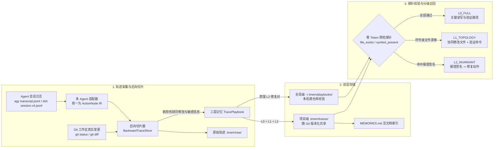
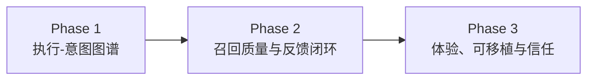

# `tmem` — 面向编程 Agent 的执行轨迹记忆编译器

**中文文档** | [English](./README_EN.md)

`tmem`（**Trace Memory**）是一个**零依赖、零 UI、双层存储（项目级 `.tmem/` + 全局级 `~/.tmem/`）**的编程 Agent 执行轨迹记忆插件与 CLI 工具。原生集成 **`agy` (Antigravity)** 与 **`@deepseek-ai/dsh` (DeepSeek Harness)**，并可解析 `codex` / `opencode` / `pi` / SWE-bench / ATIF 的会话轨迹。

与把对话文本总结成记忆的做法不同，`tmem` 把 Agent 会话日志（`transcript.jsonl` / `session.v4.jsonl`）当作一段**未经优化的执行轨迹**来处理：以 **Git 最终落盘状态**和**最终通过的验证命令（`exit_code == 0`）**为终点做**确定性后向切片**，剪掉试错弯路、废弃修改和无关扫描，编译成带**预检探针（Guards）**的 **L0 / L1 / L2 三层记忆手册（Playbook）**。下次遇到相似任务或相同报错时，先校验探针，再按校验结果分级注入。

> **一句话定位**：以 Git 为事实来源、可审计、可随仓库共享、跨 Agent 的**程序性记忆层**，记录“这类任务在这个仓库里实际是怎么做成的”，而不是“聊过什么”。

---

## 目录

- [一、核心解决的问题](#一核心解决的问题)
- [二、设计原则](#二设计原则)
- [三、核心架构](#三核心架构)
- [四、Agent 集成与支持矩阵](#四agent-集成与支持矩阵)
- [五、记忆的沉淀与召回](#五记忆的沉淀与召回)
- [六、快速开始与 CLI 手册](#六快速开始与-cli-手册)
- [七、评测](#七评测)
- [八、适用场景与设计边界](#八适用场景与设计边界)
- [九、信任、隐私与安全](#九信任隐私与安全)
- [十、路线图](#十路线图)
- [十一、目录结构](#十一目录结构)

---

## 一、核心解决的问题

1. **过程噪声高**：Agent 解决一个 Bug 可能走 30 步，其中只有几步真正起作用。把全量过程塞进上下文，既浪费 Token 又容易误导后续推理。
2. **记忆过期（Stale Memory）**：写死文件路径、行号的经验，在重构或换机器后会失效，甚至起反作用。
3. **管理负担**：不需要 Web 面板，也不需要外部服务；记忆以 JSON 文件的形式随仓库流转，用 `git` 就能 review、回滚和共享。

---

## 二、设计原则

| 原则 | 含义 |
|---|---|
| **Git 为事实来源** | 只有最终存活在磁盘上的修改、最终通过的验证命令，才会进入关键路径。 |
| **先校验，后注入** | 每条记忆都带有文件和符号探针。探针失败就隐藏具体路径并降级，不让过时细节误导 Agent。 |
| **召回零 Token** | 检索、校验、格式化全部在本地完成（SQLite FTS5 + 文件探针），不调用 LLM，可以常驻在每轮 hook 中。 |
| **记忆即代码** | 一条记忆一个短哈希 JSON 文件，可以 diff、review、blame、revert。 |
| **注入克制** | 每次最多注入 3 条，按会话去重，只在新用户轮或出现新报错时触发。 |
| **证据可追溯** | Playbook → 原始轨迹 → Git Diff，三层逐级展开，每条结论都能回溯到原始步骤。 |

---

## 三、核心架构



### 1. 基于 Git 事实的后向切片（[`tmem/slicer.py`](./tmem/slicer.py)）
- **终点锚定**：用 `git diff` / `git status` 取得会话结束时真正存活的修改文件，忽略中途创建后又删除或回滚的实验性修改。
- **因果反推**：从最终 `exit_code == 0` 的测试/构建命令出发，反向保留对最终文件有实质贡献的 `READ -> MUTATE -> ENV_EXEC(VERIFY)` 节点。
- **报错修复配对（L2 提取）**：在 36 步的因果窗口内，捕获“命令报错 → 修改代码或安装依赖 → 同类验证通过”的最小闭环，提炼为 `[Error Signature] -> [Repair] -> [Verification]`。
- **敏感信息脱敏**（[`scrub_secrets`](./tmem/adapters/base.py)）：落盘前用正则抹除 GitHub PAT、OpenAI/Anthropic/Google API Key 等常见密钥格式。

### 2. 三层记忆与预检探针（[`tmem/models.py`](./tmem/models.py) & [`tmem/guards.py`](./tmem/guards.py)）

| 层级 | 名称 | 内容 | 注入条件 |
| :--- | :--- | :--- | :--- |
| **L0** | 关键执行路径 `L0_FULL` | `READ(file) -> MUTATE(file#symbol) -> ENV_EXEC(cmd)` | 所有 `file_exists` 与 `symbol_present` 探针都通过时注入，帮 Agent 跳过全仓盲搜。 |
| **L1** | 协同修改契约 `L1_TOPOLOGY` | 一起修改的文件集合 + 必跑的验证命令 | L0 探针失效（重构、改名、删除）时，隐藏 L0，只保留架构级的“防漏改”提醒。 |
| **L2** | 排障不变量 `L2_INVARIANT` | `报错签名 -> 最小修复动作 -> 验证命令` | 工具执行出现同类报错，或跨项目检索命中报错签名时注入。工具链/依赖类修复可以跨项目复用。 |

### 3. 双层存储（[`tmem/store.py`](./tmem/store.py)）
- **项目级 `<repo>/.tmem/traces/*.json`**：随仓库提交。每条记忆是一个独立的短哈希文件（如 `tr_30fa71c60d.json`），多人协作时很少出现 merge 冲突；团队成员 `git pull` 后，本地 Agent 就能用上。
- **全局级 `~/.tmem/playbooks/*.json`**：存放从项目记忆中蒸馏出来的报错修复经验（L2），在本机跨仓库共享。
- **检索索引**：项目和全局各有一个 SQLite（FTS5）缓存索引（`.tmem/.cache/`，不进 Git），JSON 文件变化时会自动重建。

### 4. 原始轨迹存储与渐进式查看（[`tmem/raw_storage.py`](./tmem/raw_storage.py)）
切片的同时，`tmem` 会在 `.tmem/raw/<trace_id>.raw.json` 保存原始会话的工具输入、命令输出、退出码、错误堆栈，以及会话期间产生的 Git 统一补丁：
- **Tier 0 索引**（约 35 tokens）：根目录 [`MEMORIES.md`](./MEMORIES.md) 中每条记忆一行摘要。
- **Tier 1 Playbook**（约 300–500 tokens）：命中时注入的、带探针保护的 L0/L1/L2。
- **Tier 2 原始轨迹**：`tmem replay <id>` 回放完整操作流（标注 `[CRITICAL PATH]` / `[NOISE PRUNED]`），`tmem diff <id>` 查看代码补丁。

### 5. 活文档记忆索引（[`tmem/mem_doc.py`](./tmem/mem_doc.py)）
- 在仓库根目录自动生成并同步 [`MEMORIES.md`](./MEMORIES.md)，同时维护指向它的软链接 `MEM.md`。
- **不装插件也能用**：Cursor、Claude Code、Copilot 等任何能读取仓库文件的助手，都可以直接读 `MEM.md` 获取历史验证路径和报错修复对。只是这种方式没有探针校验和自动召回。
- 沉淀、删除记忆，以及执行 GC 或 `/tmem sync` 时，自动原子刷新。

### 6. 确定性执行-意图图谱（Phase 1 意图图谱拓扑）
`tmem` 在 Schema v2 中引入了**轻量、确定性、证据可闭环**的执行-意图图谱（Execution-Intent Graph）：
- **零 Token 意图绑定**：从宿主交互的 `toolSummary` 与执行前置说明中提取动作语义，自动绑定至每个 `ActionNode.rationale`。
- **确定性因果边（IntentEdge）**：
  - `Requirement (R1)` $\xrightarrow{\text{served_by}}$ `Step`（每一步服务于哪条需求）
  - `READ` $\xrightarrow{\text{informs}}$ `MUTATE`（同文件读取为后续修改提供上下文）
  - `MUTATE` $\xrightarrow{\text{modifies}}$ `file#symbol`（记录具体修改的代码符号与压缩 Diff 摘要）
  - `Error` $\xrightarrow{\text{fixed_by}}$ `MUTATE`（因果报错修复闭环）
  - `ENV_EXEC` $\xrightarrow{\text{verifies}}$ `Requirement`（验证命令闭环需求）
- **部分探针降级（Partial Guard Degradation）**：当多文件修改中仅单个文件重构漂移时，不再粗暴丢弃全部 L0，而是仅隐藏失效文件相关的局部步骤，最大限度保留有效经验。
- **符号级轨迹关联（`trace_links`）**：在 SQLite 中自动维护代码符号索引，支持跨任务回溯修改同一符号的历史轨迹。

---

## 四、Agent 集成与支持矩阵

| Agent | 会话解析 | 自动召回 hook | `/tmem` 命令 | 里程碑提示 | 说明 |
|---|:---:|:---:|:---:|:---:|---|
| **Antigravity (`agy`)** | ✅ | ✅ | ✅ | ✅ | 原生插件 |
| **DeepSeek Harness (`dsh`)** | ✅ | ✅ | ✅ | ✅ | 原生 Cordis 插件 |
| `codex` / `opencode` / `pi` | ⚠️ 通用 JSONL 适配器 | ❌ | ❌ | ❌ | 只能用 `tmem capture --agent <name>` 手动沉淀；召回依靠 `MEM.md` |
| SWE-bench `.traj` / ATIF | ✅ | — | — | — | 用于离线评测 |
| Cursor / Claude Code / Copilot 等 | ❌ | ❌ | ❌ | ❌ | 只能读取 `MEM.md` |

执行 `tmem init --agents agy,dsh` 后自动完成挂载：

### 1. Antigravity（`agy`）
- 插件目录 [`.agents/plugins/tmem/`](./.agents/plugins/tmem)：
  - [`hooks.json`](./.agents/plugins/tmem/hooks.json)：`PreInvocation` 负责召回、`/tmem` 命令拦截和里程碑提示；`PostToolUse` 负责追踪文件修改、验证结果和报错签名。
  - [`rules/AGENTS.md`](./.agents/plugins/tmem/rules/AGENTS.md)：告诉 Agent 如何使用 `<tmem_speculative_memory>`，以及达成目标后询问是否沉淀记忆。
  - [`skills/tmem/SKILL.md`](./.agents/plugins/tmem/skills/tmem/SKILL.md)：支持用自然语言请求沉淀记忆。

### 2. DeepSeek Harness（`@deepseek-ai/dsh`）
- 一键安装：
  ```bash
  dsh plugin add github:kentzjh-cmd/tmem
  ```
- Cordis 运行时插件 [`tmem/dsh_plugin.mjs`](./tmem/dsh_plugin.mjs)（通过 [`package.json`](./package.json) 的 `dsh.bundle` 与 [`cordis.patch.yml`](./cordis.patch.yml) 导出）：
  - 自动解析当前会话的项目根目录（`dsh-working-directory` 服务或 `session.header.cwd`）。
  - `agent/pre-step`：每轮推理前静默召回并注入记忆（按消息指纹去重）。
  - `tools/post-execute`：追踪 `read` / `write` / `edit` / `apply_patch` / `bash` 的退出码；报错时注入 L2 修复提示，“修改 → 测试通过”时注入里程碑提示。
  - 通过 `dsh-commands` 原生注册 `/tmem` 命令。
- 会话解析（[`tmem/adapters/dsh.py`](./tmem/adapters/dsh.py)）：支持 `session.v4.jsonl`（兼容 v3 与 `session.jsonl`），能拆解多文件 `apply_patch` 补丁。

---

## 五、记忆的沉淀与召回

### 沉淀（写入）
`tmem` **默认不会在每次会话结束时自动写入**，以免把低质量的会话记成记忆。写入有三个入口：

1. **里程碑提示**：检测到“修改代码 → 验证通过”的闭环后，提示 Agent 在回复末尾附一行询问：
   > 💡 *是否需要将本次有效执行路径沉淀为记忆？（可输入 `/tmem project` 存项目级、`/tmem global` 存全局级、或 `/tmem both` 同时保存）*
2. **`/tmem` 斜杠命令**：

   | 命令 | 作用 |
   |---|---|
   | `/tmem` 或 `/tmem project [备注]` | 切片当前会话，保存到项目级 |
   | `/tmem global [备注]` | 切片并蒸馏到全局级 |
   | `/tmem both [备注]` | 两级同时保存 |
   | `/tmem status` / `list [scope]` | 统计 / 列出记忆及其当前生效层级 |
   | `/tmem inspect <id> [index\|playbook\|raw\|diff]` | 按粒度查看记忆 |
   | `/tmem replay <id>` / `diff <id>` | 回放原始操作流 / 查看代码补丁 |
   | `/tmem sync` | 重建索引、校验探针、刷新 `MEMORIES.md` |
   | `/tmem forget <id>` | 删除记忆及其原始轨迹 |
   | `/tmem gc` | 运行探针检查，标记失效记忆 |
   | `/tmem bench` | 运行内置评测 |

3. **Git `post-commit` 兜底**：`tmem init` 会安装 `.git/hooks/post-commit`，每次提交后在后台执行 `tmem capture --scope auto --quiet`。

### 召回（读取）
- **触发时机**：新的用户轮（用用户输入做检索）或刚出现新的工具报错（用报错签名做检索）。
- **检索方式**：报错签名精确匹配 → 文件触发词 → 意图文本包含匹配 → FTS5 BM25 关键词兜底，都是本地词法检索。
- **注入内容**：最多 3 条，按探针结果标注 `L0_FULL` / `L1_TOPOLOGY` / `L2_INVARIANT`，包裹在 `<tmem_speculative_memory>` 中。

---

## 六、快速开始与 CLI 手册

### 1. 安装与初始化
```bash
pip install -e .            # 提供 `tmem` 命令（也可以用 python3 -m tmem.cli 代替）
tmem init --agents agy,dsh  # 初始化 .tmem/、~/.tmem/，安装插件与 git post-commit 钩子
```

### 2. 常用命令
```bash
tmem status                                     # 项目级 / 全局级记忆统计
tmem capture --agent dsh --scope both           # 从最新会话切片并沉淀
                                                #   --agent agy|dsh|codex|opencode|pi|swe_bench|atif
                                                #   --scope project|global|both|auto
tmem lookup "ZeroDivisionError" --file src/billing.py   # 检索 + 探针校验 + 分级
tmem inspect tr_cc3a687f02 --level playbook     # index | playbook | raw | diff
tmem replay tr_cc3a687f02                       # 回放原始操作流
tmem diff tr_cc3a687f02                         # 查看代码补丁
tmem sync                                       # 刷新 MEMORIES.md / MEM.md
tmem gc                                         # 检查重构后哪些 L0 探针已经漂移
tmem evaluate                                   # 运行内置评测
```

### 3. 运行测试
```bash
PYTHONPATH=. python3 -m unittest discover -s tests -v
```

---

## 七、评测

`tmem` 内置 SWE-bench（`.traj`）、ATIF（`trajectory.json`）和 DSH（`session.v4.jsonl`）的轨迹适配器，以及一套离线评测（[`tmem/evaluate.py`](./tmem/evaluate.py)）。

> [!IMPORTANT]
> **请先读方法说明。** 当前评测是**离线评测**，衡量的是“切片器从一条已知轨迹中能提炼出什么”，**不是**让 Agent 带着记忆重新执行任务后的 A/B 对比结果。表格中的部分指标按定义就是理论上限，请按下文说明解读。真实的下游 A/B 评测在[路线图](#十路线图)中。

### 1. 切片统计（9 条轨迹，覆盖 Django / SymPy / Flask / Astropy / Pytest / Scikit-learn / DSH 长会话，6–27 步）

| 测试实例 / 轨迹来源 | 轨迹格式 | 原始步数 | L0 步数 | 压缩率 (CR) | 噪音消除率 (NER) | L1 文件 | L2 修复对 | 自检索排名 | 切片耗时 | 检索耗时 |
|---|---|---|---|---|---|---|---|---|---|---|
| `dsh_e2e_session` | `dsh` | 9 | 4 | 55.6% | 100.0% (3 → 0) | 3 | 1 | #1 | 0.51 ms | 2.6 ms |
| `dsh_long_lifecycle_session` | `dsh` | 27 | 9 | 66.7% | 100.0% (6 → 0) | 7 | 1 | #1 | 0.45 ms | 2.5 ms |
| `dsh_multiturn_complex_session` | `dsh` | 17 | 6 | 64.7% | 100.0% (6 → 0) | 5 | 1 | #1 | 0.37 ms | 2.7 ms |
| `astropy__astropy-12907` | ATIF | 17 | 7 | 58.8% | 100.0% (9 → 0) | 3 | 1 | #1 | 0.32 ms | 2.6 ms |
| `django__django-11099` | SWE-bench | 8 | 3 | 62.5% | 100.0% (4 → 0) | 1 | 1 | #1 | 0.18 ms | 2.5 ms |
| `flask__flask-5014` | SWE-bench | 6 | 3 | 50.0% | 100.0% (3 → 0) | 1 | 1 | #1 | 0.22 ms | 2.4 ms |
| `pytest-dev__pytest-7432` | SWE-bench | 15 | 6 | 60.0% | 100.0% (6 → 0) | 2 | 1 | #1 | 0.27 ms | 2.6 ms |
| `scikit-learn__scikit-learn-13496` | SWE-bench | 12 | 6 | 50.0% | 100.0% (4 → 0) | 2 | 1 | #1 | 0.29 ms | 2.5 ms |
| `sympy__sympy-20590` | ATIF | 6 | 4 | 33.3% | 100.0% (3 → 0) | 2 | 0 | #1 | 0.18 ms | 2.4 ms |
| **平均** | — | **13.0** | **5.33** | **55.7%** | **100.0%** | **2.89** | **共 8** | **#1** | **0.31 ms** | **2.53 ms** |

**指标口径：**
- **压缩率**：`1 - L0 步数 / 原始步数`。
- **噪音消除率**：原始轨迹中探索性动作（READ 以及 `ls/grep/cat/find/git status…` 命令）在 L0 中残留的比例。定义较宽，只能说明 L0 中不含这类命令。
- **自检索排名**：用该记忆自己的 `problem_intent` 作为查询，在 9 条记忆中检索。它验证的是索引链路通不通，**不代表**对新问题的召回能力。
- **耗时**：本机单线程测得，不包含进程启动时间。

### 2. 注入后的理论收益（推算值，非实测）

假设 Agent 完全按 L0 执行，并避开原轨迹中所有已知报错，由切片结果推算出的**理论上限**：

| 测试实例 | 原始步数 | L0 步数 | 理论步数缩减 | 原轨迹报错数 | 估算 Token 节省 | 空目录漂移降级 |
|---|---|---|---|---|---|---|
| `dsh_e2e_session` | 9 | 4 | -55.6% | 1 | -85.2% | L2_INVARIANT |
| `dsh_long_lifecycle_session` | 27 | 9 | -66.7% | 1 | -88.8% | L2_INVARIANT |
| `dsh_multiturn_complex_session` | 17 | 6 | -64.7% | 1 | -88.5% | L2_INVARIANT |
| `astropy__astropy-12907` | 17 | 7 | -58.8% | 1 | -85.9% | L2_INVARIANT |
| `django__django-11099` | 8 | 3 | -62.5% | 1 | -85.9% | L2_INVARIANT |
| `flask__flask-5014` | 6 | 3 | -50.0% | 1 | -82.6% | L2_INVARIANT |
| `pytest-dev__pytest-7432` | 15 | 6 | -60.0% | 2 | -85.8% | L2_INVARIANT |
| `scikit-learn__scikit-learn-13496` | 12 | 6 | -50.0% | 2 | -81.4% | L2_INVARIANT |
| `sympy__sympy-20590` | 6 | 4 | -33.3% | 0 | -73.7% | L1_TOPOLOGY |
| **平均** | **13.0** | **5.33** | **-55.7%** | **共 10** | **-84.2%** | **9/9 降级** |

**口径：**
- 步数缩减和 Token 节省是由 L0 长度和字符数估算（约 4 字符/token）得出的上限，实际收益取决于 Agent 是否采纳记忆。
- “空目录漂移降级”只验证了**文件全部缺失**时 L0 会被屏蔽；**符号改名、逻辑改写等部分漂移场景尚未覆盖**。

### 3. 渐进式查看的上下文占用（估算）

| 层级 | 平均占用 | 相对原始轨迹 |
|---|---|---|
| Tier 2 原始轨迹 | ~3,010 tok | — |
| Tier 1 Playbook | ~376 tok | -86.1% |
| Tier 0 索引行 | ~35 tok | -98.6% |

在全部 9 条轨迹上，原始轨迹落盘校验和回放渲染均通过；`MEMORIES.md` 同步耗时约 1.7 ms。

### 4. 针对长会话的切片处理
1. **死修改消除与同文件多次编辑合并**：同一文件反复修改时，只保留最终状态涉及的符号。
2. **临时脚本剔除**：会话中创建后又删除的调试脚本（如 `tests/scratch_debug.py`）不会进入记忆。
3. **36 步因果窗口**：覆盖跨越 20 步以上的“首次失败 → 定位 → 修复 → 回归”链条。
4. **用户意图清洗**：过滤 `ok` / `continue` 等口语确认词和 `/compact` 等控制指令，聚合核心需求作为 `problem_intent`。

---

## 八、适用场景与设计边界

**适合：**
- 有测试或构建命令、使用 Git 的仓库，尤其是**同类任务反复出现**的场景（同一模块的迭代、相同的环境或依赖问题）。
- 多人或多 Agent 协作，希望把“在这个仓库里怎么做成的”像代码一样共享和 review。
- 对成本或延迟敏感，不希望召回链路上有任何 LLM 调用。

**目前不擅长：**

| 边界 | 说明 |
|---|---|
| **记录“在哪改”多于“怎么改、为什么改”** | 当前 L0 只记录动作类型、文件和符号，修改理由与 diff 只保存在原始轨迹中，不参与注入。Phase 1 会解决这个问题，见路线图。 |
| **依赖验证信号** | 没有修改或没有通过的验证命令的会话（调研、设计讨论、无测试项目）几乎切不出记忆。 |
| **词法召回** | 换一种说法描述同一个问题时可能召回不到。 |
| **探针只校验“存在性”** | 符号名还在、逻辑已经改写的情况，仍会被判为 L0 有效。 |
| **L1 来自单次共现** | “协同修改契约”目前来自一次会话中的共同修改，还不是跨会话的统计规律。 |
| **缺少使用反馈** | `hit_count` / `confidence` 还不会根据实际使用情况更新，GC 只做探针检查。 |
| **验证命令可能带有本机绝对路径** | 例如 `PYTHONPATH=/home/...`，换机器后需要调整。 |

---

## 九、信任、隐私与安全

- **注入内容来自仓库**：`.tmem/traces/` 随 Git 共享，任何能提交代码的人都能影响其他人 Agent 的上下文。请像对待代码一样 review `.tmem/` 的变更；在开源仓库中，建议只合并来自可信贡献者的记忆。
- **记忆是参考，不是指令**：注入块明确标注为历史轨迹，规则文件要求 Agent 在执行前自行验证。
- **脱敏是尽力而为**：正则只能覆盖常见密钥格式。`.tmem/raw/` 中的原始轨迹可能包含内部路径、URL、日志，如果不想共享，可以把它加入 `.gitignore`。
- **全局层只在本机**：`~/.tmem/` 不会上传到任何地方。

---

## 十、路线图



### Phase 1：执行-意图图谱（Execution-Intent Graph），🚧 进行中
把记忆从“文件路径列表”升级为**需求 → 步骤 → 文件/符号 → 验证**的小型图谱。图的骨架由确定性规则生成，语义由模型可选地补充，每条结论都必须引用证据：
- **数据模型**：`Requirement`、`IntentEdge`（`served_by / informs / modifies / verifies / fixed_by`，带 `evidence` 和 `provenance`），`ActionNode.rationale`，`TracePlaybook.schema_version = 2`（兼容旧数据）。
- **零 Token 意图绑定**：把会话中每次工具调用自带的说明（如 `toolSummary`、调用前的说明文字）绑定到对应步骤。
- **diff 摘要**：每个 MUTATE 附带压缩后的改动摘要，回答“改了什么”。
- **可选的写入时语义标注**：由宿主 Agent 或外部模型补充需求拆分、根因和坑点。标注只在写入时执行一次，召回仍然零 Token；引用不到 step 的结论会被丢弃。
- **部分降级**：探针失败时只隐藏相关的步骤和边，而不是丢弃整条 L0。

### Phase 2：召回质量与反馈闭环
- 相关性阈值 + 融合排序（取代“项目级优先”的硬排序），宁缺毋滥。
- 根据 Agent 注入后是否真的用上了记忆，更新 `hit_count / confidence`，并据此做 GC。
- 用符号体哈希做探针，检测“名字没变、逻辑已改”。
- 相似记忆合并；L1 改为从 `git log` 中统计跨会话的共现规律。
- **真实下游 A/B 评测**：同一任务分别在有记忆和无记忆的条件下复跑 Agent，并做改写查询的 held-out 检索评测，以及符号级漂移注入测试。

### Phase 3：体验、可移植与信任
- 静默候选区（`.tmem/inbox`，不进 Git），按命中次数自动转正或由用户批量确认，减少里程碑打扰。
- 路径规范化（`$WORKSPACE`），hook 不再写死解释器路径。
- 记忆来源记录与可选签名；为 `codex` / `opencode` / `pi` 提供原生 hook。

---

## 十一、目录结构

```text
.
├── pyproject.toml                 # Python 包定义与 `tmem` CLI 入口（零依赖）
├── package.json                   # dsh 插件包定义（dsh.bundle）
├── cordis.patch.yml               # dsh Cordis 插件挂载配置
├── README.md / README_EN.md       # 中文 / 英文文档
├── AGENTS.md                      # Agent 记忆消费与里程碑提示协议
├── MEMORIES.md / MEM.md           # 自动生成的活文档记忆索引（MEM.md 为软链接）
├── .agents/plugins/tmem/          # Antigravity 插件（hooks / rules / skills）
├── .tmem/                         # 本仓库自身的项目级记忆
│   ├── traces/                    #   Playbook JSON（进 Git）
│   ├── raw/                       #   原始轨迹
│   └── .cache/                    #   SQLite 索引缓存（不进 Git）
├── benchmarks/data/               # 9 条评测轨迹（SWE-bench / ATIF / DSH）
├── scripts/
│   └── submit_awesome_dsh_pr.py   # 提交到 awesome-dsh-plugin 的辅助脚本
├── tmem/
│   ├── models.py                  # ActionNode IR、GuardProbe、Playbook、RawExecutionTrace、意图图谱节点
│   ├── slicer.py                  # 基于 Git 事实的后向切片器
│   ├── guards.py                  # 预检探针校验与 L0 -> L1 -> L2 降级、注入格式化
│   ├── store.py                   # 双层存储、SQLite FTS5 索引、级联检索与 GC
│   ├── raw_storage.py             # 原始轨迹存储、回放与补丁查看
│   ├── mem_doc.py                 # MEMORIES.md / MEM.md 渲染与原子同步
│   ├── evaluate.py                # 离线评测引擎与报告生成
│   ├── cli.py                     # CLI、/tmem 命令、hook 处理与插件安装
│   ├── dsh_plugin.mjs             # dsh Cordis 插件
│   └── adapters/
│       ├── base.py                # 统一会话协议、报错签名、符号提取与脱敏
│       ├── agy.py                 # Antigravity transcript.jsonl
│       ├── dsh.py                 # DeepSeek Harness session.v4.jsonl 与 apply_patch
│       ├── swe_bench.py           # SWE-bench .traj 与 ATIF trajectory.json
│       └── __init__.py            # 适配器工厂与 codex / opencode / pi 通用 JSONL 适配器
└── tests/
    ├── test_tmem_e2e.py           # 切片、存储、探针降级与 agy hook E2E
    ├── test_dsh_e2e.py            # dsh 解析与 Cordis 运行时 E2E
    ├── test_intent_graph.py       # 意图图谱、零 Token 意图绑定、部分降级与符号链接
    ├── test_raw_and_memories.py   # 原始轨迹、渐进式查看与活文档
    └── test_evaluation_benchmark.py # 离线评测套件
```

---

## License

MIT
