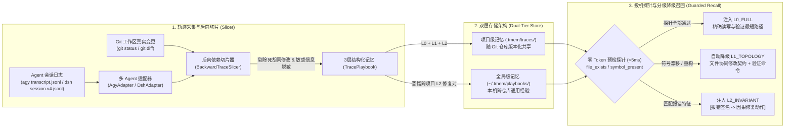

# `tmem` — 面向编程 Agent 的无感执行轨迹记忆编译器

**中文文档** | [English](./README_EN.md)

`tmem`（**Trace Memory**）是一个**零 UI、无控制面、双层架构（项目级 `.tmem/` + 全局级 `~/.tmem/`）**的编程 Agent 执行轨迹记忆插件与 CLI 工具，原生支持 **`agy` (Antigravity)**、**`@deepseek-ai/dsh` (DeepSeek Harness)**，并兼容 **`codex`**、**`opencode`**、**`pi`**。

不同于传统记忆系统记录冗长、易过期的对话文本摘要，`tmem` 将 Agent 的会话日志（`transcript.jsonl` / `session.v4.jsonl`）视为未优化的执行轨迹：以 **Git 最终落盘状态（Ground Truth）**与**最终通过的验证命令（`exit_code == 0`）**为终点，执行**确定性后向程序切片（Backward Trace Slicing）**，自动剪除所有试错弯路、废弃修改与无关扫描，编译为带预检探针（Speculative Guards）的 **L0 / L1 / L2 三层结构化记忆手册（Playbook）**。

---

## 一、核心解决的问题

1. **过程噪声极高**：Agent 解决一个复杂 Bug 往往经历 30 步探索（25 步弯路 + 5 步真正生效），全量塞入上下文既浪费 Token 又容易误导后续推理。
2. **环境漂移与记忆腐烂（Stale Memory）**：写死文件路径与行号的经验（如静态 Skill）在代码重构或换机器后会失效甚至产生反作用。
3. **无感沉淀与零管理负担**：开发者不需要打开任何 Web 面板维护记忆库；记忆随日常开发、`git commit`、里程碑达成提示或 `/tmem` 命令静默流转。

---

## 二、核心架构设计



### 1. 基于 Git Ground-Truth 的后向切片 ([`tmem/slicer.py`](file:///home/ubuntu/proj/tmem/slicer.py))
- **终点锚定**：结合 `git diff` / `git status` 提取会话结束时真正存活在磁盘上的修改文件集合，忽略中途创建后又被删除或回滚的实验性修改。
- **因果反推**：从最终 `exit_code == 0` 的测试/构建命令出发，反向保留对最终文件产生实质贡献的 `READ -> MUTATE -> ENV_EXEC(VERIFY)` 节点。
- **因果报错配对（L2 提取）**：自动捕获会话中从“命令报错（非零退出码 / Traceback）”到“修改代码或安装依赖后同命令验证通过”的最小闭环，提炼为 `[Error Signature] -> [Causal Repair] -> [Verification]`。
- **敏感信息自动脱敏 ([`scrub_secrets`](file:///home/ubuntu/proj/tmem/adapters/base.py))**：落盘前自动使用正则抹除 GitHub PAT (`github_pat_...`、`ghp_...`)、OpenAI/Anthropic/Google API Key 等密钥，杜绝隐私泄露。

### 2. 三层抽象与投机执行探针 ([`tmem/models.py`](file:///home/ubuntu/proj/tmem/models.py) & [`tmem/guards.py`](file:///home/ubuntu/proj/tmem/guards.py))
每条沉淀的 `TracePlaybook` 同时包含三层不同粒度的知识与毫秒级预检探针（`guards`）：

| 层级 | 名称 | 内容结构 | 召回条件与降级策略 |
| :--- | :--- | :--- | :--- |
| **L0** | **关键执行路径 (`L0_FULL`)** | `READ(file) -> MUTATE(file#symbol) -> ENV_EXEC(cmd)` | 仅当本地磁盘通过所有 `file_exists` 与 `symbol_present` 探针校验（耗时 `<5ms`，零 LLM 消耗）时注入，指导 Agent 跳过全仓盲搜直奔目标。 |
| **L1** | **架构协同契约 (`L1_TOPOLOGY`)** | 协同修改文件拓扑（Co-change contract）+ 必跑验证命令 | 当代码发生重构导致 L0 具体符号探针失效时，**自动屏蔽 L0 并降级注入 L1**，防止过时代码细节误导 Agent，同时保留架构级防漏改提醒。 |
| **L2** | **跨环境排障不变量 (`L2_INVARIANT`)** | `报错特征签名 -> 最小修复动作 -> 验证命令` | 当工具执行触发同类报错或跨项目检索命中报错签名时立即注入，具备极强的跨环境可移植性。 |

### 3. 项目级 + 全局级双层存储 ([`tmem/store.py`](file:///home/ubuntu/proj/tmem/store.py))
- **项目级记忆（`<repo>/.tmem/traces/*.json`）**：
  - 随 Git 仓库提交（单条记忆一个独立短 Hash JSON 文件，如 `tr_30fa71c60d.json`，多人协作 `git merge` 零冲突）。
  - 团队成员 `git clone` / `git pull` 后，本地 Agent 立即获得该项目的架构拓扑与历史排障经验。
- **全局级记忆（`~/.tmem/playbooks/*.json`）**：
  - 存储脱敏项目私有路径后的通用工具链、依赖冲突、编译器报错修复经验（L2 Invariants），跨仓库共享。

---

## 三、多 Agent 无感插件机制

执行 `python3 -m tmem.cli init --agents agy,dsh` 后，`tmem` 会在当前工作区与全局环境自动完成隐形挂载：

### 1. Antigravity (`agy`) 原生接入
- **插件目录**：[`.agents/plugins/tmem/`](file:///home/ubuntu/proj/.agents/plugins/tmem)
  - [`hooks.json`](file:///home/ubuntu/proj/.agents/plugins/tmem/hooks.json)：挂载 `PreInvocation`（新对话投机召回 + `/tmem` 命令拦截 + 里程碑提示）与 `PostToolUse`（追踪文件修改、测试通过与报错签名）。
  - [`rules/AGENTS.md`](file:///home/ubuntu/proj/.agents/plugins/tmem/rules/AGENTS.md)：指导 Agent 消费 `<tmem_speculative_memory>` 并在达成目标后主动询问是否沉淀记忆。
  - [`skills/tmem/SKILL.md`](file:///home/ubuntu/proj/.agents/plugins/tmem/skills/tmem/SKILL.md)：支持自然语言请求沉淀记忆。

### 2. DeepSeek Harness (`@deepseek-ai/dsh`) 原生接入
- **支持 `dsh plugin add` 官方协议一键安装**：
  ```bash
  dsh plugin add github:kentzjh-cmd/tmem
  ```
- **Cordis 运行时插件**：[`tmem/dsh_plugin.mjs`](file:///home/ubuntu/proj/tmem/dsh_plugin.mjs)（通过 [`package.json`](file:///home/ubuntu/proj/package.json) `dsh.bundle` 与 [`cordis.patch.yml`](file:///home/ubuntu/proj/cordis.patch.yml) 自动导出）
  - **动态工作区感知**：自动通过 `@deepseek-ai/dsh-working-directory` 服务或 `session.header.cwd` 解析当前会话所属项目根目录，无需硬编码路径。
  - **`agent/pre-step` 钩子**：在每轮推理前静默召回 `<tmem_speculative_memory>` 并注入消息上下文。
  - **`tools/post-execute` 钩子**：追踪 `read`、`write`、`edit`、`str_replace_editor`、`apply_patch` 及 `bash`/`pwsh` 的 `[exit code: N]`，在报错时即时通过 `additionalContexts` 注入 L2 修复提示，在 `修改 -> 测试通过` 时注入 `<tmem_milestone_reached>`。
  - **原生 `/tmem` 命令注册**：通过 `@deepseek-ai/dsh-commands` 的 `commands.register` 原生注册 `/tmem [project|global|both|status|list|forget|gc]` 命令。
- **会话日志解析 ([`tmem/adapters/dsh.py`](file:///home/ubuntu/proj/tmem/adapters/dsh.py))**：原生解析 `$DSH_HOME/sessions/<id>/session.v4.jsonl`（兼容 `v3` 与 `session.jsonl`），支持多文件 `apply_patch` 补丁拆解。

---

## 四、记忆沉淀的三种触发方式

1. **达成目标后 Agent 自主提示（Milestone Prompting）**
   当 `tmem` 监测到当前会话完成了 **“修改代码 (`MUTATE`) $\rightarrow$ 运行测试/构建验证通过 (`VERIFY exit 0`)”** 的里程碑闭环时，会自动提示 Agent 在回复末尾附带一行轻量询问：
   > 💡 *是否需要将本次有效执行路径沉淀为记忆？（可输入 `/tmem project` 存项目级、`/tmem global` 存全局级、或 `/tmem both` 同时保存）*
2. **`/tmem` 斜杠命令直达（支持指定层级與自定义意图）**
   - `/tmem` 或 `/tmem project [可选备注]`：切片当前会话并保存至项目级 `.tmem/traces/`。
   - `/tmem global [可选备注]`：切片并蒸馏保存至全局级 `~/.tmem/playbooks/`。
   - `/tmem both [可选备注]`：同时保存至项目级与全局级。
   - `/tmem status`：查看当前项目级与全局级记忆库统计。
   - `/tmem list [project|global|both]`：列出所有已沉淀轨迹及其当前探针生效层级（`L0_FULL` / `L1_TOPOLOGY` / `L2_INVARIANT`）。
   - `/tmem forget <trace_id>`：按 ID 或前缀一键删除指定记忆轨迹。
   - `/tmem gc`：运行预检探针代谢检查，自动标记失效的 L0 路径。
3. **Git 提交自动兜底（`.git/hooks/post-commit`）**
   每次执行 `git commit` 时，后台静默触发 `tmem capture --scope auto --quiet`，自动完成增量轨迹切片与落盘。

---

## 五、快速开始与 CLI 手册

### 1. 初始化项目
```bash
# 在当前 Git 仓库初始化 .tmem/、~/.tmem/，并安装 agy + dsh 隐形插件与 git post-commit 钩子
python3 -m tmem.cli init --agents agy,dsh
```

### 2. 常用 CLI 命令
```bash
# 查看项目级 (.tmem) 与全局级 (~/.tmem) 记忆统计
python3 -m tmem.cli status

# 手动从最新会话日志切片并沉淀记忆（支持 --agent agy|dsh|codex|opencode|pi 与 --scope project|global|both|auto）
python3 -m tmem.cli capture --agent dsh --scope both

# 按问题意图、关联文件或报错签名检索记忆（自动执行 <5ms 探针校验与 L0/L1/L2 分级）
python3 -m tmem.cli lookup "ZeroDivisionError" --file src/billing.py

# 运行探针代谢垃圾回收（检查代码重构后哪些 L0 探针已漂移）
python3 -m tmem.cli gc
```

### 3. 运行端到端（E2E）测试套件
```bash
PYTHONPATH=. python3 -m unittest discover -s tests -v
```

---

## 六、目录结构

```text
tmem/
├── pyproject.toml                 # Python 包定义与 `tmem` CLI 入口配置
├── README.md                      # 中文架构与使用文档
├── README_EN.md                   # 英文文档
├── AGENTS.md                      # Agent 记忆消费与里程碑提示协议规则
├── tmem/
│   ├── models.py                  # ActionNode IR、GuardProbe 探针与 TracePlaybook 三层数据模型
│   ├── slicer.py                  # Git Ground-Truth 后向依赖切片器 (BackwardTraceSlicer)
│   ├── guards.py                  # <5ms 零 Token 预检探针校验与 L0->L1->L2 降级格式化器
│   ├── store.py                   # 项目级 (.tmem/) + 全局级 (~/.tmem/) 双层存储与级联检索
│   ├── cli.py                     # CLI 入口、/tmem 命令解析、里程碑检测与插件安装器
│   ├── dsh_plugin.mjs             # @deepseek-ai/dsh 原生 Cordis 插件源码
│   └── adapters/
│       ├── base.py                # 统一会话协议、报错签名提取、符号提取与密钥脱敏
│       ├── agy.py                 # Antigravity (agy) transcript.jsonl 原生适配器
│       └── dsh.py                 # DeepSeek Harness (dsh) session.v4.jsonl & apply_patch 适配器
└── tests/
    ├── test_tmem_e2e.py           # 核心后向切片、双层存储、探针降级与 agy 钩子 E2E 测试
    └── test_dsh_e2e.py            # @deepseek-ai/dsh v4 解析与真机 Cordis 运行时 E2E 测试
```
