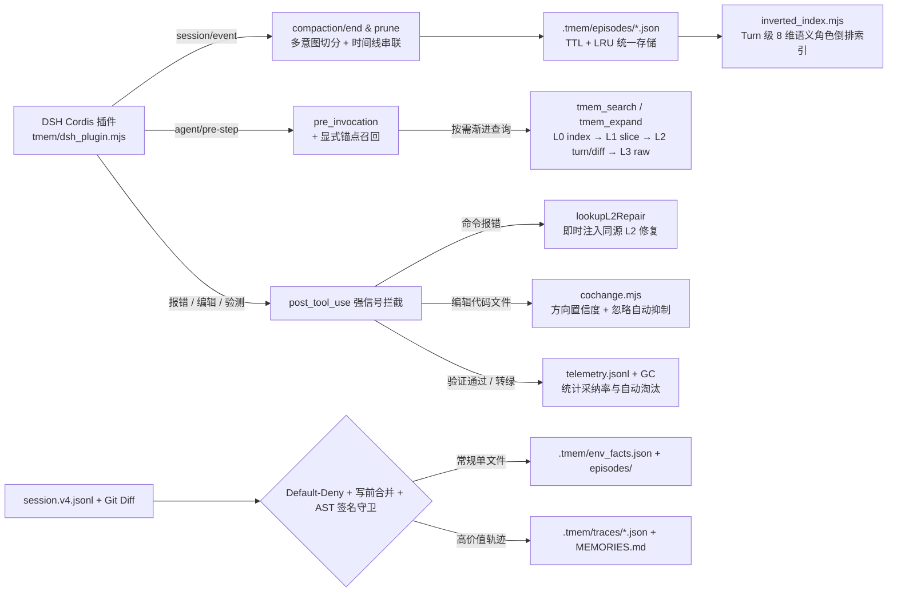

# `tmem` — 面向 DeepSeek Harness (`dsh`) 的上下文压缩切片与确定性工程记忆引擎

**中文文档** | [English](./README_EN.md)

<p align="center">
  
</p>

`tmem`（**Trace Memory**，npm 包名 [`dsh-tmem`](https://www.npmjs.com/package/dsh-tmem)）是一个**零外部依赖、聚焦 `@deepseek-ai/dsh` (DeepSeek Harness)、仓库级（`.tmem/`）**的**上下文压缩切片 + 倒排索引渐进式记忆与确定性工程 Trace 引擎**。

---

## 一、产品理念与设计思路（Why `tmem` & Design Philosophy）

在长期使用 Coding Agent 研发与维护代码仓库的过程中，传统的 **LLM 语义记忆** 与 **原生上下文压缩（Compaction）** 存在四个根本矛盾：

1. **用 LLM 总结记忆的“记忆税”与玄学失真**：每轮靠模型重写自然语言摘要既持续消耗 Token，又会在多次覆写后丢失精确的符号名、边界条件与报错堆栈——总结越精炼，工程上最关键的细节越容易变成不可验证的“玄学”。
2. **上下文压缩后的结构性失忆**：当对话触发 `compact` 或超长工具输出被截断（Prune）时，早期定下的架构约束、精确修改 Diff 以及数万字测试日志中段的根因报错会被折叠或抹去，Agent 往往只能重新全盘读仓或重复踩坑。
3. **无锚点模糊检索污染日常上下文**：若对每条用户输入都做语义相似度召回并强行塞入 Prompt，普通问答与无关任务会被历史噪声干扰（“记忆越多，推理越乱”）。
4. **代码演进导致的“毒记忆”反噬**：代码一旦重构或函数签名变更，旧记忆里写死的路径与修改经验如果继续盲目作为强指引注入，反而会误导模型写出失效代码。

针对这四个问题，`tmem` 建立了一套**“事实锚定、压缩即切片、倒排渐进披露、探针自检代谢”**的工程记忆设计逻辑：

### 1. 事实锚定，拒绝 LLM 语义重写（Fact-Anchored, Zero-LLM Summarization）
> 历史会话中的每一次 `Read → Edit → Error → Repair → Verify`，本身就是用真实 Token 换来的高确定性事实轨迹，不应在压缩时被二次改写丢弃。

`tmem` 不在后台调用 LLM“总结/维护记忆”，而是通过 **确定性逆向程序切片（Backward Trace Slicing）** 与 Git/AST 事实对齐，以 **0 Summarization Token** 编译结构化轨迹：剔除死胡同读、回滚撤销前的无效改动和末次验证通过后的悬空试探编辑，只保留因果闭合的关键路径。

### 2. 压缩与记忆融合：压缩即切片，记忆服务于压缩后无损回放（Compaction-Memory Fusion）
> 压缩（Compact）负责为当前工作窗口减负，记忆（`tmem`）负责把被折叠的轨迹切片封存并留下精确检索的路标。

- **无缝接管压缩时刻**：监听 DSH 宿主 `session/event`（`compaction/summary`、`compaction/end`、`compaction/prune`），在会话压缩或超长日志截断发生的瞬间，零感知归档完整阶段切片（`SessionEpisode`）；若单次压缩跨越 `git commit` 或多个不相交模块簇，自动切分为高内聚子切片，并串联跨多轮 Compact 的时间线（`#1 -> #2 -> #3`）。
- **双轨沉淀分离噪音与长效资产**：
  - **`.tmem/episodes/`（会话阶段切片池，Git 忽略）**：遵循“全留存不丢探索”原则，完整记录每一阶段压缩/捕获的回合大纲、关键约束决策、精确 Diff 与原始工具输出（含被 Pruner 截断的中段日志），通过 30 天 TTL + 200MB LRU 自动代谢。
  - **`.tmem/traces/` + `MEMORIES.md`（团队共享剧本库，可入库）**：经过 Default-Deny 价值门槛筛选的多文件/有 L2 因果修复的高价值 Playbook，供团队与跨会话共享复用。

### 3. 倒排索引取代语义维护，L0 → L3 渐进式披露（Inverted-Index Progressive Disclosure）
> 与其让 LLM 不断维护一份“越来越糊的散文记忆”，不如像搜索引擎一样按**关键字 + 代码标识符 + 语义角色层级**建立可精确定位的倒排索引。

- **Turn 级 8 维角色倒排索引**：在内置 SQLite（`index.db`）中按 `intent`、`error`、`decision`、`symbol`、`file`、`command`、`diff`、`raw_output` 8 种语义角色权重建立 Turn 粒度（`turn_idx` + `seq_from..seq_to`）倒排表，支持中英文混合分词、驼峰/蛇形标识符拆解与同回合局部共现加分。
- **L0 → L3 按需展开金字塔**：
  - **L0（极简路标）**：压缩后仅在 `<compact-checkpoint>` 旁注入紧凑的 `<tmem_compacted_index>` 路标，或由模型通过 `tmem_search` 命中最匹配的 Episode / Turn 坐标；
  - **L1（结构切片）**：`tmem_expand(level="slice")` 展开阶段意图、关键决策约束、Turn 目录、关键路径与 L2 修复对；
  - **L2（回合 / Diff 详情）**：`tmem_expand(level="turn" | "diff")` 查看具体回合对话、动作输出或代码补丁；
  - **L3（全量原始取证）**：`tmem_expand(level="raw", query=...)` 按关键词窗口定位并回放被截断的万字日志或完整原始轨迹。

### 4. 运行时强信号拦截与 Guard 自检代谢（Guard Verification & Self-Metabolism）
> 宁可静默零注入，也不做低置信度猜测；记忆在注入前必须先过本地结构化体检。

- **只在强信号时刻出声**：`agent/pre-step` 对泛自然语言提示词保持 **0.0% 误注入**，仅在新会话首轮注入验证过的构建/测试命令（`.tmem/env_facts.json`）、新压缩点注入 `<tmem_compacted_index>`、或用户输入明确点名文件/报错类型时触发精准召回；`tools/post-execute` 在命令报错时即时推送 L2 同源修复，在编辑源码后推送基于方向置信度的 L1 共变搭档提醒（且若连续 3 次被忽略则自动抑制降噪）。
- **AST 签名级防漂移降级**：每次注入 Playbook 前用 `<5ms` 执行本地 Guard 校验（文件存在性、`symbol_present`、多语言函数参数 `signature_match`）。一旦函数签名重构，自动将 `L0_FULL` 降级为 `L1_TOPOLOGY` / `L2_INVARIANT`，屏蔽过时路径并保留方法论与报错因果。

---

## 二、系统架构与工作原理



1. **压缩切片与倒排渐进披露引擎**（[`tmem/episodes.mjs`](./tmem/episodes.mjs)、[`tmem/inverted_index.mjs`](./tmem/inverted_index.mjs)、[`tmem/dsh_tools.mjs`](./tmem/dsh_tools.mjs)）：
   - **非侵入式 DSH 宿主挂载**：通过宿主 `session/event` 拦截 `compaction/summary`、`compaction/end`、`compaction/prune`，兼容 DSH CLI / Headless / Web Presets（即使压缩插件运行在隔离 preset 组内）；同时向 DSH 注册 `tmem_search` 与 `tmem_expand` 模型工具及系统提示引导段。
   - **多意图切分与时间线串联**：跨 `git commit` 边界或不相交文件模块簇自动拆分为高内聚子切片，并在 `.tmem/episodes/` 中维护同会话 `prev_episode_id` / `phase_index` 链条。
   - **8 维角色加权倒排检索**：纯内置 SQLite 持久化 `inverted_postings`，结合 IDF、角色权重与同 Turn 局部共现打分，支持超长输出居中窗口回放及 Playbook→Episode 无缝桥接展开。
2. **DSH 热路径瘦身与强信号即时拦截**（[`tmem/dsh_plugin.mjs`](./tmem/dsh_plugin.mjs)、[`tmem/hooks/dsh.mjs`](./tmem/hooks/dsh.mjs)）：
   - **进程内零冷启动**：基于纯 Node.js ESM 实现，DSH Cordis 插件进程内直调钩子逻辑；`agent/pre-step` 自动识别新落盘 `compact-checkpoint` 注入 `<tmem_compacted_index>` 路标，同输入常规推理步直接放行；`tools/post-execute` 跳过常规 `read`/`grep`/`glob`。
   - **实时拦截与遥测闭环**：报错时通过 `lookupL2Repair` 即时注入同源 L2 修复动作；修改源码文件后基于方向性 Git/Trace 共变统计（叠加 `.git/HEAD` 缓存与基于遥测的自动抑制）注入 `<tmem_cochange_hint>`，并在 `.tmem/telemetry.jsonl` 记录转绿率与采纳率。
3. **时间因果切片（Phase 2）、AST 签名守卫与双轨 GC**（[`tmem/slicer.mjs`](./tmem/slicer.mjs)、[`tmem/guards.mjs`](./tmem/guards.mjs)、[`tmem/store.mjs`](./tmem/store.mjs)）：
   - **时间因果图 + 尾部裁剪**：剔除语法拒改重试、`rm`/`git checkout|restore|reset` 销毁屏障前失效操作、临时复现脚本及末次通过 `VERIFY_GATE` 后的未验证试探性编辑（后者保留于 Episode `raw` 层取证）。
   - **多语言结构化 AST 解析与 `signature_match`**：[`tmem/ast_parser.mjs`](./tmem/ast_parser.mjs) 提取文件符号与参数签名指纹，写前去重合并防膨胀，支持 `tmem gc --prune` 代谢漂移条目及双轨生命周期管理。

---

## 三、快速开始（Node.js 版本）

> 运行环境要求：**Node.js >= 22.5.0**（使用内置 `node:sqlite` FTS5，零外部 npm 依赖，无需 Python；原始 Python 版本归档于 `python` 分支）。

### 安装与初始化
```bash
npm install -g dsh-tmem                       # 或 git clone 后执行 npm link
tmem init                                     # 初始化 .tmem/、安装 DSH Cordis 插件与 git post-commit hook
dsh plugin add npm:dsh-tmem                   # 或通过 dsh plugin add github:kentzjh-cmd/tmem 安装
npm test                                      # 运行 node --test 完整测试套件（50/50）
npm run verify:benchmarks                     # 运行基准回归门禁、报告校验与 README 同步校验
```

### 常用 CLI 与 DSH Slash / 工具
```bash
tmem status                                      # 查看 Playbook、Episode 与实时遥测统计
tmem telemetry                                   # 查看 L2 纠偏率与 L1 共变采纳率明细
tmem capture --agent dsh                         # 同步归档 Episode 至 .tmem/episodes/ 并编译高价值 Playbook
tmem search "jwt_guard.ts leewaySec"             # 多维倒排索引检索（支持 --files / --symbols / --errors / --roles）
tmem episodes --session <id>                     # 列出已归档的压缩阶段切片与时间线
tmem expand <episode_id> --level slice           # 渐进展开：index (L0) -> slice (L1) -> turn / diff (L2) -> raw (L3)
tmem lookup "TypeError" --file src/validator.py  # 本地 Playbook 检索 + 探针校验 + 分级预览
tmem inspect <trace_id> --level playbook         # 查看三层 Playbook 详情
tmem sync                                        # 校验探针并刷新 MEMORIES.md
tmem gc --prune                                  # 校验 Guard 漂移，并按 --max-episodes-mb / --max-episode-days 清理缓存
```

在 DSH 会话内，模型可直接调用已注册工具 **`tmem_search`** 与 **`tmem_expand`**，用户也可使用斜杠命令 **`/tmem [status|search|episodes|expand|list|inspect|replay|diff|sync|gc|forget|telemetry|evaluate]`**。

---

## 四、真实评测结果（Empirical Benchmarks）

所有脚本与数据均可在 `benchmarks/` 下复现（CI 通过 `node scripts/verify_benchmarks.mjs` 自动校验回归阈值、报告文件与文档表格一致性）：

### 1. 上下文压缩后倒排渐进恢复基准（`eval_compact_recall.mjs`）
复现命令：`node benchmarks/eval_compact_recall.mjs`（[评测脚本](./benchmarks/eval_compact_recall.mjs)）：

覆盖 4 类典型“压缩/截断后遗忘”场景（早期架构约束召回、18KB 被截断工具日志中段根因定位、多意图分簇与跨轮时间线串联、精确 Diff 恢复 + 尾部未验证编辑裁剪 + AST `signature_match` 守卫）：
- **关键细节召回率**：原生 Compact 摘要 + Prune 基线 **0.0%**（`0/4`）→ `Compact + tmem` 倒排渐进披露 **100.0%**（`4/4`）
- **上下文 Token 节省率**：L0 索引路标注入 **91.6%**（`7,157 tok` → `603 tok`）；L0 + 按需 L1/L2 定向展开总节省 **87.0%**（`933 tok`）
- **平均检索 / 展开延迟**：单次倒排检索 **~6 ms**，按需层级展开 **< 10 ms**

### 2. DSH 端到端强信号回放与遥测评测
复现命令：`node benchmarks/eval_dsh_e2e.mjs`（[评测脚本](./benchmarks/eval_dsh_e2e.mjs)）：
- **端到端交互步数精简**：**37.5%**（8 步试错基线 → 5 步完成）
- **运行时遥测命中收益**：L2 报错修复转绿率 **100%**（`1/1`），L1 共变提醒采纳率 **100%**（`1/1`）
- **泛自然语言负例误注入率**：**0.0%**（10 条无代码/报错锚点的日常对话均保持静默）
- **Cordis 插件热路径耗时**：21 次高频事件（6 轮 `agent/pre-step` + 15 次只读 `tools/post-execute`）总耗时 **~5 ms**（纯 Node.js ESM 进程内直调，零子进程冷启动）

### 3. 时间因果切片与 50 轨迹 LLM 盲测评审
复现命令：`node benchmarks/eval_slicing_fidelity.mjs --gold-path benchmarks/gold/gold_annotations_50.json` 与 `node benchmarks/eval_llm_judge.mjs`（[50 轨迹盲测报告](./benchmarks/runs/llm_judge_50_report.json) / [Gold-50 标注集](./benchmarks/gold/gold_annotations_50.json)）：

在扩展至 **50 条高质量真实轨迹**（原有 25 条 SWE-bench/DSH + 从 `sailplane/swe-agent-trajs` 筛选的 25 条 `resolved=True` 多仓库修复轨迹）上，由 5 组独立 LLM 盲测评审对随机打乱的 A/B 切片结果打分：

| 切片策略 | Precision (精确率) | Recall (召回率) | F1-Score | 平均保留步数 | LLM 盲测综合分 (1–5) |
|---|:---:|:---:|:---:|:---:|:---:|
| **B0 简单基线（修改文件 + 终测）** | 81.1% | 66.5% | 71.4% | 4.7 步 | 3.20 |
| **B1 `tmem` Phase 1 时间因果切片** | **93.8%** | **95.0%** | **93.6%** | 5.1 步 | **4.80**（成对胜率 **49:1 / 98.0%**） |
| **B2 Oracle 上限（LLM Gold-50 标注）** | 98.0% | 98.0% | 98.0% | 5.0 步 | — |

> **诚实局限**：在极少数样本（如 `sympy__sympy-22005`）中，若 Agent 在最后一次通过测试之后又编辑了测试文件却未再运行验证，Phase 1 默认切片在离线无 Git 状态下仍会保留该末尾未验证修改（`v0.4.0` 已在 Episode / Slicer Phase 2 中提供 `pruneTrailingUnverified` 裁剪开关予以覆盖）；在原始 25 标注集（`benchmarks/gold/gold_annotations.json`，复现命令：`node benchmarks/eval_slicing_fidelity.mjs --gold-path benchmarks/gold/gold_annotations.json`）基准评测中，B1 Precision 亦已从 63.2% 提升至 92.3%（F1 81.8% > B0 81.0%）。

### 4. 50 轨迹规模压力测试与独立检索评测
复现命令：`node benchmarks/eval_plugin_scale.mjs`（[规模报告](./benchmarks/runs/plugin_scale_50_report.json)）与 `node benchmarks/eval_retrieval.mjs`（[检索日志](./benchmarks/runs/retrieval_report.json)）：
- **50 轨迹全量压缩入库**：50 条编译为 **49** 条 Playbook（自动过滤空变更 `pytest-dev__pytest-7168`），原始 **898 步 → L0 157 步**（步数精简 **82.5%**，字符体积压缩 **94.8%**），纯 Node.js 单条切片耗时在毫秒级。
- **`handleDshHook` 规模运行验证**：49 条库规模下 `pre_step` 负例误注入 **0.0%**（`0/10`）、显式锚点召回 **100.0%**（`48/48`）；`post_tool_use` L2 同源报错拦截与验证转绿率 **100.0%**（`7/7`）。
- **独立原始 Issue 检索**：24 条含原始需求文本的样本在 `eval_retrieval.mjs` 取得 **Recall@1 = 100.0% / Recall@3 = 100.0% / MRR = 1.0**，词边界与词元覆盖率门控生效后 **负例误召回率降至 0.0%**（49 条全库压力下 FTS5 负例误召回 **10.0%**，且已被 `pre_step` 显式锚点策略兜底为 **0.0%**）。

### 5. 跨格式轨迹压缩与运行时开销评测（9 条真实轨迹）
复现命令：`node tmem/cli.mjs evaluate`：
- **L0 步骤精简率**：**56.5%**（106 步 → 43 步，5,406 → 1,480 字符，~1,348 tok → ~367 tok）
- **高熵 L2 因果修复对**：**8 组**（经同源验证命令与堆栈交集双重校验）
- **平均确定性切片耗时**：**0.88 ms**（零外部依赖与零 LLM Token 耗时）

---

## 五、设计边界与局限

1. **只聚焦 DSH 单一运行时**：主动裁剪了多宿主并行维护成本，全部运行时能力围绕 `@deepseek-ai/dsh` `session.v4.jsonl`、宿主 `session/event` 与 Cordis 生命周期打磨（保留 `swe_bench` 适配器仅用于离线评测）。
2. **启发式切片非形式化推导**：基于 Git 落盘、纯 Node 多语言结构化 AST 解析（[`tmem/ast_parser.mjs`](./tmem/ast_parser.mjs)，支持 Python / JS / TS / Go / Rust 等）和退出码反推，不构建完整跨文件调用图与数据流分析。
3. **探针聚焦存在性与签名指纹**：已通过 `signature_match` 检查函数参数列表稳定性；若函数签名未变而内部逻辑重构，仍需依赖终端验证命令确认结果。

---

## License

MIT
