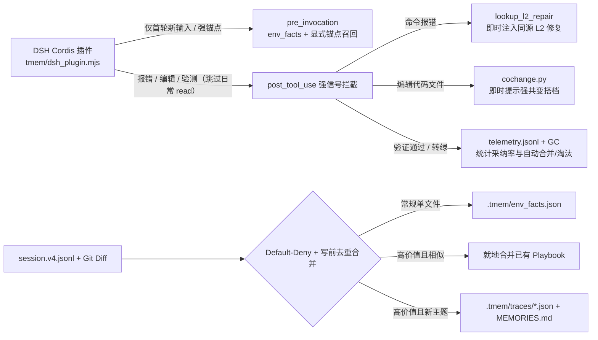

# `tmem` — 面向 DeepSeek Harness (`dsh`) 的仓库级确定性工程记忆引擎

**中文文档** | [English](./README_EN.md)

<p align="center">
  
</p>

`tmem`（**Trace Memory**）是一个**零外部依赖、聚焦 `@deepseek-ai/dsh` (DeepSeek Harness)、仓库级（`.tmem/`）**的确定性工程记忆与**历史会话零 Token 摘要引擎**。

它对 DSH 历史执行轨迹进行确定性裁剪与回放归纳：在不消耗任何 LLM Summarization Token 的前提下，将冗长会话压缩为面向**特定需求（Intent）与实际行为（Read → Edit → Repair → Verify）**的免费结构化摘要，并**内联保留原始历史 `session_id` 溯源链路**；同时在 DSH 运行时提供强信号拦截（报错即时注入 L2 同源修复、改代码文件即时提醒 L1 统计共变、累计 `.tmem/env_facts.json` 环境事实），关闭对泛自然语言 Prompt 的低质量猜测注入。

---

## 一、真实评测结果（Empirical Benchmarks）

所有脚本与数据均可在 `benchmarks/` 下复现（CI 通过 `python3 scripts/verify_benchmarks.py` 自动校验回归阈值、报告文件与文档表格一致性）：

### 1. DSH 端到端强信号回放与遥测评测
复现命令：`python3 benchmarks/eval_dsh_e2e.py`（[评测脚本](./benchmarks/eval_dsh_e2e.py)）：
- **端到端交互步数精简**：**37.5%**（8 步试错基线 → 5 步完成）
- **运行时遥测命中收益**：L2 报错修复转绿率 **100%**（`1/1`），L1 共变提醒采纳率 **100%**（`1/1`）
- **泛自然语言负例误注入率**：**0.0%**（10 条无代码/报错锚点的日常对话均保持静默）
- **Cordis 插件热路径耗时**：21 次高频事件（6 轮 `agent/pre-step` + 15 次只读 `tools/post-execute`）总耗时 **116.66 ms**（免除重复 `python3` 冷启动）

### 2. 时间因果切片与 50 轨迹 LLM 盲测评审
复现命令：`python3 benchmarks/eval_slicing_fidelity.py --gold-path benchmarks/gold/gold_annotations_50.json` 与 `python3 benchmarks/eval_llm_judge.py`（[50 轨迹盲测报告](./benchmarks/runs/llm_judge_50_report.json) / [Gold-50 标注集](./benchmarks/gold/gold_annotations_50.json)）：

在扩展至 **50 条高质量真实轨迹**（原有 25 条 SWE-bench/DSH + 从 `sailplane/swe-agent-trajs` 筛选的 25 条 `resolved=True` 多仓库修复轨迹）上，由 5 组独立 LLM 盲测评审对随机打乱的 A/B 切片结果打分：

| 切片策略 | Precision (精确率) | Recall (召回率) | F1-Score | 平均保留步数 | LLM 盲测综合分 (1–5) |
|---|:---:|:---:|:---:|:---:|:---:|
| **B0 简单基线（修改文件 + 终测）** | 81.1% | 66.5% | 71.4% | 4.7 步 | 3.20 |
| **B1 `tmem` Phase 1 时间因果切片** | **93.8%** | **95.0%** | **93.6%** | 5.1 步 | **4.80**（成对胜率 **49:1 / 98.0%**） |
| **B2 Oracle 上限（LLM Gold-50 标注）** | 98.0% | 98.0% | 98.0% | 5.0 步 | — |

> **诚实局限**：在极少数样本（如 `sympy__sympy-22005`）中，若 Agent 在最后一次通过测试之后又编辑了测试文件却未再运行验证，`tmem` 在离线无 Git 状态下仍会保留该末尾未验证修改；在原始 25 标注集（`benchmarks/gold/gold_annotations.json`，复现命令：`python3 benchmarks/eval_slicing_fidelity.py --gold-path benchmarks/gold/gold_annotations.json`）基准评测中，B1 Precision 亦已从 63.2% 提升至 92.3%（F1 81.8% > B0 81.0%）。

### 3. 50 轨迹规模压力测试与独立检索评测
复现命令：`python3 benchmarks/eval_plugin_scale.py`（[规模报告](./benchmarks/runs/plugin_scale_50_report.json)）与 `python3 benchmarks/eval_retrieval.py`（[检索日志](./benchmarks/runs/retrieval_report.json)）：
- **50 轨迹全量压缩入库**：50 条编译为 **49** 条 Playbook（自动过滤空变更 `pytest-dev__pytest-7168`），原始 **898 步 → L0 157 步**（步数精简 **82.5%**，字符体积压缩 **94.7%**），平均单条切片 **0.82 ms**，`MEMORIES.md` 全量原子同步 **6.98 ms**。
- **`handle_dsh_hook` 规模运行验证**：49 条库规模下平均 Hook 延迟 **8.79 ms**；`pre_step` 负例误注入 **0.0%**（`0/10`）、显式锚点召回 **100.0%**（`48/48`）；`post_tool_use` L2 同源报错拦截与验证转绿率 **100.0%**（`7/7`）。
- **独立原始 Issue 检索**：24 条含原始需求文本的样本在 `eval_retrieval.py` 取得 **Recall@1 = 100.0% / Recall@3 = 100.0% / MRR = 1.0**，词边界与词元覆盖率门控生效后 **负例误召回率降至 0.0%**（49 条全库压力下 FTS5 负例误召回 **10.0%**，且已被 `pre_step` 显式锚点策略兜底为 **0.0%**）。

### 4. 跨格式轨迹压缩与运行时开销评测（9 条真实轨迹）
复现命令：`python3 -m tmem.evaluate`：
- **L0 步骤精简率**：**56.5%**（106 步 → 43 步，5,406 → 1,480 字符，~1,348 tok → ~367 tok）
- **高熵 L2 因果修复对**：**8 组**（经同源验证命令与堆栈交集双重校验）
- **平均确定性切片耗时**：**0.88 ms**（零外部依赖与零 LLM Token 耗时）

---

## 二、工作原理与核心机制



1. **DSH 热路径瘦身与强信号即时拦截**（[`tmem/dsh_plugin.mjs`](./tmem/dsh_plugin.mjs)、[`tmem/hooks/dsh.mjs`](./tmem/hooks/dsh.mjs)）：
   - **进程内零冷启动**：基于纯 Node.js ESM 实现，DSH Cordis 插件进程内直调钩子逻辑，彻底免除子进程冷启动开销；`agent/pre-step` 对同输入后续推理步直接放行，`tools/post-execute` 跳过常规 `read`/`grep`/`glob`；
   - **降级泛猜测**：`pre_invocation` 不再拿自然语言做模糊 BM25 猜测，仅在首轮注入 `env_facts` 或命中显式文件路径/报错名时召回；
   - **实时拦截**：报错时通过 `lookupL2Repair` 即时注入经过同源验证的 L2 修复动作；修改源码文件后基于 Git/Trace 统计共变即时注入 `<tmem_cochange_hint>`。
2. **时间因果切片、写前合并与漂移淘汰**（[`tmem/slicer.mjs`](./tmem/slicer.mjs)、[`tmem/store.mjs`](./tmem/store.mjs)）：
   - **时间因果图裁剪**：识别并剔除语法拒改重试、`rm`/`git checkout|restore|reset` 销毁回滚屏障前失效操作、独立临时复现脚本及写后悬空读；拆分持续有效的 `ENV_INSTALL` 与最新 epoch `VERIFY_GATE`（过滤 `|| true` 伪通过命令并支持 `PYTHONPATH=.` 等环境前缀）；
   - **符号归因与词边界检索**：基于 `git diff -U0` + 纯 Node 多语言结构化解析（[`tmem/ast_parser.mjs`](./tmem/ast_parser.mjs)）精准归因修改符号，默认拒绝单文件无修复常规修改，并将触发器检索收紧为 `len >= 4` 词边界匹配；
   - **写前合并与 Guard 漂移淘汰**：同 L2/高重合度自动就地合并防止 `.tmem/traces/` 膨胀，`tmem gc --prune` 清理长期漂移且无 L2 价值的过期条目。
3. **真实收益遥测闭环**（[`tmem/telemetry.mjs`](./tmem/telemetry.mjs)）：
   - 记录每次 L2 注入后下轮同源命令是否转绿、以及 L1 共变提示后是否读/改了目标搭档文件，通过 `tmem telemetry` 或 `tmem status` 量化真实采纳率。

---

## 三、快速开始（Node.js 分支版本）

> 运行环境要求：**Node.js >= 22.5.0**（使用内置 `node:sqlite` FTS5，零外部 npm 依赖，无需 Python）。

### 安装与初始化
```bash
npm link                                      # 链接全局 `tmem` CLI（零外部依赖，免构建直接运行）
tmem init                                     # 初始化 .tmem/、安装 DSH Cordis 插件与 git post-commit hook
dsh plugin add github:kentzjh-cmd/tmem#node   # 或直接通过 dsh 安装 node 分支插件
npm test                                      # 运行 node --test 完整测试套件
```

### 常用命令
```bash
tmem status                                      # 查看当前仓库记忆、探针与实时遥测统计
tmem telemetry                                   # 查看 L2 纠偏率与 L1 共变采纳率明细
tmem capture --agent dsh                         # 从最新 DSH 会话切片并合并/保存到 .tmem/
tmem lookup "TypeError" --file src/validator.py  # 本地检索 + 探针校验 + 分级预览
tmem inspect <trace_id> --level playbook         # 查看三层 Playbook 详情
tmem sync                                        # 校验探针并刷新 MEMORIES.md
tmem gc --prune                                  # 校验 Guard 漂移并清理已失效且无 L2 的记忆
```

---

## 四、设计边界与局限

1. **只聚焦 DSH 单一运行时**：主动裁剪了多宿主并行维护成本，全部运行时能力围绕 `@deepseek-ai/dsh` `session.v4.jsonl` 与 Cordis 生命周期打磨（保留 `swe_bench` 适配器仅用于离线评测）。
2. **启发式切片非形式化推导**：基于 Git 落盘、Python AST 顶级符号和退出码反推；非 Python 文件暂仅做文件级与测试命令校验。
3. **探针仅覆盖浅层存在性**：检查文件与符号是否存在，若函数签名未变但内部逻辑重构，仍需依赖终端验证命令确认结果。

---

## License

MIT
