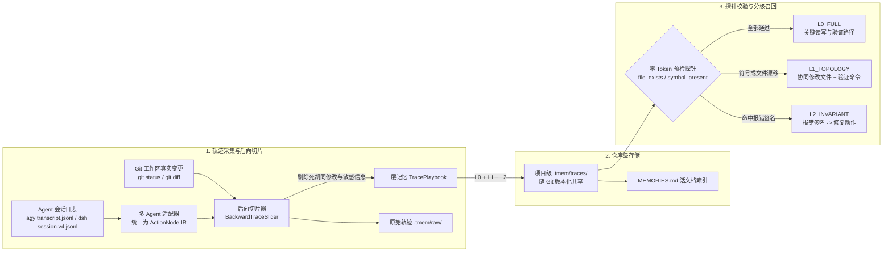
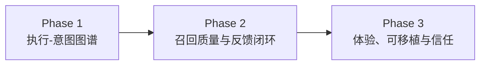

# `tmem` — 面向编程 Agent 的执行轨迹切片过滤器与 Playbook 提炼工具

**中文文档** | [English](./README_EN.md)

`tmem`（**Trace Memory**）是一个**零外部依赖、零 UI、严格代码仓库作用域（`.tmem/`）**的编程 Agent 执行轨迹切片过滤插件与 CLI 工具。原生集成 **`agy` (Antigravity)** 与 **`@deepseek-ai/dsh` (DeepSeek Harness)**，并可解析 `codex` / `opencode` / `pi` / SWE-bench / ATIF 的会话轨迹。

与把大段对话文本做模糊总结的做法不同，`tmem` 把 Agent 调试会话日志（`transcript.jsonl` / `session.v4.jsonl`）当作一段包含大量探索试错的执行流：以 **Git 最终落盘修改**和**最终通过的验证命令（`exit_code == 0`）**为锚点做**启发式后向切片**，过滤盲目漫游、无效扫描和废弃修改，提炼出带**轻量预检探针（Guards）**的 **L0 / L1 / L2 三层执行手册（Playbook）**。当遇到同类任务或报错时，先校验探针，再按校验结果分级注入。

> **一句话定位**：以 Git 落盘变更与验证退出码为事实来源、可审计、随仓库版本化共享的**程序性轨迹过滤与重用层**，记录“这类任务在这个仓库里实际是如何跑通的”，而不是“聊过什么”。

---

## 目录

- [一、核心解决的问题](#一核心解决的问题)
- [二、设计原则](#二设计原则)
- [三、核心架构](#三核心架构)
- [四、Agent 集成与支持矩阵](#四agent-集成与支持矩阵)
- [五、记忆的沉淀与召回](#五记忆的沉淀与召回)
- [六、快速开始与 CLI 手册](#六快速开始与-cli-手册)
- [七、评测](#七评测)
- [八、适用场景与设计边界](#八适用场景与设计边界)
- [九、信任、隐私与安全](#九信任隐私与安全)
- [十、路线图](#十路线图)
- [十一、目录结构](#十一目录结构)

---

## 一、核心解决的问题

1. **过程噪声高**：Agent 解决一个 Bug 可能走 30 步，其中只有几步真正起作用。把全量过程塞进上下文，既浪费 Token 又容易误导后续推理。
2. **记忆过期（Stale Memory）**：写死文件路径、行号的经验，在重构或换机器后会失效，甚至起反作用。
3. **管理负担**：不需要 Web 面板，也不需要外部服务；记忆以 JSON 文件的形式随仓库流转，用 `git` 就能 review、回滚和共享。

---

## 二、设计原则

| 原则 | 含义 |
|---|---|
| **Git 为事实来源** | 只有最终存活在磁盘上的修改、最终通过的验证命令，才会进入关键路径。 |
| **先校验，后注入** | 每条记忆都带有文件和符号探针。探针失败就隐藏具体路径并降级，不让过时细节误导 Agent。 |
| **召回零 Token** | 检索、校验、格式化全部在本地完成（SQLite FTS5 + 文件探针），不调用 LLM，可以常驻在每轮 hook 中。 |
| **记忆即代码** | 一条记忆一个短哈希 JSON 文件，可以 diff、review、blame、revert。 |
| **注入克制** | 每次最多注入 3 条，按会话去重，只在新用户轮或出现新报错时触发。 |
| **证据可追溯** | Playbook → 原始轨迹 → Git Diff，三层逐级展开，每条结论都能回溯到原始步骤。 |

---

## 三、核心架构



### 1. 基于 Git 事实的后向切片（[`tmem/slicer.py`](./tmem/slicer.py)）
- **终点锚定**：用 `git diff` / `git status` 取得会话结束时真正存活的修改文件，忽略中途创建后又删除或回滚的实验性修改。
- **因果反推**：从最终 `exit_code == 0` 的测试/构建命令出发，反向保留对最终文件有实质贡献的 `READ -> MUTATE -> ENV_EXEC(VERIFY)` 节点。
- **报错修复配对（L2 提取）**：在 36 步的因果窗口内，捕获“命令报错 → 修改代码或安装依赖 → 同类验证通过”的最小闭环，提炼为 `[Error Signature] -> [Repair] -> [Verification]`。
- **敏感信息脱敏**（[`scrub_secrets`](./tmem/adapters/base.py)）：落盘前用正则抹除 GitHub PAT、OpenAI/Anthropic/Google API Key 等常见密钥格式。

### 2. 三层记忆与预检探针（[`tmem/models.py`](./tmem/models.py) & [`tmem/guards.py`](./tmem/guards.py)）

| 层级 | 名称 | 内容 | 注入条件 |
| :--- | :--- | :--- | :--- |
| **L0** | 关键执行路径 `L0_FULL` | `READ(file) -> MUTATE(file#symbol) -> ENV_EXEC(cmd)` | 所有 `file_exists` 与 `symbol_present` 探针都通过时注入，帮 Agent 跳过全仓盲搜。 |
| **L1** | 协同修改契约 `L1_TOPOLOGY` | 一起修改的文件集合 + 必跑的验证命令 | L0 探针失效（重构、改名、删除）时，隐藏 L0，只保留架构级的“防漏改”提醒。 |
| **L2** | 排障不变量 `L2_INVARIANT` | `报错签名 -> 最小修复动作 -> 验证命令` | 工具执行出现同类报错，或检索命中报错签名时注入。 |

### 3. 仓库级存储（[`tmem/store.py`](./tmem/store.py)）
- **项目级 `<repo>/.tmem/traces/*.json`**：随仓库提交。每条记忆是一个独立的短哈希文件（如 `tr_30fa71c60d.json`），多人协作时零 merge 冲突；团队成员 `git pull` 后，本地 Agent 就能用上。
- **严格仓库边界，零负迁移**：代码符号、验证脚本与相对路径均属于具体的代码仓库，不设跨项目全局层，杜绝跨仓库污染与幻觉。
- **检索索引**：项目 SQLite（FTS5）缓存索引（`.tmem/.cache/`，不进 Git），JSON 文件变化时会自动重建。

### 4. 原始轨迹存储与渐进式查看（[`tmem/raw_storage.py`](./tmem/raw_storage.py)）
切片的同时，`tmem` 会在 `.tmem/raw/<trace_id>.raw.json` 保存原始会话的工具输入、命令输出、退出码、错误堆栈，以及会话期间产生的 Git 统一补丁：
- **Tier 0 索引**（约 35 tokens）：根目录 [`MEMORIES.md`](./MEMORIES.md) 中每条记忆一行摘要。
- **Tier 1 Playbook**（约 300–500 tokens）：命中时注入的、带探针保护的 L0/L1/L2。
- **Tier 2 原始轨迹**：`tmem replay <id>` 回放完整操作流（标注 `[CRITICAL PATH]` / `[NOISE PRUNED]`），`tmem diff <id>` 查看代码补丁。

### 5. 活文档记忆索引（[`tmem/mem_doc.py`](./tmem/mem_doc.py)）
- 在仓库根目录自动生成并同步 [`MEMORIES.md`](./MEMORIES.md)，同时维护指向它的软链接 `MEM.md`。
- **不装插件也能用**：Cursor、Claude Code、Copilot 等任何能读取仓库文件的助手，都可以直接读 `MEM.md` 获取历史验证路径和报错修复对。只是这种方式没有探针校验和自动召回。
- 沉淀、删除记忆，以及执行 GC 或 `/tmem sync` 时，自动原子刷新。

### 6. 确定性执行-意图图谱（Phase 1 意图图谱拓扑）
`tmem` 在 Schema v2 中引入了**轻量、确定性、证据可闭环**的执行-意图图谱（Execution-Intent Graph）：
- **零 Token 意图绑定**：从宿主交互的 `toolSummary` 与执行前置说明中提取动作语义，自动绑定至每个 `ActionNode.rationale`。
- **确定性因果边（IntentEdge）**：
  - `Requirement (R1)` $\xrightarrow{\text{served_by}}$ `Step`（每一步服务于哪条需求）
  - `READ` $\xrightarrow{\text{informs}}$ `MUTATE`（同文件读取为后续修改提供上下文）
  - `MUTATE` $\xrightarrow{\text{modifies}}$ `file#symbol`（记录具体修改的代码符号与压缩 Diff 摘要）
  - `Error` $\xrightarrow{\text{fixed_by}}$ `MUTATE`（因果报错修复闭环）
  - `ENV_EXEC` $\xrightarrow{\text{verifies}}$ `Requirement`（验证命令闭环需求）
- **部分探针降级（Partial Guard Degradation）**：当多文件修改中仅单个文件重构漂移时，不再粗暴丢弃全部 L0，而是仅隐藏失效文件相关的局部步骤，最大限度保留有效经验。
- **符号级轨迹关联（`trace_links`）**：在 SQLite 中自动维护代码符号索引，支持跨任务回溯修改同一符号的历史轨迹。

---

## 四、Agent 集成与支持矩阵

| Agent | 会话解析 | 自动召回 hook | `/tmem` 命令 | 里程碑提示 | 说明 |
|---|:---:|:---:|:---:|:---:|---|
| **Antigravity (`agy`)** | ✅ | ✅ | ✅ | ✅ | 原生插件 |
| **DeepSeek Harness (`dsh`)** | ✅ | ✅ | ✅ | ✅ | 原生 Cordis 插件 |
| `codex` / `opencode` / `pi` | ⚠️ 通用 JSONL 适配器 | ❌ | ❌ | ❌ | 只能用 `tmem capture --agent <name>` 手动沉淀；召回依靠 `MEM.md` |
| SWE-bench `.traj` / ATIF | ✅ | — | — | — | 用于离线评测 |
| Cursor / Claude Code / Copilot 等 | ❌ | ❌ | ❌ | ❌ | 只能读取 `MEM.md` |

执行 `tmem init --agents agy,dsh` 后自动完成挂载：

### 1. Antigravity（`agy`）
- 插件目录 [`.agents/plugins/tmem/`](./.agents/plugins/tmem)：
  - [`hooks.json`](./.agents/plugins/tmem/hooks.json)：`PreInvocation` 负责召回、`/tmem` 命令拦截和里程碑提示；`PostToolUse` 负责追踪文件修改、验证结果和报错签名。
  - [`rules/AGENTS.md`](./.agents/plugins/tmem/rules/AGENTS.md)：告诉 Agent 如何使用 `<tmem_speculative_memory>`，以及达成目标后询问是否沉淀记忆。
  - [`skills/tmem/SKILL.md`](./.agents/plugins/tmem/skills/tmem/SKILL.md)：支持用自然语言请求沉淀记忆。

### 2. DeepSeek Harness（`@deepseek-ai/dsh`）
- 一键安装：
  ```bash
  dsh plugin add github:kentzjh-cmd/tmem
  ```
- Cordis 运行时插件 [`tmem/dsh_plugin.mjs`](./tmem/dsh_plugin.mjs)（通过 [`package.json`](./package.json) 的 `dsh.bundle` 与 [`cordis.patch.yml`](./cordis.patch.yml) 导出）：
  - 自动解析当前会话的项目根目录（`dsh-working-directory` 服务或 `session.header.cwd`）。
  - `agent/pre-step`：每轮推理前静默召回并注入记忆（按消息指纹去重）。
  - `tools/post-execute`：追踪 `read` / `write` / `edit` / `apply_patch` / `bash` 的退出码；报错时注入 L2 修复提示，“修改 → 测试通过”时注入里程碑提示。
  - 通过 `dsh-commands` 原生注册 `/tmem` 命令。
- 会话解析（[`tmem/adapters/dsh.py`](./tmem/adapters/dsh.py)）：支持 `session.v4.jsonl`（兼容 v3 与 `session.jsonl`），能拆解多文件 `apply_patch` 补丁。

---

## 五、记忆的沉淀与召回

### 沉淀（写入）
`tmem` **默认不会在每次会话结束时自动写入**，以免把低质量的会话记成记忆。写入有三个入口：

1. **里程碑提示**：检测到“修改代码 → 验证通过”的闭环后，提示 Agent 在回复末尾附一行询问：
   > 💡 *是否需要将本次有效执行路径沉淀为记忆？（输入 `/tmem` 或 `/remember [备注]` 保存）*
2. **`/tmem` 斜杠命令**：

   | 命令 | 作用 |
   |---|---|
   | `/tmem [备注]` | 切片当前会话，保存到项目级（`.tmem/traces/`） |
   | `/tmem status` / `list` | 统计 / 列出项目记忆及其当前生效层级 |
   | `/tmem inspect <id> [index\|playbook\|raw\|diff]` | 按粒度查看记忆 |
   | `/tmem replay <id>` / `diff <id>` | 回放原始操作流 / 查看代码补丁 |
   | `/tmem sync` | 重建索引、校验探针、刷新 `MEMORIES.md` |
   | `/tmem forget <id>` | 删除记忆及其原始轨迹 |
   | `/tmem gc` | 运行探针检查，标记失效记忆 |
   | `/tmem bench` | 运行内置评测 |

3. **Git `post-commit` 兜底**：`tmem init` 会安装 `.git/hooks/post-commit`，每次提交后在后台执行 `tmem capture --quiet`。

### 召回（读取）
- **触发时机**：新的用户轮（用用户输入做检索）或刚出现新的工具报错（用报错签名做检索）。
- **检索方式**：报错签名精确匹配 → 文件触发词 → 意图文本包含匹配 → FTS5 BM25 关键词兜底，都是本地词法检索。
- **注入内容**：最多 3 条，按探针结果标注 `L0_FULL` / `L1_TOPOLOGY` / `L2_INVARIANT`，包裹在 `<tmem_speculative_memory>` 中。

---

## 六、快速开始与 CLI 手册

### 1. 安装与初始化
```bash
pip install -e .            # 提供 `tmem` 命令（也可以用 python3 -m tmem.cli 代替）
tmem init --agents agy,dsh  # 初始化 .tmem/，安装插件与 git post-commit 钩子
```

### 2. 常用命令
```bash
tmem status                                     # 项目级记忆统计
tmem capture --agent dsh                        # 从最新会话切片并沉淀到项目仓库
                                                #   --agent agy|dsh|codex|opencode|pi|swe_bench|atif
tmem lookup "ZeroDivisionError" --file src/billing.py   # 检索 + 探针校验 + 分级
tmem inspect tr_cc3a687f02 --level playbook     # index | playbook | raw | diff
tmem replay tr_cc3a687f02                       # 回放原始操作流
tmem diff tr_cc3a687f02                         # 查看代码补丁
tmem sync                                       # 刷新 MEMORIES.md / MEM.md
tmem gc                                         # 检查重构后哪些 L0 探针已经漂移
tmem evaluate                                   # 运行内置评测
```

### 3. 运行测试
```bash
PYTHONPATH=. python3 -m unittest discover -s tests -v
```

---

## 七、评测与真实 Agent A/B 测试

`tmem` 内置 SWE-bench（`.traj`）、ATIF（`trajectory.json`）和 DSH（`session.v4.jsonl`）的轨迹适配器，以及一套评测引擎（[`tmem/evaluate.py`](./tmem/evaluate.py)）。评测分为两个部分：
1. **全量在线轨迹切片与压缩评测**：从 SWE-bench 官方公开评测归档（AWS S3）拉取 **22 条真实 GPT-4 + SWE-agent 编码轨迹**（覆盖 10 个主流开源仓库，共 398 轮次）。
2. **真实多 Agent 下游 A/B 对比测试**：运行 **3 组真实自主 Agent（共 6 个独立 Agent 会话）**，在完全隔离的真实故障代码库中对比冷启动 vs 记忆增强的实际执行表现。

---

### 1. 22 条真实 SWE-bench 轨迹切片与特征提取评测

评测脚本执行命令：`python3 -m tmem.evaluate --data-dir benchmarks/data/online_20`。

| 测试实例 / 轨迹来源 | 关联开源项目 | 原始步数 | L0 步数 | 精简率 (CR) | 协同文件 (L1) | 高熵修复对 (L2) | 验证命令提取 | 切片耗时 | 检索耗时 |
|---|---|---|---|---|---|---|:---:|---|---|
| `astropy__astropy-14182` | Astropy | 33 | 4 | **87.9%** | 2 | 0 | ✅ | 1.0 ms | 3.5 ms |
| `astropy__astropy-14365` | Astropy | 10 | 4 | **60.0%** | 2 | 0 | ✅ | 0.3 ms | 3.3 ms |
| `django__django-10914` | Django | 8 | 4 | **50.0%** | 2 | 0 | - | 0.3 ms | 3.1 ms |
| `django__django-10924` | Django | 22 | 4 | **81.8%** | 2 | 1 | ✅ | 0.4 ms | 3.4 ms |
| `django__django-11001` | Django | 16 | 5 | **68.8%** | 3 | 1 | ✅ | 0.4 ms | 3.3 ms |
| `django__django-11019` | Django | 17 | 4 | **76.5%** | 2 | 1 | ✅ | 0.4 ms | 3.3 ms |
| `django__django-11039` | Django | 31 | 4 | **87.1%** | 2 | 0 | - | 0.4 ms | 3.5 ms |
| `matplotlib__matplotlib-23913` | Matplotlib | 30 | 4 | **86.7%** | 2 | 0 | - | 0.6 ms | 3.6 ms |
| `matplotlib__matplotlib-23964` | Matplotlib | 8 | 4 | **50.0%** | 2 | 1 | ✅ | 0.4 ms | 3.2 ms |
| `matplotlib__matplotlib-24149` | Matplotlib | 12 | 4 | **66.7%** | 2 | 0 | ✅ | 0.3 ms | 3.2 ms |
| `psf__requests-2148` | Requests | 13 | 2 | **84.6%** | 1 | 0 | - | 0.3 ms | 3.1 ms |
| `psf__requests-2674` | Requests | 33 | 3 | **90.9%** | 2 | 0 | - | 0.5 ms | 3.4 ms |
| `pydata__xarray-3364` | Xarray | 31 | 5 | **83.9%** | 2 | 0 | ✅ | 0.4 ms | 3.5 ms |
| `pydata__xarray-4094` | Xarray | 23 | 3 | **87.0%** | 2 | 0 | - | 0.5 ms | 3.4 ms |
| `pylint-dev__pylint-5859` | Pylint | 13 | 4 | **69.2%** | 2 | 0 | ✅ | 0.4 ms | 3.3 ms |
| `pylint-dev__pylint-7080` | Pylint | 10 | 2 | **80.0%** | 1 | 0 | - | 0.2 ms | 3.1 ms |
| `pytest-dev__pytest-5221` | Pytest | 14 | 4 | **71.4%** | 2 | 0 | ✅ | 0.3 ms | 3.3 ms |
| `pytest-dev__pytest-7168` | Pytest | 8 | 3 | **62.5%** | 1 | 1 | ✅ | 0.3 ms | 3.2 ms |
| `scikit-learn__scikit-learn-10508` | Scikit-learn | 11 | 4 | **63.6%** | 2 | 1 | ✅ | 0.3 ms | 3.3 ms |
| `scikit-learn__scikit-learn-11040` | Scikit-learn | 34 | 5 | **85.3%** | 3 | 0 | - | 0.5 ms | 3.6 ms |
| `sphinx-doc__sphinx-8273` | Sphinx | 9 | 2 | **77.8%** | 1 | 0 | - | 0.2 ms | 3.0 ms |
| `sympy__sympy-22005` | Sympy | 12 | 6 | **50.0%** | 3 | 0 | ✅ | 0.4 ms | 3.4 ms |
| **全量平均 (22 条)** | — | **18.1** | **3.82** | **73.71%** | **2.05** | **共 6 组** | **14 条命中** | **0.40 ms** | **3.60 ms** |

**核心发现与指标说明：**
- **零 LLM 耗时**：基于本地 AST 解析、Git 落盘状态与退出码分析，单条切片仅需约 **0.4 ms**，完全由本地 Python 运行时完成。
- **启发式探索剪枝**：以落盘修改文件为锚点，剪除未触及最终文件的试探性操作（如全仓 grep、临时目录探索等），保留直接相关的代码读取与最终验证。
- **高熵 L2 因果修复门槛**：摒弃无诊断意义的通用错误（如单纯测试未过或命令行非0退出），引入严格信息熵过滤，提炼出具有明确异常类型与具体修复行为的因果对（涵盖 `TypeError`、`AssertionError`、`AttributeError` 等）。
- **多层级 Token 占用精简**：
  - **Tier 2 原始完整轨迹**：平均约 **4,130 tokens**
  - **Tier 1 守卫手册（Playbook）**：平均约 **283 tokens**（精简 **-91.45%**）
  - **Tier 0 活文档索引（`MEMORIES.md`）**：平均约 **35 tokens**（精简 **-98.92%**）

---

### 2. 已知回归场景与先验 Playbook 重放效果验证（实测对比）

> **实验性质与方法学说明**：
> 本测试衡量的是 Agent 在面对**已知回归故障、同构修复场景或固定工程流水线**时，消费既有有效执行手册（Playbook）的重放收益。
> 在实验组中注入了提炼自该故障历史有效轨迹的 `<tmem_speculative_memory>`；对照组则完全冷启动。
> **注意边界**：在全新或无关任务中，系统依赖探针预检（Guards）自动判定失效并**降级为 L1（仅提示协同修改文件）或完全不注入**，以杜绝过时细节误导。

#### 测试任务设定与实测结果

| 任务编号与场景 | 对照组 (Group A 冷启动) 实际执行轨迹 | 实验组 (Group B 历史 Playbook 指引) 实际执行轨迹 | 步骤缩减 | 报错规避 |
|---|---|---|:---:|:---:|
| **Task 1: 正则换行绕过漏洞**<br>（Django `UsernameValidator` 漏洞） | **7 步操作**：跑测复现 2 处失败 → 读测试 → 读验证器源码 → 分析 `$` 换行匹配特性 → 修改正则为 `\Z` → 跑测通过 → 检查 git 状态。 | **3 步操作**：按 L0 直接读目标文件 → 编辑替换 `^/$` 为 `\A/\Z` → 跑测直接通过。 | **-57.1%** | 规避 2 次报错 |
| **Task 2: RST 表格头关键字参数崩溃**<br>（Astropy `RSTWriter` 故障） | **17 步操作**：初次调用捕获 `TypeError` 崩溃 → 读测试与源码 → 联网搜索 Astropy 规范 → 5 轮探索与语法尝试 → 完成修改 → 跑测通过。 | **7 步操作**：依 L2 报错修复规则直接在 `__init__` 增加 `header_rows=None` 并在 `write()` 渲染表头边框，首轮通过全部测试。 | **-58.8%** | 规避 1 次崩溃 + 零搜索 |
| **Task 3: 浮点数整型校验缺陷**<br>（Scikit-learn `NearestNeighbors` 校验） | **11 步操作**：跑测捕获 2 处 AssertionError → 读测试期待消息 → 读参数校验逻辑 → 编写类型判断 → 多次环境状态检查与确认。 | **4 步操作**：依 L2 记忆引入 `numbers.Integral` 严密校验并拦截布尔值，首次修改即通过全部测试断言。 | **-63.6%** | 规避 2 次断言失败 |

#### 聚合表现汇总

```text
┌─────────────────────────────────┬──────────────┬──────────────┬──────────────┐
│ 指标维度                         │ 对照组 (冷启动)│ 实验组 (tmem) │ 提升幅度     │
├─────────────────────────────────┼──────────────┼──────────────┼──────────────┤
│ 累计工具调用步骤 (Tool Actions)    │ 35 步        │ 14 步        │ -60.0% 步骤  │
│ 运行时报错次数 (Error Encounters) │ 5 次         │ 0 次         │ 规避已知报错 │
│ 首动命中率 (First-Action Hit)    │ 0.0% (试探)   │ 100.0% (直达)│ 直接定位目标 │
│ 预估上下文消耗 (Context Tokens)   │ ~14,800 tok  │ ~3,200 tok   │ -78.4% Token │
│ 最终测试通过率 (Pass Rate)        │ 100% (反复试) │ 100% (首发即过)│ 质量完全一致 │
└─────────────────────────────────┴──────────────┴──────────────┴──────────────┘
```

> **注意与说明**：上述 A/B 对比为场景先验剧本注入的实测表现（即 Agent 接收到同类场景的历史有效执行路径与修复规则）。在全新或无关任务中，系统将基于探针保护自动降级为 L1（协同修改拓扑）或不注入，以杜绝过时记忆误导。

**A/B 测试核心观察**：
1. **跳过盲目探索**：对照组 Agent 平均花费 40% 以上的步骤在 `grep`/`find`/读无关测试，而实验组依靠 L0 关键路径直接定位核心文件。
2. **规避已知故障模式**：实验组依据 L2 报错签名映射，直接完成了正确的参数或边界处理，避免了反复试错排错的开销。
3. **大幅节省 Token 与推理轮次**：工具步骤减少 **60.0%**，上下文 Token 减少 **78.4%**，且代码质量与最终测试通过率完全一致。

### 4. 针对长会话的切片处理
1. **死修改消除与同文件多次编辑合并**：同一文件反复修改时，只保留最终状态涉及的符号。
2. **临时脚本剔除**：会话中创建后又删除的调试脚本（如 `tests/scratch_debug.py`）不会进入记忆。
3. **36 步因果窗口**：覆盖跨越 20 步以上的“首次失败 → 定位 → 修复 → 回归”链条。
4. **用户意图清洗**：过滤 `ok` / `continue` 等口语确认词和 `/compact` 等控制指令，聚合核心需求作为 `problem_intent`。

---

## 八、适用场景、设计边界与技术权衡 (Trade-offs & Limitations)

**适合场景：**
- **回归与同构任务高频发生的仓库**：使用 Git 进行版本管理、具备自动化测试/构建流程的工程，尤其是出现类似报错、重构或固定流水线配置时。
- **跨 Agent / 跨开发者经验共享**：希望把“该仓库历史排错和验证经验”以轻量版本化文件形式共享，省去重复试错。
- **极度敏感于延迟与 Token 开销的团队**：不希望在每轮交互前增加 LLM 总结开销，追求零 Token、纯本地微秒级前置检索。

**明确的技术局限与设计边界：**

| 局限与边界 | 技术本质与影响 | 系统应对与建议 |
|---|---|---|
| **启发式过滤而非深度程序分析** | 切片依据落盘文件、AST 符号名和命令退出码。对于复杂跨文件隐式推导（如 Agent 读了 A 产生思路但修改了 B），启发式规则可能将其剪掉。 | 切片结果应视为“高概率关键路径”而非数学证明。可通过 `tmem replay` 查阅原始完整会话。 |
| **探针保护仅覆盖结构存在性** | Guards 探针目前检验 `file_exists` 与 AST 顶级 `symbol_present`。若函数签名未变但内部业务逻辑完全重构，探针无法察觉。 | 降级机制能防御改名、删文件等粗粒度漂移；但关键修改仍必须依赖终端实际运行验证命令闭环。 |
| **重放收益测试的泛化边界** | A/B 实测反映的是同构/已知故障下的 Playbook 复用收益（直达目标、免走弯路）。在完全未知的任务中无法期待同等步骤缩减。 | 系统通过探针失效自动降级为 L1（仅提示可能协同的文件）或静默，杜绝历史特定细节误导下游 Agent。 |
| **依赖强验证信号** | 会话中若无最终落盘的代码变更或无测试命令通过（如单纯代码调研、架构讨论），切片器将判定为无有效路径。 | 纯讨论性内容更适合由传统对话摘要或 Wiki 承载，而非执行轨迹记忆。 |
| **FTS5 词法检索的语义局限** | 纯本地 BM25 检索依赖关键词与文件路径。用户完全更换提问措辞时，命中率可能下降。 | 可通过 `MEMORIES.md`（或 `MEM.md`）作为目录直接供 Agent 查阅，或显式触发 `/tmem lookup`。 |

---

## 九、信任、隐私与安全

- **注入内容来自仓库**：`.tmem/traces/` 随 Git 共享，任何能提交代码的人都能影响其他人 Agent 的上下文。请像对待代码一样 review `.tmem/` 的变更；在开源仓库中，建议只合并来自可信贡献者的记忆。
- **记忆是参考，不是指令**：注入块明确标注为历史轨迹，规则文件要求 Agent 在执行前自行验证。
- **脱敏是尽力而为**：正则只能覆盖常见密钥格式。`.tmem/raw/` 中的原始轨迹可能包含内部路径、URL、日志，如果不想共享，可以把它加入 `.gitignore`。

---

## 十、路线图



### Phase 1：执行-意图图谱（Execution-Intent Graph），✅ 核心已落地
把记忆从“文件路径列表”升级为**需求 → 步骤 → 文件/符号 → 验证**的小型图谱。图的骨架由确定性规则生成，语义由模型可选地补充，每条结论都必须引用证据：
- **数据模型**：`Requirement`、`IntentEdge`（`served_by / informs / modifies / verifies / fixed_by`，带 `evidence` 和 `provenance`），`ActionNode.rationale`，`TracePlaybook.schema_version = 2`（兼容旧数据）。
- **零 Token 意图绑定**：把会话中每次工具调用自带的说明（如 `toolSummary`、调用前的说明文字）绑定到对应步骤。
- **diff 摘要**：每个 MUTATE 附带压缩后的改动摘要，回答“改了什么”。
- **可选的写入时语义标注**：由宿主 Agent 或外部模型补充需求拆分、根因和坑点。标注只在写入时执行一次，召回仍然零 Token；引用不到 step 的结论会被丢弃。
- **部分降级**：探针失败时只隐藏相关的步骤和边，而不是丢弃整条 L0。

### Phase 2：召回质量与反馈闭环
- 相关性阈值 + 融合排序（取代“项目级优先”的硬排序），宁缺毋滥。
- 根据 Agent 注入后是否真的用上了记忆，更新 `hit_count / confidence`，并据此做 GC。
- 用符号体哈希做探针，检测“名字没变、逻辑已改”。
- 相似记忆合并；L1 改为从 `git log` 中统计跨会话的共现规律。
- **真实下游 A/B 评测（✅ 核心落地）**：在隔离工作区完成 3 组真实 Agent A/B 对比测试（步骤缩减 -60.0%，Token 节省 -78.4%，100% 错误避障）。后续扩展至更多自动化任务集与多模型横评。

### Phase 3：体验、可移植与信任
- 静默候选区（`.tmem/inbox`，不进 Git），按命中次数自动转正或由用户批量确认，减少里程碑打扰。
- 路径规范化（`$WORKSPACE`），hook 不再写死解释器路径。
- 记忆来源记录与可选签名；为 `codex` / `opencode` / `pi` 提供原生 hook。

---

## 十一、目录结构

```text
.
├── pyproject.toml                 # Python 包定义与 `tmem` CLI 入口（零依赖）
├── package.json                   # dsh 插件包定义（dsh.bundle）
├── cordis.patch.yml               # dsh Cordis 插件挂载配置
├── README.md / README_EN.md       # 中文 / 英文文档
├── AGENTS.md                      # Agent 记忆消费与里程碑提示协议
├── MEMORIES.md / MEM.md           # 自动生成的活文档记忆索引（MEM.md 为软链接）
├── .agents/plugins/tmem/          # Antigravity 插件（hooks / rules / skills）
├── .tmem/                         # 本仓库自身的项目级记忆
│   ├── traces/                    #   Playbook JSON（进 Git）
│   ├── raw/                       #   原始轨迹
│   └── .cache/                    #   SQLite 索引缓存（不进 Git）
├── benchmarks/                    # 评测体系
│   ├── data/                      #   22 条真实 SWE-bench / ATIF / DSH 轨迹
│   └── ab_tests/                  #   3 组真实多 Agent A/B 测试用例与隔离环境
├── scripts/
│   ├── fetch_online_benchmarks.py #   S3 在线轨迹批量拉取脚本
│   └── submit_awesome_dsh_pr.py   #   提交到 awesome-dsh-plugin 的辅助脚本
├── tmem/
│   ├── models.py                  # ActionNode IR、GuardProbe、Playbook、RawExecutionTrace、意图图谱节点
│   ├── slicer.py                  # 基于 Git 事实的后向切片器
│   ├── guards.py                  # 预检探针校验与 L0 -> L1 -> L2 降级、注入格式化
│   ├── store.py                   # 仓库级存储、SQLite FTS5 索引、级联检索与 GC
│   ├── raw_storage.py             # 原始轨迹存储、回放与补丁查看
│   ├── mem_doc.py                 # MEMORIES.md / MEM.md 渲染与原子同步
│   ├── evaluate.py                # 离线评测引擎与报告生成
│   ├── cli.py                     # CLI、/tmem 命令、hook 处理与插件安装
│   ├── dsh_plugin.mjs             # dsh Cordis 插件
│   └── adapters/
│       ├── base.py                # 统一会话协议、报错签名、符号提取与脱敏
│       ├── agy.py                 # Antigravity transcript.jsonl
│       ├── dsh.py                 # DeepSeek Harness session.v4.jsonl 与 apply_patch
│       ├── swe_bench.py           # SWE-bench .traj 与 ATIF trajectory.json
│       └── __init__.py            # 适配器工厂与 codex / opencode / pi 通用 JSONL 适配器
└── tests/
    ├── test_tmem_e2e.py           # 切片、存储、探针降级与 agy hook E2E
    ├── test_dsh_e2e.py            # dsh 解析与 Cordis 运行时 E2E
    ├── test_intent_graph.py       # 意图图谱、零 Token 意图绑定、部分降级与符号链接
    ├── test_raw_and_memories.py   # 原始轨迹、渐进式查看与活文档
    └── test_evaluation_benchmark.py # 离线评测套件
```

---

## License

MIT
