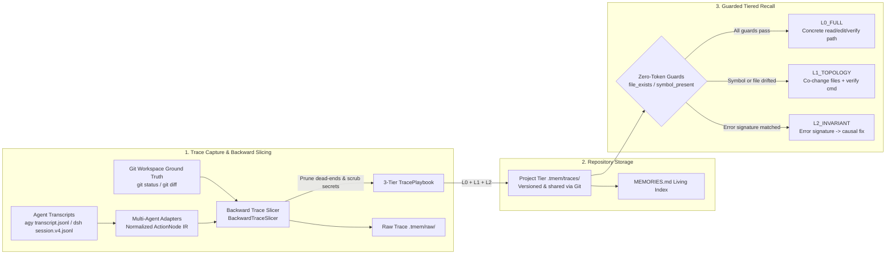
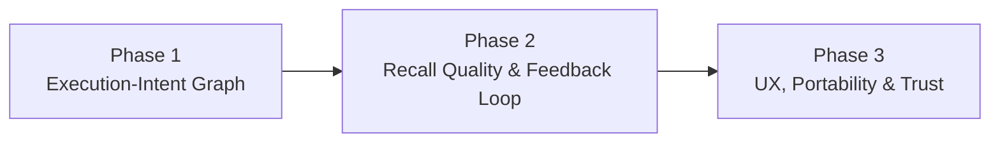

# `tmem` — Execution Trace Memory Compiler for Coding Agents

[中文文档](./README.md) | **English**

`tmem` (**Trace Memory**) is a **zero-dependency, zero-UI, repository-scoped (`.tmem/`)** execution trace memory compiler and CLI tool for coding agents. It integrates natively with **`agy` (Antigravity)** and **`@deepseek-ai/dsh` (DeepSeek Harness)**, and parses session trajectories from `codex`, `opencode`, `pi`, SWE-bench, and ATIF.

Unlike memory systems that store unstructured conversational summaries, `tmem` treats agent transcripts (`transcript.jsonl` / `session.v4.jsonl`) as **unoptimized execution traces**. By anchoring on **Git ground-truth surviving states** and **final passing verification commands (`exit_code == 0`)**, it performs **deterministic backward trace slicing** to prune exploratory dead-ends, abandoned edits, and noise scans into **3-tier structured playbooks (L0 / L1 / L2)** protected by **pre-flight guards**. When a similar task or error arises later, `tmem` validates the guards first and injects the highest valid tier.

> **One-line positioning**: A Git-grounded, auditable, repo-shareable, cross-agent **procedural memory layer** that records *how tasks actually got solved and verified in this codebase*, rather than *what was discussed*.

---

## Table of Contents

- [1. Problems Solved](#1-problems-solved)
- [2. Design Principles](#2-design-principles)
- [3. Core Architecture](#3-core-architecture)
- [4. Agent Integration & Support Matrix](#4-agent-integration--support-matrix)
- [5. Memory Capture & Recall Workflows](#5-memory-capture--recall-workflows)
- [6. Quickstart & CLI Reference](#6-quickstart--cli-reference)
- [7. Evaluation & Benchmarks](#7-evaluation--benchmarks)
- [8. When to Use & Design Boundaries](#8-when-to-use--design-boundaries)
- [9. Trust, Privacy & Security](#9-trust-privacy--security)
- [10. Roadmap](#10-roadmap)
- [11. Directory Structure](#11-directory-structure)

---

## 1. Problems Solved

1. **High Exploratory Noise**: Solving a bug often takes 30 steps where only a few actually contribute to the final fix. Stuffing raw transcripts into context wastes tokens and misleads subsequent reasoning.
2. **Stale Memory & Code Drift**: Hardcoded file paths and symbol references break after refactoring or across machines, causing negative transfer if injected blindly.
3. **Zero Management Overhead**: No web dashboard or external server required. Memories live as JSON files versioned with Git—easy to diff, review, revert, and share.

---

## 2. Design Principles

| Principle | Meaning |
|---|---|
| **Git as Ground Truth** | Only edits that survive on disk and verification commands that pass (`exit_code == 0`) enter the critical path. |
| **Verify Before Inject** | Every playbook carries file and symbol guards. When a guard fails, concrete paths are suppressed and degraded to prevent stale guidance. |
| **Zero-Token Recall** | Retrieval, guard probing, and formatting run locally (SQLite FTS5 + filesystem checks) with zero LLM calls, safe to run on every turn hook. |
| **Memory as Code** | One short-hash JSON file per trace—diffable, reviewable, blameable, and revertable via Git. |
| **Restrained Injection** | At most 3 traces injected per turn, deduplicated per session, triggered only on new user turns or new tool errors. |
| **Traceable Evidence** | Progressive disclosure across Playbook → Raw Trace → Git Diff; every conclusion links back to concrete step indices. |

---

## 3. Core Architecture



### 1. Git Ground-Truth Backward Slicing ([`tmem/slicer.py`](./tmem/slicer.py))
- **Sink Anchoring**: Uses `git diff` / `git status` to identify files that survived on disk at the end of the session, ignoring temporary scratch files or reverted edits.
- **Backward Slicing**: Backtracks from passing test/build commands (`exit_code == 0`) to retain the minimal `READ -> MUTATE -> ENV_EXEC(VERIFY)` sequence that contributed to the surviving files.
- **Error-to-Fix Pairing (L2 Extraction)**: Within a 36-step causal window, pairs a failing command/error signature with subsequent edits or toolchain installs followed by a passing verification command (`[Error Signature] -> [Repair] -> [Verification]`).
- **Secret Scrubbing** ([`scrub_secrets`](./tmem/adapters/base.py)): Scrubs common credential formats (GitHub PATs, OpenAI/Anthropic/Google API keys, bearer tokens) via regex before writing to disk.

### 2. Three-Tier Playbooks & Pre-Flight Guards ([`tmem/models.py`](./tmem/models.py) & [`tmem/guards.py`](./tmem/guards.py))

| Tier | Name | Content | Injection Condition |
| :--- | :--- | :--- | :--- |
| **L0** | Critical Path `L0_FULL` | `READ(file) -> MUTATE(file#symbol) -> ENV_EXEC(cmd)` | Injected only when all `file_exists` and `symbol_present` guards pass, helping the agent skip blind repo scans. |
| **L1** | Co-Change Topology `L1_TOPOLOGY` | Co-modified file set + verification command | When L0 guards fail (refactoring, rename, deletion), L0 is suppressed and degraded to L1 architectural reminders. |
| **L2** | Causal Invariant `L2_INVARIANT` | `Error Signature -> Minimal Repair Action -> Verification` | Injected when a tool execution hits a matching error signature or cross-repo lookup matches. Toolchain/dependency fixes are portable across repos. |

### 3. Repository Storage ([`tmem/store.py`](./tmem/store.py))
- **Project Tier (`<repo>/.tmem/traces/*.json`)**: Tracked in Git. Each trace is stored as an independent content-addressed JSON file (e.g., `tr_30fa71c60d.json`) to avoid merge conflicts. Teammates get project playbooks automatically on `git pull`.
- **Strict Repo Boundary & Zero Negative Transfer**: Symbols, verification contracts, and relative paths are strictly bound to their parent repository, eliminating cross-project hallucinations and negative transfer.
- **Search Index**: Local SQLite FTS5 cache index (`.tmem/.cache/`, git-ignored) is rebuilt automatically whenever trace JSON files change.

### 4. Raw Trace Storage & Progressive Disclosure ([`tmem/raw_storage.py`](./tmem/raw_storage.py))
Alongside compact playbooks, `tmem` saves full-fidelity raw traces in `.tmem/raw/<trace_id>.raw.json` (tool inputs, outputs, exit codes, error stacks, and unified git diffs):
- **Tier 0 Catalog Index** (~35 tokens): Single-line summary per trace in root [`MEMORIES.md`](./MEMORIES.md).
- **Tier 1 Guarded Playbook** (~300–500 tokens): Guard-validated L0/L1/L2 block injected on match.
- **Tier 2 Raw Trajectory**: `tmem replay <id>` replays the full terminal sequence (marking `[CRITICAL PATH]` vs. `[NOISE PRUNED]`), and `tmem diff <id>` inspects the recorded git patch.

### 5. Living Memory Index ([`tmem/mem_doc.py`](./tmem/mem_doc.py))
- Automatically generates and updates [`MEMORIES.md`](./MEMORIES.md) at the workspace root, along with a symlink alias `MEM.md`.
- **Works without plugins**: Any coding assistant that reads repo files (Cursor, Claude Code, Copilot, etc.) can read `MEM.md` to browse verified paths and error repairs—though without automatic guard probing or hook-based recall.
- Atomically refreshed whenever traces are captured, deleted, garbage-collected, or synced via `/tmem sync`.

### 6. Deterministic Execution-Intent Graph (Phase 1)
Schema v2 introduces a lightweight, deterministic, evidence-backed Execution-Intent Graph:
- **Zero-Token Intent Binding**: Extracts action rationale from `toolSummary` and pre-action explanations, automatically bound to `ActionNode.rationale`.
- **Deterministic Causal Edges (`IntentEdge`)**:
  - `Requirement (R1)` $\xrightarrow{\text{served_by}}$ `Step` (tracks which requirement each step serves)
  - `READ` $\xrightarrow{\text{informs}}$ `MUTATE` (captures inspection steps that informed subsequent mutations)
  - `MUTATE` $\xrightarrow{\text{modifies}}$ `file#symbol` (records mutated code symbols with compact diff summaries)
  - `Error` $\xrightarrow{\text{fixed_by}}$ `MUTATE` (closes the loop on root-cause bug fixes)
  - `ENV_EXEC` $\xrightarrow{\text{verifies}}$ `Requirement` (verifies requirement completion)
- **Partial Guard Degradation**: When only one file in a multi-file modification drifts, `tmem` preserves the surviving steps rather than discarding the entire L0 path.
- **Symbol-Level Trace Links (`trace_links`)**: Maintains a symbol index in SQLite to cross-reference historical traces that touched the same code symbols.

---

## 4. Agent Integration & Support Matrix

| Agent | Transcript Parsing | Auto-Recall Hook | `/tmem` Command | Milestone Prompt | Notes |
|---|:---:|:---:|:---:|:---:|---|
| **Antigravity (`agy`)** | ✅ | ✅ | ✅ | ✅ | Native plugin |
| **DeepSeek Harness (`dsh`)** | ✅ | ✅ | ✅ | ✅ | Native Cordis plugin |
| `codex` / `opencode` / `pi` | ⚠️ Generic JSONL adapter | ❌ | ❌ | ❌ | Manual capture via `tmem capture --agent <name>`; discovery via `MEM.md` |
| SWE-bench `.traj` / ATIF | ✅ | — | — | — | Offline benchmark evaluation |
| Cursor / Claude Code / Copilot | ❌ | ❌ | ❌ | ❌ | Reads `MEM.md` directly |

Run `tmem init --agents agy,dsh` to set up integrations:

### 1. Antigravity (`agy`)
- Plugin directory [`.agents/plugins/tmem/`](./.agents/plugins/tmem):
  - [`hooks.json`](./.agents/plugins/tmem/hooks.json): `PreInvocation` handles recall, `/tmem` command dispatch, and milestone prompts; `PostToolUse` tracks file edits, test passes, and error signatures.
  - [`rules/AGENTS.md`](./.agents/plugins/tmem/rules/AGENTS.md): Guides the agent on consuming `<tmem_speculative_memory>` and prompting on milestones.
  - [`skills/tmem/SKILL.md`](./.agents/plugins/tmem/skills/tmem/SKILL.md): Supports natural-language memory capture requests.

### 2. DeepSeek Harness (`@deepseek-ai/dsh`)
- One-line install:
  ```bash
  dsh plugin add github:kentzjh-cmd/tmem
  ```
- Cordis runtime plugin [`tmem/dsh_plugin.mjs`](./tmem/dsh_plugin.mjs) (exported via `dsh.bundle` in [`package.json`](./package.json) and [`cordis.patch.yml`](./cordis.patch.yml)):
  - Resolves workspace root dynamically via `dsh-working-directory` service or `session.header.cwd`.
  - `agent/pre-step`: Silently recalls and injects matching playbooks (deduplicated by message fingerprint).
  - `tools/post-execute`: Tracks exit codes for `read` / `write` / `edit` / `apply_patch` / `bash`; injects L2 hints on errors and milestone prompts on `edit -> test pass`.
  - Registers native `/tmem` commands via `dsh-commands`.
- Transcript adapter ([`tmem/adapters/dsh.py`](./tmem/adapters/dsh.py)): Parses `session.v4.jsonl` (compatible with v3 and `session.jsonl`) and multi-file `apply_patch` diffs.

---

## 5. Memory Capture & Recall Workflows

### Capture (Write)
By default, `tmem` **does not auto-save on every conversation stop**, avoiding polluting the store with unfinished or low-quality sessions. Memories are captured through three entry points:

1. **Milestone Prompt**: After detecting a `MUTATE -> VERIFY (exit 0)` loop, `tmem` asks the agent to append a one-line prompt at the end of its response:
   > 💡 *Would you like to persist this execution path to memory? (Type `/tmem` or `/remember [notes]`)*
2. **`/tmem` Slash Commands**:

   | Command | Description |
   |---|---|
   | `/tmem [notes]` | Slice current session and save to project tier (`.tmem/traces/`) |
   | `/tmem status` / `list` | Show counts / list project traces and active guard tiers |
   | `/tmem inspect <id> [index\|playbook\|raw\|diff]` | Inspect a trace at the chosen granularity |
   | `/tmem replay <id>` / `diff <id>` | Replay terminal steps / view recorded git diff |
   | `/tmem sync` | Rebuild SQLite index, re-evaluate guards, update `MEMORIES.md` |
   | `/tmem forget <id>` | Delete a trace and its raw recording |
   | `/tmem gc` | Run guard checks and mark drifted traces |
   | `/tmem bench` | Run built-in offline evaluation |

3. **Git `post-commit` Hook**: `tmem init` installs `.git/hooks/post-commit`, running `tmem capture --quiet` in the background after each commit.

### Recall (Read)
- **When triggered**: On a new user turn (querying with user input) or immediately after a new tool error (querying with the error signature).
- **How matched**: Exact error-signature match → file trigger match → intent substring match → FTS5 BM25 keyword fallback (all local lexical retrieval).
- **What gets injected**: Up to 3 playbooks labeled `L0_FULL` / `L1_TOPOLOGY` / `L2_INVARIANT` after guard evaluation, wrapped in `<tmem_speculative_memory>`.

---

## 6. Quickstart & CLI Reference

### 1. Install & Initialize
```bash
pip install -e .            # Provides the `tmem` CLI (or run `python3 -m tmem.cli`)
tmem init --agents agy,dsh  # Initialize .tmem/, agent plugins, and git post-commit hook
```

### 2. Common Commands
```bash
tmem status                                     # Project memory statistics
tmem capture --agent dsh                        # Slice latest session and persist to project repo
                                                #   --agent agy|dsh|codex|opencode|pi|swe_bench|atif
tmem lookup "ZeroDivisionError" --file src/billing.py   # Retrieve + evaluate guards + tier
tmem inspect tr_cc3a687f02 --level playbook     # index | playbook | raw | diff
tmem replay tr_cc3a687f02                       # Replay raw action stream
tmem diff tr_cc3a687f02                         # View recorded unified git diff
tmem sync                                       # Refresh MEMORIES.md / MEM.md
tmem gc                                         # Check which L0 guards have drifted
tmem evaluate                                   # Run built-in offline evaluation
```

### 3. Run Tests
```bash
PYTHONPATH=. python3 -m unittest discover -s tests -v
```

---

## 7. Evaluation & Benchmarks

`tmem` ships with adapters for SWE-bench (`.traj`), ATIF (`trajectory.json`), and DSH (`session.v4.jsonl`), plus an offline evaluation script ([`tmem/evaluate.py`](./tmem/evaluate.py)).

> [!IMPORTANT]
> **Methodology note.** The built-in benchmark is an **offline evaluation** measuring what the slicer extracts from a fixed set of recorded trajectories. It is **not** a live A/B re-execution of an agent with vs. without memory. Several metrics in the tables below represent theoretical upper bounds by construction; please read the metric definitions below each table. Live downstream A/B evaluation is tracked in the [Roadmap](#10-roadmap).

### 1. Slicing Statistics (9 trajectories across Django / SymPy / Flask / Astropy / Pytest / Scikit-learn / DSH, 6–27 steps)

| Instance | Format | Raw Steps | L0 Steps | Compression (CR) | Noise Elimination (NER) | L1 Files | L2 Pairs | Self-Recall Rank | Slicing Time | Lookup Time |
|---|---|---|---|---|---|---|---|---|---|---|
| `dsh_e2e_session` | `dsh` | 9 | 4 | 55.6% | 100.0% (3 → 0) | 3 | 1 | #1 | 0.51 ms | 2.6 ms |
| `dsh_long_lifecycle_session` | `dsh` | 27 | 9 | 66.7% | 100.0% (6 → 0) | 7 | 1 | #1 | 0.45 ms | 2.5 ms |
| `dsh_multiturn_complex_session` | `dsh` | 17 | 6 | 64.7% | 100.0% (6 → 0) | 5 | 1 | #1 | 0.37 ms | 2.7 ms |
| `astropy__astropy-12907` | ATIF | 17 | 7 | 58.8% | 100.0% (9 → 0) | 3 | 1 | #1 | 0.32 ms | 2.6 ms |
| `django__django-11099` | SWE-bench | 8 | 3 | 62.5% | 100.0% (4 → 0) | 1 | 1 | #1 | 0.18 ms | 2.5 ms |
| `flask__flask-5014` | SWE-bench | 6 | 3 | 50.0% | 100.0% (3 → 0) | 1 | 1 | #1 | 0.22 ms | 2.4 ms |
| `pytest-dev__pytest-7432` | SWE-bench | 15 | 6 | 60.0% | 100.0% (6 → 0) | 2 | 1 | #1 | 0.27 ms | 2.6 ms |
| `scikit-learn__scikit-learn-13496` | SWE-bench | 12 | 6 | 50.0% | 100.0% (4 → 0) | 2 | 1 | #1 | 0.29 ms | 2.5 ms |
| `sympy__sympy-20590` | ATIF | 6 | 4 | 33.3% | 100.0% (3 → 0) | 2 | 0 | #1 | 0.18 ms | 2.4 ms |
| **Average** | — | **13.0** | **5.33** | **55.7%** | **100.0%** | **2.89** | **8 total** | **#1** | **0.31 ms** | **2.53 ms** |

**Metric definitions:**
- **Compression Ratio (CR)**: `1 - L0_steps / raw_steps`.
- **Noise Elimination Rate (NER)**: Share of exploratory actions (`READ` steps plus `ls/grep/cat/find/git status…` commands) removed from L0. By definition, L0 only keeps canonical verification commands, so NER mainly verifies that exploratory shell commands are filtered out.
- **Self-Recall Rank**: Queries the 9-trace store using the playbook's own `problem_intent`. This verifies indexing pipeline integrity, **not** recall generalization on paraphrased or unseen queries.
- **Latency**: Measured in-process on a single thread, excluding Python startup overhead.

### 2. Projected Upper-Bound Savings (Derived, Not Live A/B)

Analytical upper bounds derived from the sliced critical path assuming an agent follows L0 directly and avoids prior errors in that trajectory:

| Instance | Raw Steps | L0 Steps | Projected Step Reduction | Trajectory Errors | Est. Token Savings | Empty-Dir Drift Degradation |
|---|---|---|---|---|---|---|
| `dsh_e2e_session` | 9 | 4 | -55.6% | 1 | -85.2% | L2_INVARIANT |
| `dsh_long_lifecycle_session` | 27 | 9 | -66.7% | 1 | -88.8% | L2_INVARIANT |
| `dsh_multiturn_complex_session` | 17 | 6 | -64.7% | 1 | -88.5% | L2_INVARIANT |
| `astropy__astropy-12907` | 17 | 7 | -58.8% | 1 | -85.9% | L2_INVARIANT |
| `django__django-11099` | 8 | 3 | -62.5% | 1 | -85.9% | L2_INVARIANT |
| `flask__flask-5014` | 6 | 3 | -50.0% | 1 | -82.6% | L2_INVARIANT |
| `pytest-dev__pytest-7432` | 15 | 6 | -60.0% | 2 | -85.8% | L2_INVARIANT |
| `scikit-learn__scikit-learn-13496` | 12 | 6 | -50.0% | 2 | -81.4% | L2_INVARIANT |
| `sympy__sympy-20590` | 6 | 4 | -33.3% | 0 | -73.7% | L1_TOPOLOGY |
| **Average** | **13.0** | **5.33** | **-55.7%** | **10 total** | **-84.2%** | **9/9 degraded** |

**Notes:**
- Step reduction and token savings (~4 chars/token heuristic) are analytical upper bounds derived from `len(L0)` vs. `len(raw_actions)`; actual downstream gains depend on agent compliance.
- "Empty-Dir Drift Degradation" evaluates guards against an empty temporary directory, confirming L0 is suppressed when all target files are absent. **Partial drift (e.g., symbol rename or body rewrite while the file still exists) is not yet covered by this test.**

### 3. Progressive Disclosure Footprint (Estimated)

| Tier | Avg Footprint | vs. Raw Trajectory |
|---|---|---|
| Tier 2 Raw Trajectory | ~3,010 tok | — |
| Tier 1 Playbook | ~376 tok | -86.1% |
| Tier 0 Index Line | ~35 tok | -98.6% |

Across all 9 trajectories, raw storage verification and terminal replay rendering pass; `MEMORIES.md` synchronization takes ~1.7 ms.

---

## 8. When to Use & Design Boundaries

**Good fit:**
- Git-backed repositories with test/build verification commands, especially where **similar tasks recur** (iterative work on the same modules, recurring toolchain or environment issues).
- Multi-developer or multi-agent teams that want procedural knowledge shared and reviewed like code.
- Latency- or cost-sensitive workflows that want zero LLM calls on the recall path.

**Current limitations:**

| Boundary | Explanation |
|---|---|
| **Records *where* more than *how/why*** | L0 currently records action types, files, and symbols; diff content and step rationales live only in raw traces and are not injected. Phase 1 addresses this (see Roadmap). |
| **Requires verification signals** | Sessions without mutations or passing verification commands (research, design discussions, projects without tests) rarely produce playbooks. |
| **Lexical retrieval** | Paraphrased problem descriptions with no overlapping keywords may miss in FTS5/trigger lookup. |
| **Presence-only guards** | `symbol_present` checks whether a symbol name still exists via regex; if a function's logic was rewritten under the same name, L0 still passes. |
| **Single-session L1 co-change** | Co-change contracts are currently derived from files modified together in one session rather than multi-commit statistical co-occurrence. |
| **No usage feedback loop yet** | `hit_count` and `confidence` are not yet updated based on post-injection outcomes; GC only checks guard validity. |
| **Machine-specific paths in commands** | Recorded verification commands may contain local absolute paths (e.g., `PYTHONPATH=/home/...`). |

---

## 9. Trust, Privacy & Security

- **Repo memories are untrusted input**: Because `.tmem/traces/` is tracked in Git, anyone with commit access can influence what gets injected into another developer's agent context. Review `.tmem/` changes in PRs just like code, and only merge traces from trusted contributors in open-source repos.
- **Advisory, not imperative**: Injected blocks are framed as historical traces, and agent rules instruct the model to verify applicability before acting.
- **Best-effort secret scrubbing**: Regex scrubbing covers common token patterns, but `.tmem/raw/` may still contain internal paths, URLs, or command outputs. Add `.tmem/raw/` to `.gitignore` if you do not want raw traces shared.

---

## 10. Roadmap



### Phase 1: Execution-Intent Graph (🚧 In Progress)
Upgrade playbooks from flat file paths to a compact **Requirement → Step → File/Symbol → Verification** graph. The skeleton is built deterministically; optional model annotations must cite step evidence:
- **Data model**: `Requirement`, `IntentEdge` (`served_by / informs / modifies / verifies / fixed_by` with `evidence` and `provenance`), `ActionNode.rationale`, and `TracePlaybook.schema_version = 2` (backward-compatible with v1).
- **Zero-token rationale binding**: Bind per-call rationales already present in transcripts (`toolSummary`, pre-call assistant text) directly to `ActionNode`s.
- **Compact diff summaries**: Attach truncated hunk summaries to `MUTATE` steps to capture *what changed*.
- **Optional capture-time semantic annotation**: Allow the host agent or an external model to fill requirement decomposition, root cause, and pitfalls once at capture time (recall remains zero-token); drop any claim that fails step-index evidence validation.
- **Partial degradation**: Suppress only the steps and edges tied to failed guards instead of dropping all of L0.

### Phase 2: Recall Quality & Feedback Loop
- Relevance threshold and unified score ranking (replacing hard project-first ordering).
- Post-injection usage tracking via `PostToolUse` to update `hit_count` / `confidence` and drive metabolic GC.
- Symbol-body hash guards to detect logic rewrites under unchanged symbol names.
- Trace deduplication/merging and `git log`-mined statistical L1 co-change contracts.
- **Live A/B downstream benchmark**, paraphrased held-out retrieval queries, and symbol-level drift injection tests.

### Phase 3: UX, Portability & Trust
- Silent staging inbox (`.tmem/inbox`, git-ignored) with auto-promotion on repeated hits or batch confirmation, replacing per-milestone prompts.
- Workspace path normalization (`$WORKSPACE`) and portable hook commands.
- Provenance attribution, optional trace signing, and native hooks for `codex` / `opencode` / `pi`.

---

## 11. Directory Structure

```text
.
├── pyproject.toml                 # Python package & `tmem` CLI entrypoint (zero dependencies)
├── package.json                   # dsh plugin package manifest (dsh.bundle)
├── cordis.patch.yml               # dsh Cordis plugin configuration
├── README.md / README_EN.md       # Chinese / English documentation
├── AGENTS.md                      # Agent memory consumption & milestone protocol
├── MEMORIES.md / MEM.md           # Auto-generated living memory index (MEM.md is a symlink)
├── .agents/plugins/tmem/          # Antigravity plugin (hooks / rules / skills)
├── .tmem/                         # Project-tier memory store for this repository
│   ├── traces/                    #   Playbook JSONs (git-tracked)
│   ├── raw/                       #   Full-fidelity raw traces
│   └── .cache/                    #   SQLite FTS5 cache (git-ignored)
├── benchmarks/data/               # 9 evaluation trajectories (SWE-bench / ATIF / DSH)
├── scripts/
│   └── submit_awesome_dsh_pr.py   # Helper script for awesome-dsh-plugin submission
├── tmem/
│   ├── models.py                  # ActionNode IR, GuardProbe, Playbook, RawExecutionTrace, Intent Graph models
│   ├── slicer.py                  # Git ground-truth backward trace slicer
│   ├── guards.py                  # Pre-flight guard evaluation, tiered degradation & context formatting
│   ├── store.py                   # Dual-tier storage, SQLite FTS5 indexing, cascading lookup & GC
│   ├── raw_storage.py             # Raw trace storage, terminal replay & diff inspection
│   ├── mem_doc.py                 # MEMORIES.md / MEM.md rendering & atomic sync
│   ├── evaluate.py                # Offline benchmark evaluator & report generator
│   ├── cli.py                     # CLI, /tmem commands, hook handlers & plugin installer
│   ├── dsh_plugin.mjs             # dsh Cordis runtime plugin
│   └── adapters/
│       ├── base.py                # Normalized session protocol, error signatures, symbols & scrubbing
│       ├── agy.py                 # Antigravity transcript.jsonl adapter
│       ├── dsh.py                 # DeepSeek Harness session.v4.jsonl & apply_patch adapter
│       ├── swe_bench.py           # SWE-bench .traj & ATIF trajectory.json adapter
│       └── __init__.py            # Adapter factory & generic JSONL adapters (codex / opencode / pi)
└── tests/
    ├── test_tmem_e2e.py           # Core slicing, storage, guard degradation & agy hook E2E tests
    ├── test_dsh_e2e.py            # dsh parsing & Cordis runtime E2E tests
    ├── test_intent_graph.py       # Intent graph, zero-token rationale binding & partial degradation tests
    ├── test_raw_and_memories.py   # Raw storage, progressive disclosure & living index tests
    └── test_evaluation_benchmark.py # Offline evaluation benchmark test suite
```

---

## License

MIT
