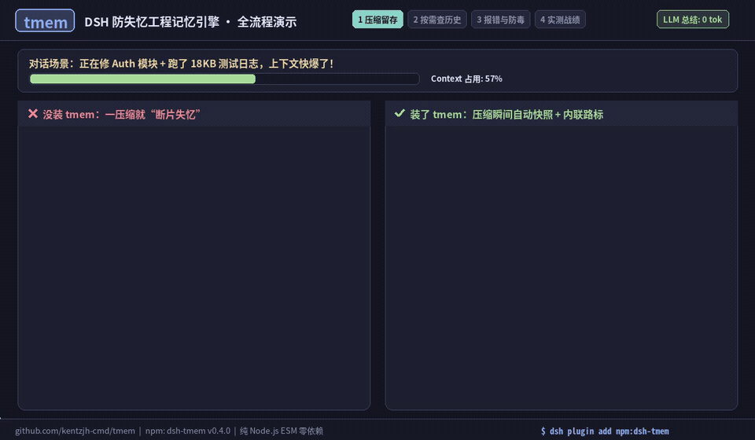
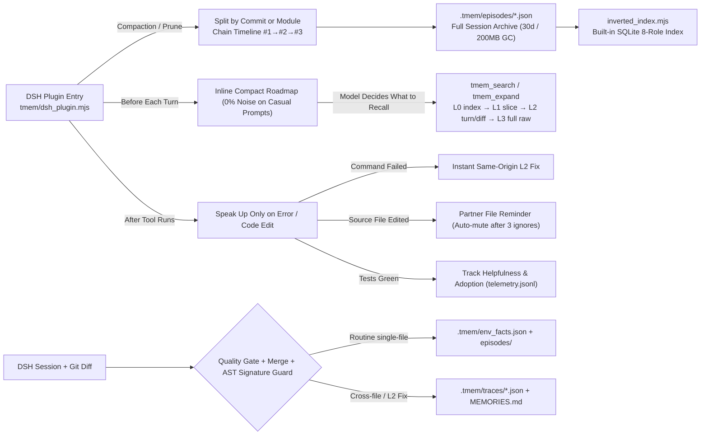

# `tmem` — The Anti-Amnesia Memory Plugin for DeepSeek Harness (`dsh`) (Archived)

> **Project Status: Sunset & Archived (2026-11-24)**
> This project is no longer actively developed or maintained and is preserved solely as a technical experiment and engineering post-mortem. After running **multi-round real-world E2E evaluations (Rounds 1–3)** and a **container-isolated carrier ablation study (Phase-1b, 30 real sessions)**, empirical evidence refuted our core hypothesis that `tmem` beats plain Markdown on context token cost and general amnesia prevention: **in realistic sessions, `tmem` costs 3.55× more tokens and 478× more disk space than maintaining a plain `MEMORY.md`, while suffering from noisy trace compilation.** For practical workflows, stick to concise native Markdown docs (`AGENTS.md` / `MEMORY.md` / `CONVENTIONS.md`).

[中文文档](./README.md) | **English**

---

## 0. Sunset Post-Mortem: Why Real-World E2E Refuted the Design

While `tmem` achieved strong numbers on offline and semi-synthetic benchmarks (preserved in [Section 4](#4-empirical-benchmarks)), real-world DSH runs on an external Python service (`ledger-svc`) and container-isolated ablation revealed that the design fails to deliver net value in practice.

### 1. Head-to-Head Real-World Results (Phase-1b Ablation + Storage Audit + Round 3)

| Dimension | `tmem` Plugin | Prose `MEMORY.md` Control | No Memory (`C`) | Verdict |
| :--- | :---: | :---: | :---: | :--- |
| **Total Knowledge Acquisition Cost (`free` mode)** | `A1` auto-inject: **18,016.7** tok<br>`A2` on-demand: **14,250.3** tok | `B2` on-demand read: **5,073.0** tok<br>`B1` 200-line injector: **7,112.3** tok | **8,775.0** tok | ❌ **3.55× worse** than plain MD; **2.05× worse** than no memory (CA-1 / CA-1b / CA-4 FAIL) |
| **Zero-Tool Recall (`zero` mode)** | Phase-1b `A1_zero`: **1.000**<br>Round 3 `A_zero`: **0.333** | `B1_zero` (200-line injector): **1.000**<br>`B2_zero` (no injection): **0.000** | **0.000** | ⚠️ **Not unique & unstable**: a 200-line MD injector matches `1.000`, and `tmem` dropped to `0.333` in Round 3 |
| **Routine Knowledge Consumption (`G7`)** | `1.0` | `1.0` (no plugin) | — | ❌ **FAIL × 3 rounds**: agents already write `CONVENTIONS.md` and read source files |
| **Disk & Git Footprint** | `.tmem/`: **2,934.3 KB** (**991.4 KB/trace**, 77.7% SQLite index) | `MEMORY.md`: **6.1 KB** | **0** | ❌ **478.2× disk overhead** (`102.1×` even without rebuildable cache); `raw/` tracked in git by default |

### 2. Four Root Lessons Learned

1. **"Progressive Disclosure" + `L0 drifted` Warnings Triggered a Token Explosion**
   - The injected slice itself was compact (`1,388` tokens, `0.2736×` of `B2`) and already contained all required answers.
   - However, whenever current workspace code lacked the prior fix symbols, [`tmem/guards.mjs`](./tmem/guards.mjs) emitted a verbose `Note: L0 concrete paths drifted (...); degraded to structural/causal invariants` block, while [`tmem/dsh_tools.mjs`](./tmem/dsh_tools.mjs) encouraged expanding `turn`/`raw` logs up to `20,000` chars per call.
   - Seeing the drift warning, models reflexively fired 6–8 consecutive `tmem_expand` calls—pulling an average of **16,169 tokens** (up to 19,577 tokens) of raw logs and erasing every supposed savings.

2. **Zero-LLM Static Compilation Produced Dirty, Fragile Traces**
   - Inspecting the actual injected payload in Round 3 `H6_probe_a_zero` (`tr_e66fe4c00d`) exposed severe noise:
     - `Verification Command` captured a 400-char `tmem capture --agent dsh --intent "..." --full-session --force` invocation instead of the test command;
     - `Root Cause` dropped `settlement.py` from the repair chain;
     - `Semantic Summary` clipped mid-sentence (`Now updating the failure baseline section:`), and `L0` paths leaked raw assistant chatter.
   - This directly drove Round 3 `A_zero` down from `1.000` to `0.333`.

3. **Mistaking Engineering Complexity for Product Moat**
   - Maintaining an 8-role SQLite inverted index, multi-language AST guards, multi-frame zstd decoding, and telemetry introduced real integration failures (half-mounted workspace plugins overriding global installs, 2-char CJK lookup misses) while losing across the board to a 200-line Markdown injector ([`md_carrier_plugin.mjs`](./research/carrier-ablation/md_carrier_plugin.mjs)) in cost, simplicity, and reliability.

4. **Narrow Remaining Signal Did Not Justify the Heavy Architecture**
   - The only capabilities genuinely hard to replicate with static Markdown were **runtime `L2` error-signature repair transfer (Round 3 `G8` PASS)** and **co-change partner hints (`G5` PASS)**.
   - Meanwhile, session capture rate (`G1 = 0.833`), natural-language search (`G6 search = 0.625`), recurrence reduction (`CA-2`), and post-compaction recovery (`CA-6–CA-9`) either fell short or remained unproven in Phase-2. Rather than keeping a bloated, negative-ROI engine alive, we chose to sunset and archive the repository cleanly.

### 3. Archived Reports & Reproducible Evidence

All raw `.jsonl.zstd` trajectories, pre-registered oracles, container isolation scripts, and anti-drift verifiers remain archived in-repo:

- **Independent E2E Report (Rounds 1–3)**: [`docs/dsh-independent-e2e-report.md`](./docs/dsh-independent-e2e-report.md) ([Round 3 archive](./research/round3/README.md))
- **Carrier Ablation Study (`tmem` vs. Prose MD vs. No Memory)**: [`docs/dsh-memory-carrier-ablation-report.md`](./docs/dsh-memory-carrier-ablation-report.md) & [Protocol](./docs/dsh-memory-carrier-ablation.md) ([Apparatus & 30 sessions](./research/carrier-ablation/README.md))
- **Storage Overhead Audit**: [`docs/dsh-tmem-storage-overhead.md`](./docs/dsh-tmem-storage-overhead.md)
- **Automated Number & Trajectory Verifier**: `python3 research/carrier-ablation/verify_report_numbers.py`

---

> Sections 1–5 below preserve the pre-archival design documentation and offline benchmarks for historical reference.

<p align="center">
  
</p>

`tmem` (published on npm as [`dsh-tmem`](https://www.npmjs.com/package/dsh-tmem)) is a zero-dependency, pure Node.js local memory plugin built specifically for `@deepseek-ai/dsh` (DeepSeek Harness). Everything lives inside your repo's `.tmem/` folder.

In plain words: **whenever a long coding chat gets compacted (`compact`) or a huge terminal log gets truncated, `tmem` saves a complete snapshot on the spot and keeps an ultra-compact inline roadmap right inside the conversation. From there, the model decides for itself whether a high-level summary is enough—or whether it needs to pull back specific diffs, pruned error logs, or even the full prior session history on demand.**

---

## 1. Why `tmem`? (The 4 Pains & How We Fix Them)

If you use a coding agent on real repos for hours, four things get annoying fast:

1. **Post-Compaction Amnesia**: Once the context fills up and `compact` runs—or a 20KB test log gets truncated—early architectural decisions, exact file edits, and mid-log stack traces vanish behind a vague blurb. The model ends up re-reading half the repo and stepping on the same rakes twice.
2. **Paying an LLM to Rewrite Memory Gets Expensive and Blurry**: Many memory tools ask an LLM in the background to re-summarize every turn. That burns tokens continuously, and after a few rewrites, exact function names, file paths, and error codes quietly evaporate.
3. **Dumping Fuzzy History Into Every Prompt**: If every routine message triggers a loose similarity search and pastes chunks into the prompt, unrelated tasks get noisy fast.
4. **Stale Advice After Code Refactors**: When a function's parameters change or a file moves, blindly injecting yesterday's snippet actively misleads the agent.

Here is `tmem`'s straightforward answer to all four:

### 1.1 No LLM Re-Writing—Trim Noise Straight From Real Actions
> Every `Read -> Edit -> Error -> Fix -> Test Pass` trail is already grounded in real tool execution. You don't need to pay an LLM to paraphrase it.

`tmem` spends **0 summarization tokens**. Instead of generating prose summaries, it trims execution traces backwards from the files that actually landed and the tests that actually passed:
- Dead-end file reads, typos retried immediately, edits wiped by `git checkout`/`rm`, and unverified edits made *after* the final green test are pruned out;
- Only the verified working path stays—preserving exact paths, symbols, diffs, and stack traces with **zero LLM hallucination**.

### 1.2 Fuse Compaction With Memory & Keep an Inline Session History Chain
> Compaction shrinks the active prompt; `tmem` catches the folded chunk before it disappears, chains it into a timeline, and leaves a tiny inline signpost so the model decides how much history to bring back.

- **Automatic Compaction Snapshots + Cross-Phase Timeline**: `tmem` listens to DSH host compaction events (`compaction/summary`, `compaction/end`, `compaction/prune`). Every compacted chunk or pruned log is saved into `.tmem/episodes/`. If one long span crossed a `git commit` or worked on unrelated modules, it splits cleanly into sub-episodes and chains across compactions (`prev_episode_id` + `phase_index`: `#1 -> #2 -> #3`).
- **Inline History Signpost — Model Decides Full vs. Partial Recall**: After compaction, `tmem` keeps a tiny **inline** directory card (`<tmem_compacted_index>`) right next to `<compact-checkpoint>`. Meanwhile, the complete turn-by-turn history, decisions, code diffs, and raw logs remain intact in `.tmem/episodes/`. If the compact summary is enough, the model pulls nothing (saving tokens). Whenever the model judges that it needs exact context—whether a single diff, a truncated error log, or the **full conversation history** chained across `#1 -> #2 -> #3`—it calls `tmem_search` and `tmem_expand` itself to fetch it.
- **Two Separate Buckets**:
  - **`.tmem/episodes/` (full session history archive, gitignored)**: Saves *everything* compacted or captured manually via `/tmem`, including full turns and untruncated tool output, auto-cleaned by a 30-day TTL and 200MB LRU cap.
  - **`.tmem/traces/` + `MEMORIES.md` (team-shareable playbooks, git-friendly)**: Promotes only high-value multi-file fixes and verified error-repair pairs so teammates and future sessions benefit too.

### 1.3 Drill Down Like a Table of Contents (`L0 -> L3`), Don't Dump Everything
> Index historical sessions locally by keyword and code identifier, then let the model open pages on demand.

Using built-in Node.js `node:sqlite`, `tmem` maintains a Turn-level inverted index across 8 buckets (`intent`, `error`, `decision`, `symbol`, `file`, `command`, `diff`, `raw_output`) and unlocks 4 zoom levels:
- **L0 (`<tmem_compacted_index>` / `tmem_search`)**: The compact inline roadmap plus fast keyword/file/symbol lookup;
- **L1 (`tmem_expand(level="slice")`)**: Phase goal, key constraints, Turn table of contents, modified files, and L2 fixes;
- **L2 (`tmem_expand(level="turn" | "diff")`)**: Full per-turn messages, actions, and exact unified diffs;
- **L3 (`tmem_expand(level="raw", query=...)`)**: Unabridged step logs and middle-pruned test outputs windowed around the match—walkable back through `prev_episode_id` if full session history recovery is needed.

### 1.4 Stay Quiet Until Needed; Health-Check Old Tricks Before Injecting
> Better silent than noisy—and always check if the code still matches before offering old advice.

- **Zero Noise on Casual Prompts**: On `agent/pre-step`, plain natural-language questions get **0.0% false injections**. It speaks up only on Turn 1 (verified test/build commands from `.tmem/env_facts.json`), right after compaction (the inline `<tmem_compacted_index>`), or when you explicitly mention a known file or error signature. On `tools/post-execute`, failing commands trigger instant same-origin L2 fixes, and source edits nudge companion files via `<tmem_cochange_hint>` (auto-muting if ignored 3 times).
- **Sub-5ms AST Signature Checks (`signature_match`)**: Before injecting any saved playbook across Python, JS/TS, Go, Rust, Java, or C++, `tmem` checks file presence, symbol presence, and parameter signatures. Refactored functions automatically downgrade old snippets from `L0_FULL` to `L1_TOPOLOGY` / `L2_INVARIANT`—keeping the insight without pushing outdated code.

---

## 2. How Everything Fits Together



1. **Compaction Archive, Inline Roadmap & Model-Driven Recall** ([`tmem/episodes.mjs`](./tmem/episodes.mjs), [`tmem/inverted_index.mjs`](./tmem/inverted_index.mjs), [`tmem/dsh_tools.mjs`](./tmem/dsh_tools.mjs)):
   Hooks DSH `session/event` across CLI, Headless, and Web Presets, inlines lightweight timeline pointers (`prev_episode_id`), and gives the model `tmem_search` & `tmem_expand` so *it* decides whether to peek at a diff or pull full conversation history back.
2. **In-Process Zero Cold-Start Hooks** ([`tmem/dsh_plugin.mjs`](./tmem/dsh_plugin.mjs), [`tmem/hooks/dsh.mjs`](./tmem/hooks/dsh.mjs)):
   Runs directly inside the DSH Cordis process with pure Node.js ESM; skips routine `read`/`grep`/`glob` calls, tracks real L2 resolution & L1 adoption in `.tmem/telemetry.jsonl`, and adds near-zero latency overhead.
3. **Trace Trimming, AST Signature Checks & Auto-GC** ([`tmem/slicer.mjs`](./tmem/slicer.mjs), [`tmem/guards.mjs`](./tmem/guards.mjs), [`tmem/store.mjs`](./tmem/store.mjs)):
   [`tmem/ast_parser.mjs`](./tmem/ast_parser.mjs) fingerprints parameter signatures across languages, merges duplicate traces instead of bloating `.tmem/`, and cleans stale data via `tmem gc --prune`.

---

## 3. Quick Start

> Requirement: **Node.js >= 22.5.0** (uses built-in `node:sqlite` FTS5, zero external npm packages, no Python required; legacy Python code lives on the `python` branch).

### Install & Initialize
```bash
npm install -g dsh-tmem                       # Global CLI (or clone and run `npm link`)
tmem init                                     # Create .tmem/, wire DSH plugin & git post-commit hook
dsh plugin add npm:dsh-tmem                   # Or install via `dsh plugin add github:kentzjh-cmd/tmem`
npm test                                      # Run full node --test suite (50/50)
npm run verify:benchmarks                     # Verify benchmark gates, saved reports & README sync
```

### Everyday CLI, Slash Commands & Model Tools
```bash
tmem status                                      # Check playbooks, episodes & live telemetry
tmem telemetry                                   # Inspect L2 error fix rate & L1 partner adoption
tmem capture --agent dsh                         # Manually snapshot current session into episodes/ & compile playbooks
tmem search "jwt_guard.ts leewaySec"             # Search across turns, files, symbols & errors
tmem episodes --session <id>                     # View chained compaction episodes for a session
tmem expand <episode_id> --level slice           # Zoom in: index (L0) -> slice (L1) -> turn / diff (L2) -> raw (L3)
tmem lookup "TypeError" --file src/validator.py  # Look up past L2 fixes with live guard checks
tmem inspect <trace_id> --level playbook         # Read a compiled team playbook
tmem sync                                        # Re-check guards and refresh MEMORIES.md
tmem gc --prune                                  # Drop drifted traces & enforce episode TTL/LRU limits
```

Inside DSH chats, the model invokes **`tmem_search`** and **`tmem_expand`** whenever it decides to pull history back; you can also type **`/tmem [status|search|episodes|expand|list|inspect|replay|diff|sync|gc|forget|telemetry|evaluate]`** directly.

---

## 4. Empirical Benchmarks

All scripts and datasets live under `benchmarks/` and are automatically verified in CI via `node scripts/verify_benchmarks.mjs`:

### 4.1 Post-Compaction Progressive Recall Benchmark (`eval_compact_recall.mjs`)
Reproduce: `node benchmarks/eval_compact_recall.mjs` ([Script](./benchmarks/eval_compact_recall.mjs)):

Tests 4 classic "forgotten right after compaction" scenarios (early architectural rule recall, mid-log failure hidden inside an 18KB truncated output, multi-intent split + timeline chaining, and exact diff recovery + trailing-edit pruning + AST `signature_match` check):
- **Key Detail Recall**: Vanilla Compact Summary + Prune **0.0%** (`0/4`) → `Compact + tmem` Inverted Progressive Disclosure **100.0%** (`4/4`)
- **Context Token Savings**: L0 index checkpoint injection saves **91.6%** (`7,157` → `603` est. tokens); L0 + targeted L1/L2 expansion saves **87.0%** (`933` est. tokens)
- **Lookup & Expansion Latency**: **~6 ms** mean search latency, **< 10 ms** targeted expansion

### 4.2 DSH End-to-End Strong-Signal Replay & Telemetry
Reproduce: `node benchmarks/eval_dsh_e2e.mjs` ([Script](./benchmarks/eval_dsh_e2e.mjs)):
- **End-to-End Interaction Step Reduction**: **37.5%** (8 trial-and-error baseline steps → 5 steps with `tmem`)
- **Runtime Telemetry Resolution**: L2 green error resolution **100%** (`1/1`), L1 co-change partner adoption **100%** (`1/1`)
- **Natural-Language Holdout False Positive Injection Rate**: **0.0%** (10 vague prompts without file/error anchors stayed silent)
- **Live Cordis Hot-Path Latency**: **~5 ms** total across 21 events (6 `agent/pre-step` + 15 routine `read` `tools/post-execute` calls, in-process pure Node.js ESM)

### 4.3 Temporal Causal Slicing & 50-Trajectory Blinded LLM Judge
Reproduce: `node benchmarks/eval_slicing_fidelity.mjs --gold-path benchmarks/gold/gold_annotations_50.json` and `node benchmarks/eval_llm_judge.mjs` ([50-Trace LLM Judge Report](./benchmarks/runs/llm_judge_50_report.json) / [Gold-50 Annotations](./benchmarks/gold/gold_annotations_50.json)):

Across **50 real issue-fix trajectories** (25 SWE-bench/DSH + 25 `resolved=True` multi-repo traces from `sailplane/swe-agent-trajs`), 5 blinded LLM judges scored shuffled A/B outputs:

| Slicing Strategy | Precision | Recall | F1-Score | Mean Retained Steps | Mean LLM Score (1–5) |
|---|:---:|:---:|:---:|:---:|:---:|
| **B0 Trivial Baseline (Landed files + Final test)** | 81.1% | 66.5% | 71.4% | 4.7 steps | 3.20 |
| **B1 `tmem` Phase 1 Temporal Causal Slicer** | **93.8%** | **95.0%** | **93.6%** | 5.1 steps | **4.80** (**49:1 / 98.0% win rate**) |
| **B2 Oracle Upper Bound (LLM Gold-50)** | 98.0% | 98.0% | 98.0% | 5.0 steps | — |

> **Honest Limitation**: On rare cases such as `sympy__sympy-22005`, if an agent edits a test file *after* its final passing test without re-running tests, default Phase 1 offline slicing (`use_git_ground_truth=False`) keeps that dangling trailing edit (`v0.4.0` adds `pruneTrailingUnverified` in Slicer Phase 2 and turns it on during Episode/Playbook compaction compilation). On the original 25-trace benchmark (`benchmarks/gold/gold_annotations.json`, reproduced via `node benchmarks/eval_slicing_fidelity.mjs --gold-path benchmarks/gold/gold_annotations.json`), B1 Precision likewise improved from 63.2% to 92.3% (F1 81.8% vs. B0's 81.0%).

### 4.4 50-Trajectory Plugin Scale Stress Test & Retrieval
Reproduce: `node benchmarks/eval_plugin_scale.mjs` ([Scale Report](./benchmarks/runs/plugin_scale_50_report.json)) and `node benchmarks/eval_retrieval.mjs` ([Retrieval Log](./benchmarks/runs/retrieval_report.json)):
- **50-Trace Corpus Compilation & Compression**: 49/50 compiled playbooks (`pytest-dev__pytest-7168` skipped as empty deleted-scratch session), reducing **898 → 157 L0 steps** (**82.5%** step reduction, **94.8%** RawTrace-to-L0 char compression) in milliseconds per trace.
- **`handleDshHook` Runtime Validation (49-Playbook DB)**: **0.0%** `pre_step` negative FP (`0/10`); **100.0%** explicit anchor recall (`48/48`); **100.0%** `post_tool_use` L2 interception & green resolution (`7/7`).
- **Independent Raw Issue Retrieval**: Across 24 issue-query traces in `eval_retrieval.mjs`, **Recall@1 = 100.0% / Recall@3 = 100.0% / MRR = 1.0**, and negative holdout FP dropped to **0.0%** after word-boundary and token-coverage filtering (under the 49-playbook scale DB, lexical FTS5 negative FP is **10.0%** while `pre_step` remains **0.0%**).

### 4.5 Cross-Format Trajectory Compression & Runtime Footprint (9 real trajectories)
Reproduce: `node tmem/cli.mjs evaluate`:
- **Mean Step Compression**: **56.5%** (106 → 43 steps; 5,406 → 1,480 chars; ~1,348 → ~367 est. tokens)
- **High-Entropy L2 Causal Pairs Extracted**: **8 pairs** (verified via traceback file intersection + same-origin command verification)
- **Mean Deterministic Slicing Latency**: **0.88 ms** (zero external dependencies, zero LLM calls)

---

## 5. What `tmem` Doesn't Do (Design Boundaries)

1. **Built Only for DeepSeek Harness (`dsh`)**: All runtime hooks, compaction listeners, and telemetry focus cleanly on `@deepseek-ai/dsh` (`session.v4.jsonl`, `session/event`, Cordis). `SweBenchAdapter` is kept solely for the offline benchmarks above.
2. **Heuristic Trace Trimming, Not Full Compiler Dataflow**: Uses Git ground truth, lightweight multi-language structural AST parsing ([`tmem/ast_parser.mjs`](./tmem/ast_parser.mjs)), and command exit codes rather than full cross-repo call-graph analysis.
3. **Catches Changed Signatures, Not Unchanged-Signature Rewrites**: `signature_match` blocks stale snippets when parameters change; if a function keeps the exact same signature while rewriting its internals, test runs remain the source of truth.

---

## License

MIT
