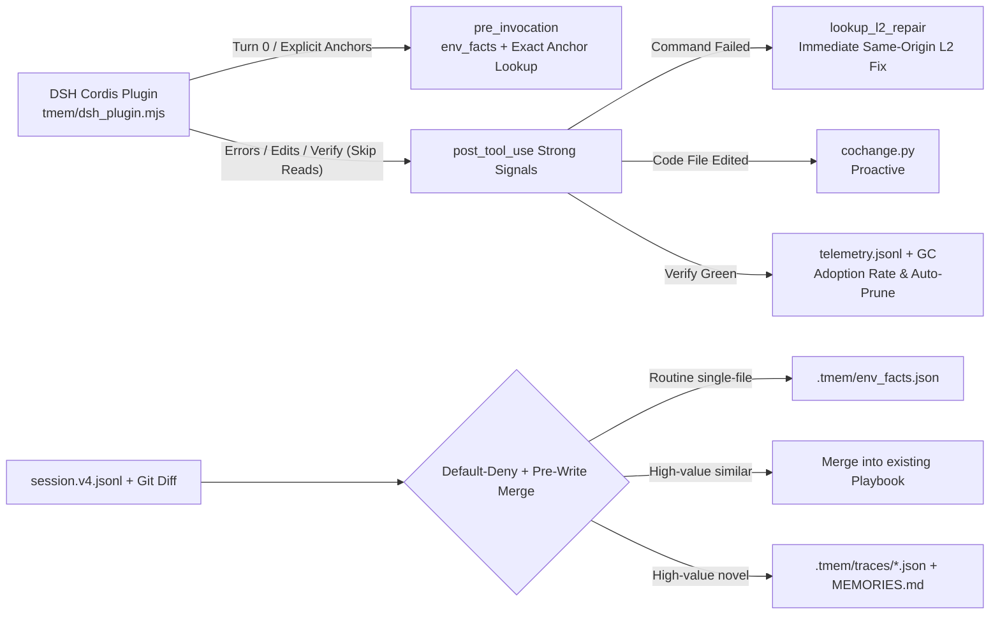

# `tmem` — Deterministic Engineering Memory Engine for DeepSeek Harness (`dsh`)

[中文文档](./README.md) | **English**

<p align="center">
  
</p>

`tmem` (**Trace Memory**) is a **zero-dependency, repository-scoped (`.tmem/`)** deterministic engineering memory & **zero-token historical session digest engine** built specifically for **`@deepseek-ai/dsh` (DeepSeek Harness)**.

By deterministically slicing and indexing past DSH trajectories without spending a single LLM summarization token, `tmem` turns noisy historical sessions into **free, structured requirement-and-behavior summaries (`Intent` + `Read -> Edit -> Repair -> Verify` + `MEMORIES.md`) with inline historical `session_id` lineage**—paired at runtime with strong-signal DSH interception (L2 error repairs, L1 co-change partner hints, and `.tmem/env_facts.json`).

---

## 1. Empirical Benchmarks

All scripts and datasets are reproducible under `benchmarks/` (CI runs `python3 scripts/verify_benchmarks.py` to enforce regression gates, saved report consistency, and README table sync):

### 1.1 DSH End-to-End Strong-Signal Replay & Telemetry
Reproduction command: `python3 benchmarks/eval_dsh_e2e.py` ([Script](./benchmarks/eval_dsh_e2e.py)):
- **End-to-End Interaction Step Reduction**: **37.5%** (8 trial-and-error baseline steps → 5 steps with `tmem`)
- **Runtime Telemetry Resolution**: L2 green error resolution **100%** (`1/1`), L1 co-change partner adoption **100%** (`1/1`)
- **Natural-Language Holdout False Positive Injection Rate**: **0.0%** (10 vague prompts without file/error anchors stayed silent)
- **Live Cordis Hot-Path Latency**: **116.66 ms** total across 21 events (6 `agent/pre-step` + 15 routine `read` `tools/post-execute` calls, skipping redundant `python3` spawns)

### 1.2 Temporal Causal Slicing & 50-Trajectory Blinded LLM Judge
Reproduction commands: `python3 benchmarks/eval_slicing_fidelity.py --gold-path benchmarks/gold/gold_annotations_50.json` and `python3 benchmarks/eval_llm_judge.py` ([50-Trace LLM Judge Report](./benchmarks/runs/llm_judge_50_report.json) / [Gold-50 Annotations](./benchmarks/gold/gold_annotations_50.json)):

Across **50 high-quality real trajectories** (25 original SWE-bench/DSH + 25 `resolved=True` multi-repo fixes from `sailplane/swe-agent-trajs`), 5 independent blinded LLM judge shards evaluated shuffled Option A/B slices:

| Slicing Strategy | Precision | Recall | F1-Score | Mean Retained Steps | Mean LLM Score (1–5) |
|---|:---:|:---:|:---:|:---:|:---:|
| **B0 Trivial Baseline (Landed files + Final test)** | 81.1% | 66.5% | 71.4% | 4.7 steps | 3.20 |
| **B1 `tmem` Phase 1 Temporal Causal Slicer** | **93.8%** | **95.0%** | **93.6%** | 5.1 steps | **4.80** (**49:1 / 98.0% win rate**) |
| **B2 Oracle Upper Bound (LLM Gold-50)** | 98.0% | 98.0% | 98.0% | 5.0 steps | — |

> **Honest Limitation**: On rare edge cases such as `sympy__sympy-22005`, when an agent modifies a test file *after* its final passing reproduction command and submits without re-running tests, offline `tmem` (`use_git_ground_truth=False`) retains that trailing unverified edit. On the original 25-trace benchmark (`benchmarks/gold/gold_annotations.json`, reproduced via `python3 benchmarks/eval_slicing_fidelity.py --gold-path benchmarks/gold/gold_annotations.json`), B1 Precision likewise improved from 63.2% to 92.3% (F1 81.8% vs. B0's 81.0%).

### 1.3 50-Trajectory Plugin Scale Stress Test & Retrieval
Reproduction commands: `python3 benchmarks/eval_plugin_scale.py` ([Scale Report](./benchmarks/runs/plugin_scale_50_report.json)) and `python3 benchmarks/eval_retrieval.py` ([Retrieval Log](./benchmarks/runs/retrieval_report.json)):
- **50-Trace Corpus Compilation & Compression**: 49/50 compiled playbooks (`pytest-dev__pytest-7168` pruned as empty deleted-scratch session), reducing **898 → 157 L0 steps** (**82.5%** step reduction, **94.7%** RawTrace-to-L0 char compression), **0.82 ms** avg slice time, **6.98 ms** `MEMORIES.md` sync.
- **`handle_dsh_hook` Runtime Validation (49-Playbook DB)**: **8.79 ms** avg hook latency; **0.0%** `pre_step` negative FP (`0/10`); **100.0%** explicit anchor recall (`48/48`); **100.0%** `post_tool_use` L2 interception & green resolution (`7/7`, `l2_resolution_rate = 1.0`).
- **Independent Raw Issue Retrieval**: Across 24 issue-query traces in `eval_retrieval.py`, **Recall@1 = 100.0% / Recall@3 = 100.0% / MRR = 1.0**, and negative holdout FP dropped to **0.0%** after word-boundary and token-coverage fixes in `tmem/store.py` (under the 49-playbook scale DB, lexical FTS5 negative FP is **10.0%** while `pre_step` remains **0.0%**).

### 1.4 Cross-Format Trajectory Compression & Runtime Footprint (9 real trajectories)
Reproduction command: `python3 -m tmem.evaluate`:
- **Mean Step Compression**: **56.5%** (106 → 43 steps; 5,406 → 1,480 chars; ~1,348 → ~367 est. tokens)
- **High-Entropy L2 Causal Pairs Extracted**: **8 pairs** (verified via traceback file intersection + same-origin command verification)
- **Mean Deterministic Slicing Latency**: **0.88 ms** (zero external dependencies, zero LLM calls)

---

## 2. Architecture & How It Works



1. **DSH Hot-Path Optimization & Strong-Signal Interception** ([`tmem/dsh_plugin.mjs`](./tmem/dsh_plugin.mjs), [`tmem/hooks/dsh.py`](./tmem/hooks/dsh.py)):
   - **Cold-Start Pruning**: `agent/pre-step` skips spawning Python when user input hasn't changed across loop steps; `tools/post-execute` skips routine `read`/`grep`/`glob` calls unless an error occurred or an L1 co-change watch is active.
   - **Zero-Noise Pre-Step**: Downgrades fuzzy natural-language BM25 prompt guessing; only injects `env_facts` once per session or recalls when explicit workspace paths or error signatures are mentioned.
   - **Runtime Interception**: Injects verified L2 fixes immediately via `lookup_l2_repair` on command failure, and emits `<tmem_cochange_hint>` after editing code files with strong Git/trace co-change partners.
2. **Temporal Causal Slicing, Pre-Write Merging & Drift GC** ([`tmem/slicer.py`](./tmem/slicer.py), [`tmem/store.py`](./tmem/store.py)):
   - **Temporal Causal Graph**: Prunes syntax-rejected edit retries, pre-barrier states wiped by `rm`/`git checkout|restore|reset`, standalone scratch reproduction scripts, and dangling post-mutation reads; separates persistent `ENV_INSTALL` from latest-epoch `VERIFY_GATE` (rejecting non-gating `|| true` commands while preserving POSIX env prefixes like `PYTHONPATH=.`).
   - **Symbol Attribution & Boundary-Safe Retrieval**: Uses `git diff -U0` + Python ASTs with a default-deny gate, and enforces `len >= 4` word-boundary trigger matching in SQLite lookup.
   - **Pre-Write Merging & Guard-Drift Metabolism**: Merges playbooks sharing L2 repairs or high file/intent overlap in place, and retires expired no-L2 entries via `tmem gc --prune`.
3. **Runtime Benefit Telemetry** ([`tmem/telemetry.py`](./tmem/telemetry.py)):
   - Appends structured events to `.tmem/telemetry.jsonl` (gitignored) tracking L2 same-origin green resolution rate and L1 partner-file adoption rate (`tmem telemetry` / `tmem status`).

---

## 3. Quick Start

### Installation & Initialization
```bash
pip install -e .            # Install CLI (zero external dependencies, standard library only)
tmem init                   # Initialize .tmem/, install DSH Cordis plugin, and set git post-commit hook
dsh plugin add github:kentzjh-cmd/tmem   # Or install directly via dsh
```

### Common Commands
```bash
tmem status                                      # Show trace counts, probes, and runtime telemetry
tmem telemetry                                   # View L2 repair resolution & L1 co-change adoption stats
tmem capture --agent dsh                         # Slice latest DSH session and merge/save to .tmem/
tmem lookup "TypeError" --file src/validator.py  # Lexical retrieval + probe validation preview
tmem inspect <trace_id> --level playbook         # View three-tier playbook details
tmem sync                                        # Validate probes and refresh MEMORIES.md
tmem gc --prune                                  # Scan drifted guards and prune expired no-L2 traces
```

---

## 4. Limitations & Design Boundaries

1. **Single-Host Focus (DSH)**: Non-DSH runtime hooks were intentionally pruned so all lifecycle hooks and telemetry focus cleanly on `@deepseek-ai/dsh` (`session.v4.jsonl` & Cordis). `SweBenchAdapter` remains only for offline benchmark suites.
2. **Heuristic Slicing is Not Formal Analysis**: Relies on Git ground truth, Python AST symbols, and exit codes; non-Python languages use file-level probes and shell verification contracts.
3. **Probes Check Syntactic Presence**: If a function signature remains intact while its internal logic is rewritten, runtime verification commands remain essential.

---

## License

MIT
