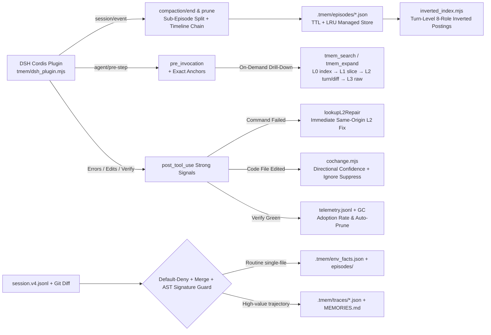

# `tmem` — Compaction Episode Slicer & Deterministic Engineering Memory Engine for DeepSeek Harness (`dsh`)

[中文文档](./README.md) | **English**

<p align="center">
  
</p>

`tmem` (**Trace Memory**, published on npm as [`dsh-tmem`](https://www.npmjs.com/package/dsh-tmem)) is a **zero-dependency, repository-scoped (`.tmem/`)** **compaction episode slicer, inverted-index progressive memory, and deterministic trace engine** built specifically for **`@deepseek-ai/dsh` (DeepSeek Harness)**.

It integrates directly into DSH's host lifecycle:
1. **Compaction-Triggered Episode Slicing**: Hooks DSH `session/event` (`compaction/summary`, `compaction/end`, `compaction/prune`) to compile compacted conversation phases and middle-pruned tool outputs into `.tmem/episodes/` (governed by 30-day TTL + 200MB LRU GC) with zero LLM summarization tokens—supporting **multi-intent sub-episode segmentation** and **cross-compaction timeline chaining**, while promoting non-trivial trajectories to shareable `.tmem/traces/` playbooks + `MEMORIES.md`.
2. **Zero-LLM Multi-Dimensional Inverted Index & L0→L3 Progressive Disclosure**: Maintains a Turn-granular (`turn_idx`, `seq_from..seq_to`) SQLite inverted index across 8 weighted semantic roles (`intent`, `error`, `decision`, `symbol`, `file`, `command`, `diff`, `raw_output`), injects `<tmem_compacted_index>` checkpoints after compaction, and registers `tmem_search` & `tmem_expand` (`index` -> `slice` -> `turn` / `diff` -> `raw`) in DSH for lossless on-demand recovery.
3. **Strong-Signal Runtime Interception & AST Signature Guards**: Injects same-origin L2 repairs on errors, emits directional L1 `<tmem_cochange_hint>` partner reminders (with telemetry-based suppression of ignored pairs), and validates both `symbol_present` and multi-language AST `signature_match` guards.

---

## 1. Empirical Benchmarks

All scripts and datasets are reproducible under `benchmarks/` (CI runs `node scripts/verify_benchmarks.mjs` to enforce regression gates, saved report consistency, and README table sync):

### 1.1 DSH End-to-End Strong-Signal Replay & Telemetry
Reproduction command: `node benchmarks/eval_dsh_e2e.mjs` ([Script](./benchmarks/eval_dsh_e2e.mjs)):
- **End-to-End Interaction Step Reduction**: **37.5%** (8 trial-and-error baseline steps → 5 steps with `tmem`)
- **Runtime Telemetry Resolution**: L2 green error resolution **100%** (`1/1`), L1 co-change partner adoption **100%** (`1/1`)
- **Natural-Language Holdout False Positive Injection Rate**: **0.0%** (10 vague prompts without file/error anchors stayed silent)
- **Live Cordis Hot-Path Latency**: **~5 ms** total across 21 events (6 `agent/pre-step` + 15 routine `read` `tools/post-execute` calls, in-process pure Node.js ESM with zero child-process spawning)

### 1.2 Temporal Causal Slicing & 50-Trajectory Blinded LLM Judge
Reproduction commands: `node benchmarks/eval_slicing_fidelity.mjs --gold-path benchmarks/gold/gold_annotations_50.json` and `node benchmarks/eval_llm_judge.mjs` ([50-Trace LLM Judge Report](./benchmarks/runs/llm_judge_50_report.json) / [Gold-50 Annotations](./benchmarks/gold/gold_annotations_50.json)):

Across **50 high-quality real trajectories** (25 original SWE-bench/DSH + 25 `resolved=True` multi-repo fixes from `sailplane/swe-agent-trajs`), 5 independent blinded LLM judge shards evaluated shuffled Option A/B slices:

| Slicing Strategy | Precision | Recall | F1-Score | Mean Retained Steps | Mean LLM Score (1–5) |
|---|:---:|:---:|:---:|:---:|:---:|
| **B0 Trivial Baseline (Landed files + Final test)** | 81.1% | 66.5% | 71.4% | 4.7 steps | 3.20 |
| **B1 `tmem` Phase 1 Temporal Causal Slicer** | **93.8%** | **95.0%** | **93.6%** | 5.1 steps | **4.80** (**49:1 / 98.0% win rate**) |
| **B2 Oracle Upper Bound (LLM Gold-50)** | 98.0% | 98.0% | 98.0% | 5.0 steps | — |

> **Honest Limitation**: On rare edge cases such as `sympy__sympy-22005`, when an agent modifies a test file *after* its final passing reproduction command and submits without re-running tests, offline `tmem` (`use_git_ground_truth=False`) retains that trailing unverified edit. On the original 25-trace benchmark (`benchmarks/gold/gold_annotations.json`, reproduced via `node benchmarks/eval_slicing_fidelity.mjs --gold-path benchmarks/gold/gold_annotations.json`), B1 Precision likewise improved from 63.2% to 92.3% (F1 81.8% vs. B0's 81.0%).

### 1.3 50-Trajectory Plugin Scale Stress Test & Retrieval
Reproduction commands: `node benchmarks/eval_plugin_scale.mjs` ([Scale Report](./benchmarks/runs/plugin_scale_50_report.json)) and `node benchmarks/eval_retrieval.mjs` ([Retrieval Log](./benchmarks/runs/retrieval_report.json)):
- **50-Trace Corpus Compilation & Compression**: 49/50 compiled playbooks (`pytest-dev__pytest-7168` pruned as empty deleted-scratch session), reducing **898 → 157 L0 steps** (**82.5%** step reduction, **94.8%** RawTrace-to-L0 char compression) with sub-millisecond/low-millisecond pure-Node slicing and `MEMORIES.md` sync.
- **`handleDshHook` Runtime Validation (49-Playbook DB)**: **0.0%** `pre_step` negative FP (`0/10`); **100.0%** explicit anchor recall (`48/48`); **100.0%** `post_tool_use` L2 interception & green resolution (`7/7`, `l2_resolution_rate = 1.0`).
- **Independent Raw Issue Retrieval**: Across 24 issue-query traces in `eval_retrieval.mjs`, **Recall@1 = 100.0% / Recall@3 = 100.0% / MRR = 1.0**, and negative holdout FP dropped to **0.0%** after word-boundary and token-coverage fixes in `tmem/store.mjs` (under the 49-playbook scale DB, lexical FTS5 negative FP is **10.0%** while `pre_step` remains **0.0%**).

### 1.4 Cross-Format Trajectory Compression & Runtime Footprint (9 real trajectories)
Reproduction command: `node tmem/cli.mjs evaluate`:
- **Mean Step Compression**: **56.5%** (106 → 43 steps; 5,406 → 1,480 chars; ~1,348 → ~367 est. tokens)
- **High-Entropy L2 Causal Pairs Extracted**: **8 pairs** (verified via traceback file intersection + same-origin command verification)
- **Mean Deterministic Slicing Latency**: **0.88 ms** (zero external dependencies, zero LLM calls)

### 1.5 Post-Compaction Progressive Recall Benchmark (`eval_compact_recall.mjs`)
Reproduction command: `node benchmarks/eval_compact_recall.mjs` ([Script](./benchmarks/eval_compact_recall.mjs)):

Across 4 typical post-compaction amnesia scenarios (early architectural constraint recall, 18KB middle-pruned tool log root cause recovery, multi-intent segmentation & cross-compaction timeline chaining, and exact diff recovery + post-verify dangling edit pruning + AST `signature_match` guard verification):
- **Key Detail Recall**: Vanilla Compact Summary + Prune **0.0%** (`0/4`) → `Compact + tmem` Inverted Progressive Disclosure **100.0%** (`4/4`)
- **Context Token Savings**: L0 index checkpoint injection saves **91.6%** (`7,157` → `603` est. tokens); L0 + targeted L1/L2 expansion saves **87.0%** (`933` est. tokens)
- **Lookup & Expansion Latency**: **~6 ms** mean search latency, **< 10 ms** targeted expansion

---

## 2. Architecture & How It Works



1. **Compaction Slicing & Inverted-Index Progressive Disclosure** ([`tmem/episodes.mjs`](./tmem/episodes.mjs), [`tmem/inverted_index.mjs`](./tmem/inverted_index.mjs), [`tmem/dsh_tools.mjs`](./tmem/dsh_tools.mjs)):
   - **Non-Invasive Host Integration**: Hooks DSH host `session/event` (`compaction/summary`, `compaction/end`, `compaction/prune`)—working seamlessly across CLI, Headless, and isolated Web Presets—and registers model tools `tmem_search` and `tmem_expand`.
   - **Multi-Intent Segmentation & Timeline Chaining**: Splits large spans along `git commit` or disjoint file-module clusters into cohesive sub-episodes while maintaining `prev_episode_id` / `phase_index` chains across repeated compactions.
   - **Weighted 8-Role SQLite Inverted Index**: Indexes `intent`, `error`, `decision`, `symbol`, `file`, `command`, `diff`, and `raw_output` at Turn granularity (`inverted_postings`) with mixed CJK/identifier tokenization and Turn-locality boosts—without LLM summary rewrites.
2. **DSH Hot-Path Optimization & Strong-Signal Interception** ([`tmem/dsh_plugin.mjs`](./tmem/dsh_plugin.mjs), [`tmem/hooks/dsh.mjs`](./tmem/hooks/dsh.mjs)):
   - **Zero Cold-Start In-Process Runtime**: Pure Node.js ESM execution inside the DSH Cordis plugin; `agent/pre-step` injects `<tmem_compacted_index>` whenever new `compact-checkpoint` messages appear and skips unchanged inference steps, while `tools/post-execute` skips routine `read`/`grep`/`glob` calls.
   - **Runtime Interception**: Injects verified L2 fixes immediately via `lookupL2Repair` on failure, and emits directional `<tmem_cochange_hint>` reminders (with `.git/HEAD`-cached git log lookup and telemetry auto-suppression after 3 ignored hints).
3. **Temporal Causal Slicing (Phase 2), AST Signature Guards & Dual-Track GC** ([`tmem/slicer.mjs`](./tmem/slicer.mjs), [`tmem/guards.mjs`](./tmem/guards.mjs), [`tmem/store.mjs`](./tmem/store.mjs)):
   - **Temporal Causal Graph + Trailing Edit Pruning**: Prunes syntax-rejected retries, destroyed states (`rm`/`git checkout|restore|reset`), scratch reproduction scripts, dangling post-mutation reads, and trailing unverified edits after the final passing `VERIFY_GATE` (which remain inspectable at Episode `raw` tier).
   - **Structural AST & `signature_match` Guards**: [`tmem/ast_parser.mjs`](./tmem/ast_parser.mjs) extracts parameter signatures across Python/JS/TS/Go/Rust/Java/C++; refactored signatures automatically degrade playbooks from `L0_FULL` to `L1_TOPOLOGY`/`L2_INVARIANT`.
   - **Dual-Track Metabolism & Telemetry**: `tmem gc --prune` retires drifted playbooks in `.tmem/traces/`, while `.tmem/episodes/` enforces 30-day TTL and 200MB LRU quota eviction.

---

## 3. Quick Start

> Requirement: **Node.js >= 22.5.0** (uses built-in `node:sqlite`, zero external npm dependencies, no Python required; the legacy Python implementation is archived on the `python` branch).

### Installation & Initialization
```bash
npm install -g dsh-tmem                       # Or clone and run `npm link`
tmem init                                     # Initialize .tmem/, install DSH Cordis plugin, and set git post-commit hook
dsh plugin add npm:dsh-tmem                   # Or install via `dsh plugin add github:kentzjh-cmd/tmem`
npm test                                      # Run full node --test suite (50/50)
npm run verify:benchmarks                     # Verify benchmark gates, saved reports, and README sync
```

### Common CLI, Slash Commands & DSH Tools
```bash
tmem status                                      # Show trace/episode counts, probes, and runtime telemetry
tmem telemetry                                   # View L2 repair resolution & L1 co-change adoption stats
tmem capture --agent dsh                         # Archive Episode to .tmem/episodes/ and compile high-value Playbook
tmem search "jwt_guard.ts leewaySec"             # Inverted-index search (--files / --symbols / --errors / --roles)
tmem episodes --session <id>                     # List archived compacted session episodes & phase timeline
tmem expand <episode_id> --level slice           # Progressive disclosure: index (L0) -> slice (L1) -> turn / diff (L2) -> raw (L3)
tmem lookup "TypeError" --file src/validator.py  # Playbook lexical retrieval + probe validation preview
tmem inspect <trace_id> --level playbook         # View three-tier playbook details
tmem sync                                        # Validate probes and refresh MEMORIES.md
tmem gc --prune                                  # Prune drifted no-L2 traces & enforce episode TTL/LRU quota
```

Inside DSH sessions, the model has access to **`tmem_search`** and **`tmem_expand`**, and users can invoke **`/tmem [status|search|episodes|expand|list|inspect|replay|diff|sync|gc|forget|telemetry|evaluate]`**.

---

## 4. Limitations & Design Boundaries

1. **Single-Host Focus (DSH)**: Non-DSH runtime hooks were intentionally pruned so lifecycle hooks, compaction events, and telemetry focus cleanly on `@deepseek-ai/dsh` (`session.v4.jsonl`, `session/event`, & Cordis). `SweBenchAdapter` remains only for offline benchmark suites.
2. **Heuristic Slicing is Not Formal Analysis**: Relies on Git ground truth, pure-Node multi-language structural AST parsing ([`tmem/ast_parser.mjs`](./tmem/ast_parser.mjs) for Python, JS/TS, Go, Rust, etc.), and exit codes rather than full cross-file call-graph or dataflow analysis.
3. **Probes Check Presence & Parameter Signatures**: `signature_match` catches parameter-list refactors, while internal body rewrites with unchanged signatures still rely on runtime verification commands.

---

## License

MIT
