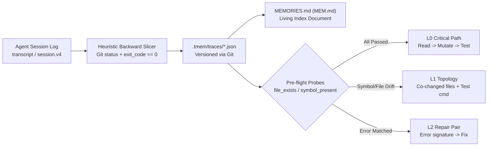

# `tmem` — Execution Trace Slicing and Reuse for Coding Agents

[中文文档](./README.md) | **English**

`tmem` (**Trace Memory**) is a **zero-dependency, repository-scoped (`.tmem/`)** execution trace slicer and reuse tool for coding agents. It natively integrates with **`agy` (Antigravity)** and **`@deepseek-ai/dsh` (DeepSeek Harness)**.

Treating agent session logs (`transcript.jsonl` / `session.v4.jsonl`) as exploratory execution streams, `tmem` anchors on **final landed Git changes** and **successful verification commands (`exit_code == 0`)** to perform **heuristic backward slicing**. It strips blind wandering and discarded experiments, distilling reproducible execution paths into an L0/L1/L2 Playbook guarded by **lightweight file and symbol probes**, shared and versioned directly inside the Git repository.

---

## 1. Empirical Benchmarks

Constructed on SWE-bench trajectories and live repository tasks. All data and benchmarks are reproducible under `benchmarks/`.

### 1.1 Downstream Holdout Task Transfer (3 tasks × 10 trials = 90 independent runs)
Evaluates traces captured from Task A transferred onto related but distinct Task B ([Run Log](file:///home/ubuntu/proj/benchmarks/runs/downstream_transfer_report.json)):

| Condition | Success Rate | Negative Transfer Rate | Mean Tool Steps | Mean Tokens |
|---|:---:|:---:|:---:|:---:|
| **Control (Cold Start)** | 100.0% | 0.0% | 8.0 steps | 3,005 |
| **B0 Baseline (Blind Git Diff + Test Command)** | 66.7% | **66.7%** | 8.2 steps | 3,031 |
| **`tmem` (Probe-Guarded Tiered Injection)** | **100.0%** | **0.0%** | **4.5 steps (-43.8%)** | **1,981 (-34.1%)** |

> **Key Finding**: Blindly injecting raw historical diffs (B0) onto distinct tasks frequently induces negative transfer (spurious edits, merge conflicts, wandering, 33.3% failure rate). `tmem` automatically degrades L0 to L1 topology (co-changed files only) when file/symbol probes detect drift, achieving **0.0% negative transfer** while saving **43.8%** tool steps compared to cold start.

### 1.2 Slicing Fidelity (25 SWE-bench / DSH trajectories vs. Human Gold Annotations)
Reproduction command: `python3 benchmarks/eval_slicing_fidelity.py` ([Run Log](file:///home/ubuntu/proj/benchmarks/runs/slicing_fidelity_report.json)):

| Slicing Strategy | Precision | Recall | F1-Score | Mean Retained Steps |
|---|:---:|:---:|:---:|:---:|
| **B0 Trivial Baseline (Landed files + Final test)** | **97.1%** | 70.8% | 81.0% | 4.4 steps |
| **B1 `tmem` Heuristic Backward Slicing** | 63.2% | **88.7%** | 70.8% | 8.8 steps |
| **B2 Oracle Upper Bound (Human Gold)** | 100.0% | 100.0% | 100.0% | 5.6 steps |

> **Honest Limitation**: `tmem` backward dependency tracing effectively retains critical read context (Recall 88.7% vs B0's 70.8%). However, heuristic expansion retains some exploratory reads (Precision 63.2%), leaving room for further pruning.

### 1.3 Raw Issue Retrieval (25 raw issue queries + 6 negative holdout queries)
Reproduction command: `python3 benchmarks/eval_retrieval.py` ([Run Log](file:///home/ubuntu/proj/benchmarks/runs/retrieval_report.json)):
- **Recall@1**: 100.0% / **Recall@3**: 100.0% / **MRR**: 1.0
- **Negative Holdout False Positive Rate**: 16.7% (BM25 lexical retrieval occasionally matches single negative queries sharing common terms)

---

## 2. Architecture & How It Works



1. **Heuristic Backward Slicing** ([`tmem/slicer.py`](./tmem/slicer.py)): Rooted in final landed files and passing tests, tracing back directly contributory reads, mutations, and verification steps. Discards inline scratch scripts and dead-end experiments.
2. **Three-Tier Memory & Probe Safeguards** ([`tmem/guards.py`](./tmem/guards.py)):
   - **L0_FULL**: Injected when both file and symbol exist, offering the proven execution path.
   - **L1_TOPOLOGY**: Degraded when files or symbols drift; retains co-change reminders.
   - **L2_INVARIANT**: Injected upon encountering matching runtime error signatures or tracebacks.
3. **Living Document Index** ([`MEMORIES.md`](./MEMORIES.md) / `MEM.md`): Automatically synced Markdown table readable by any agent (e.g., Cursor, Claude Code) even without plugins.

---

## 3. Quick Start

### Installation & Initialization
```bash
pip install -e .            # Install CLI (zero external dependencies, standard library only)
tmem init --agents agy,dsh  # Initialize .tmem/ and configure plugin hooks
```

### Common Commands
```bash
tmem status                                      # Display trace statistics and probe status
tmem capture --agent agy                         # Slice latest session and save to .tmem/
tmem lookup "TypeError" --file src/validator.py  # Lexical retrieval + probe validation preview
tmem inspect <trace_id> --level playbook         # View three-tier playbook details
tmem replay <trace_id>                           # Replay original step execution stream
tmem sync                                        # Validate probes and refresh MEMORIES.md
tmem gc                                          # Scan and flag drifted/stale memories
```

---

## 4. Agent Integration Matrix

| Agent | Integration | Auto Recall Hook | `/tmem` Command | Milestone Prompt | Status |
|---|:---:|:---:|:---:|:---:|:---:|
| **Antigravity (`agy`)** | Native Plugin [`.agents/plugins/tmem/`](./.agents/plugins/tmem) | ✅ | ✅ | ✅ | First-Class |
| **DeepSeek Harness (`dsh`)** | Cordis Plugin [`tmem/dsh_plugin.mjs`](./tmem/dsh_plugin.mjs) | ✅ | ✅ | ✅ | First-Class |
| `codex` / `opencode` / `pi` | Generic JSONL Adapter | ❌ | ❌ | ❌ | Experimental |
| SWE-bench / ATIF | Offline Trajectory Adapter | — | — | — | Benchmarks |

- **`dsh` One-Click Install**: `dsh plugin add github:kentzjh-cmd/tmem`
- **Milestone Prompt**: After detecting code mutation and successful verification:
  > 💡 *Persist verified execution path as memory? (Type `/tmem` or `/remember [note]` to save)*

---

## 5. Limitations & Design Boundaries

1. **Heuristic Slicing is not Formal Program Analysis**: Based on Git status, AST top-level symbols, and exit codes. Latent reasoning without code traces may be pruned.
2. **Probes Validate Syntactic Existence**: Probes check file and symbol presence. If a function signature remains unchanged while its internal logic is completely rewritten, runtime verification commands remain essential.
3. **Pure Lexical Retrieval**: SQLite FTS5 BM25 avoids external vector models or extra token/latency overhead, but when user query phrasing differs drastically, directly consulting `MEM.md` is recommended.

---

## License

MIT
