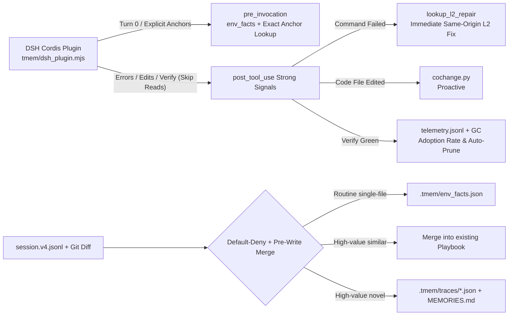

# `tmem` — Deterministic Engineering Memory Engine for DeepSeek Harness (`dsh`)

[中文文档](./README.md) | **English**

`tmem` (**Trace Memory**) is a **zero-dependency, repository-scoped (`.tmem/`)** deterministic engineering memory & **zero-token historical session digest engine** built specifically for **`@deepseek-ai/dsh` (DeepSeek Harness)**.

By deterministically slicing and indexing past DSH trajectories without spending a single LLM summarization token, `tmem` turns noisy historical sessions into **free, structured requirement-and-behavior summaries (`Intent` + `Read -> Edit -> Repair -> Verify` + `MEMORIES.md`) with inline historical `session_id` lineage**—paired at runtime with strong-signal DSH interception (L2 error repairs, L1 co-change partner hints, and `.tmem/env_facts.json`).

---

## 1. Empirical Benchmarks

All scripts and datasets are reproducible under `benchmarks/`:

### 1.1 DSH End-to-End Strong-Signal Replay & Telemetry
Reproduction command: `python3 benchmarks/eval_dsh_e2e.py` ([Script](file:///home/ubuntu/proj/benchmarks/eval_dsh_e2e.py)):
- **End-to-End Interaction Step Reduction**: **37.5%** (8 trial-and-error baseline steps → 5 steps with `tmem`)
- **Runtime Telemetry Resolution**: L2 green error resolution **100%** (`1/1`), L1 co-change partner adoption **100%** (`1/1`)
- **Natural-Language Holdout False Positive Injection Rate**: **0.0%** (10 vague prompts without file/error anchors stayed silent)
- **Live Cordis Hot-Path Latency**: **111.98 ms** total across 21 events (6 `agent/pre-step` + 15 routine `read` `tools/post-execute` calls, skipping redundant `python3` spawns)

### 1.2 Slicing Fidelity (25 SWE-bench / DSH trajectories vs. Human Gold Annotations)
Reproduction command: `python3 benchmarks/eval_slicing_fidelity.py` ([Run Log](file:///home/ubuntu/proj/benchmarks/runs/slicing_fidelity_report.json)):

| Slicing Strategy | Precision | Recall | F1-Score | Mean Retained Steps |
|---|:---:|:---:|:---:|:---:|
| **B0 Trivial Baseline (Landed files + Final test)** | **97.1%** | 70.8% | **81.0%** | 4.4 steps |
| **B1 `tmem` Heuristic Backward Slicing** | 63.2% | **88.7%** | 70.8% | 8.8 steps |
| **B2 Oracle Upper Bound (Human Gold)** | 100.0% | 100.0% | 100.0% | 5.6 steps |

> **Honest Limitation**: `tmem` backward tracing retains pre-edit read context well (88.7% Recall vs. B0's 70.8%), but heuristic rules still leave some exploratory reads unpruned (63.2% Precision, trailing B0 in F1).

### 1.3 Independent Raw Issue Retrieval (25 raw issue queries + 6 negative holdout queries)
Reproduction command: `python3 benchmarks/eval_retrieval.py` ([Run Log](file:///home/ubuntu/proj/benchmarks/runs/retrieval_report.json)):
- **Recall@1**: **100.0%** / **Recall@3**: **100.0%** / **MRR**: **1.0**
- **Negative Holdout False Positive Rate**: 16.7% (raw SQLite FTS5 BM25 lexical lookup can occasionally surface cross-domain queries sharing generic tokens; accordingly, DSH `pre-step` recall now requires explicit file-path or error-signature anchors)

### 1.4 Trajectory Compression & Runtime Footprint (9 real trajectories)
Reproduction command: `python3 -m tmem.evaluate`:
- **Mean Step Compression**: **56.97%** (117 -> 47 steps; ~1,423 -> ~349 est. tokens)
- **High-Entropy L2 Causal Pairs Extracted**: **7 pairs** (verified via traceback file intersection + same-origin command verification)
- **Mean Deterministic Slicing Latency**: **0.65 ms** (zero external dependencies, zero LLM calls)

---

## 2. Architecture & How It Works



1. **DSH Hot-Path Optimization & Strong-Signal Interception** ([`tmem/dsh_plugin.mjs`](./tmem/dsh_plugin.mjs), [`tmem/hooks/dsh.py`](./tmem/hooks/dsh.py)):
   - **Cold-Start Pruning**: `agent/pre-step` skips spawning Python when user input hasn't changed across loop steps; `tools/post-execute` skips routine `read`/`grep`/`glob` calls unless an error occurred or an L1 co-change watch is active.
   - **Zero-Noise Pre-Step**: Downgrades fuzzy natural-language BM25 prompt guessing; only injects `env_facts` once per session or recalls when explicit workspace paths or error signatures are mentioned.
   - **Runtime Interception**: Injects verified L2 fixes immediately via `lookup_l2_repair` on command failure, and emits `<tmem_cochange_hint>` after editing code files with strong Git/trace co-change partners.
2. **Precision-First Slicing, Pre-Write Merging & Drift GC** ([`tmem/slicer.py`](./tmem/slicer.py), [`tmem/store.py`](./tmem/store.py)):
   - Uses `git diff -U0` + full-file Python ASTs for symbol attribution, enforces a default-deny gate on routine edits while saving passing test commands to `.tmem/env_facts.json`.
   - **Pre-Write Similarity Merging**: Merges new playbooks sharing the same L2 causal repair or high file-set + intent overlap in place instead of creating duplicate JSON files.
   - **Guard-Drift Metabolism**: Tracks `guard_fail_streak` on drifted paths; `tmem gc --prune` retires expired stale entries lacking L2 invariants.
3. **Runtime Benefit Telemetry** ([`tmem/telemetry.py`](./tmem/telemetry.py)):
   - Appends structured events to `.tmem/telemetry.jsonl` (gitignored) tracking L2 same-origin green resolution rate and L1 partner-file adoption rate (`tmem telemetry` / `tmem status`).

---

## 3. Quick Start

### Installation & Initialization
```bash
pip install -e .            # Install CLI (zero external dependencies, standard library only)
tmem init                   # Initialize .tmem/, install DSH Cordis plugin, and set git post-commit hook
dsh plugin add github:kentzjh-cmd/tmem   # Or install directly via dsh
```

### Common Commands
```bash
tmem status                                      # Show trace counts, probes, and runtime telemetry
tmem telemetry                                   # View L2 repair resolution & L1 co-change adoption stats
tmem capture --agent dsh                         # Slice latest DSH session and merge/save to .tmem/
tmem lookup "TypeError" --file src/validator.py  # Lexical retrieval + probe validation preview
tmem inspect <trace_id> --level playbook         # View three-tier playbook details
tmem sync                                        # Validate probes and refresh MEMORIES.md
tmem gc --prune                                  # Scan drifted guards and prune expired no-L2 traces
```

---

## 4. Limitations & Design Boundaries

1. **Single-Host Focus (DSH)**: Non-DSH runtime hooks were intentionally pruned so all lifecycle hooks and telemetry focus cleanly on `@deepseek-ai/dsh` (`session.v4.jsonl` & Cordis). `SweBenchAdapter` remains only for offline benchmark suites.
2. **Heuristic Slicing is Not Formal Analysis**: Relies on Git ground truth, Python AST symbols, and exit codes; non-Python languages use file-level probes and shell verification contracts.
3. **Probes Check Syntactic Presence**: If a function signature remains intact while its internal logic is rewritten, runtime verification commands remain essential.

---

## License

MIT
